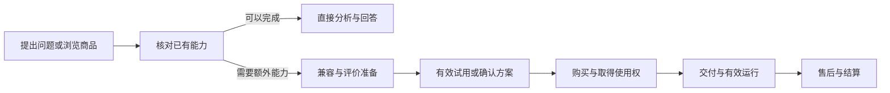

# Shroom 算法交易平台产品需求草案

- 文档版本：0.2
- 日期：2026-10-20
- 状态：产品探索与方案评审
- 用户已确认：算法类型暂不限、先探索；卖家采用公司自营与邀请开发者
- 建议首批市场：已有 Shroom 客户及其设备交付需求，实际地区、币种和交易主体待确认
- 与既有文档关系：本方案新增交易平台设计，不修改现有软件授权及到期产品规则

本版将产品反驳评审转为试点记录、商品准入、有效试用、审核回避和交易验收要求。以下为拟实施的产品规则，不代表能力已经开发或上线；价格、费率、试用时长、支持时限及投入额度仍须在对应试点或收费前确认。

## 1 概要

建设一个围绕 Shroom 设备与数据任务的算法交易平台。买家可以判断适用性、试用、购买、运行和获得支持；卖家可以提交能力、取得收入并持续维护；平台负责商品可信度、交易、授权、交付记录、争议和结算。

算法类型保持开放，客户可通过与 Agent 对话提出具体问题，也可直接浏览商品。先核对已有能力能否解决问题，再判断是否需要付费算法或定制服务。本机算法包、云端 API 与定制服务共享必要的商品、身份、订单和售后记录，交付与验收分别设计。

首阶段使用真实客户与邀请卖家做人工撮合或小额交易，分别验证自营销售、第三方标准商品及定制项目。根据需求、执行格式和交付证据选择先投入的交易方式；本机包为优先候选，云端能力与定制服务保留探索，不预先承诺三类商品同时完成自动交易。

平台出售的默认对象是约定范围内的算法使用权及支持服务。源码交付、模型权利转让、再分发和独占定制必须单独约定。付款、拿到包、安装完成和业务效果达标分别记录。

## 2 参与角色与责任

以下为建议分工，具体人员在立项时指定。

| 角色 | 职责 | 需要取得的结果 |
| --- | --- | --- |
| 买家操作者 | 选择任务、确认数据、试用与运行 | 在目标设备和数据上完成约定任务 |
| 企业采购或组织管理员 | 下单、确认授权组织与电脑数量、管理成员 | 价格与权益明确，订单和使用范围可核对 |
| 自营算法团队 | 提供首批商品与维护样例 | 建立可复用的商品和交付标准 |
| 邀请开发者 | 提交包或服务、声明来源与依赖、维护支持 | 获得真实试用、成交和可核对结算 |
| 产品与平台运营 | 目录、交易规则、卖家入驻、争议与退出 | 供需匹配并形成可持续交易 |
| 算法与技术审核 | 兼容性、基准、执行权限和资源评估 | 准入证据明确，风险版本可隔离 |
| 客户支持与交付 | 安装排障、效果问题归类和升级 | 解决使用问题，记录每单支持成本 |
| 财务与商务 | 收款、退款、结算、合同及开票责任 | 订单、支付、授权和结算能够对账 |

同一企业可以同时是买家和卖家。商品提交人及直接业务负责人不得自行批准其版本，也不得单独裁定相关争议；自营与第三方商品均由回避直接利益关系的审核及售后复核角色处理。人员不足时暂停对应审批，或交给预先指定且同样满足回避条件的替代负责人，不以更换账号代替角色回避。

自营商品标明平台关系，采用与第三方一致的证据和售后标准。复核记录参与人、利益关系、依据及结论；无法解决的争议按预先公布的升级路径和时限处理，不要求每笔交易引入外部裁定。卖家收入明细与买家原始数据按职责分别授权。

## 3 背景与现有基础

Shroom 已有设备接入、标准帧、本地记录、算法配置和结果展示。现有算法超市界面提供指标图表、算法包入口和传感器选择；包目录已有名称、版本、兼容信息和指标描述，可作为商业商品接入的基础。

需要建立的交易层包括组织账户、卖家入驻、商品与报价、订单支付、商业使用权、试用、交付证据、售后和结算。不能将本机包目录中的一个条目直接等同于已经具备完整权利定义的收费商品。

现有内置包发现路径会读取算法源码并提供给配置能力。商业包应区分公开能力描述与私有执行内容，分别审查 Agent、系统包导出、诊断和日志的可见范围；不能直接照搬内置资源的源码公开方式。

相关入口：

- [现有算法超市界面](../client/src/page/licensePortal/PortalAlgorithmMarket.jsx)
- [内置算法包目录](../backend/extension-host/manifest/builtinAlgorithmPackageCatalog.js)
- [算法运行服务](../backend/extension-host/runtime/algorithmMarketService.js)
- [现有协同设计与到期规则](客户端与服务端协同设计说明-v1.3.md)

以上用于界定衔接位置，不构成支付、安全隔离或商业分发能力已完成的结论。

## 4 目标与成功指标

### 4.1 阶段目标

先证明存在可跨客户复用、有人愿意付费且支持成本可控的算法商品，再扩大算法数量和卖家规模。首阶段覆盖真实的试用、采购、有效运行、售后与结算，并比较平台相对现有销售和人工交付减少了哪些投入或增加了哪些有效结果。

自营标准商品、第三方标准商品与定制项目分别记录，交付类型另按本机、云端或项目分类。自营收入和定制收入可以成立，但不能替代第三方标准交易及平台增量价值的证据；下载量、上架数和全部订单合计不作为扩大平台的单一依据。

以下为建议的试点门槛，属于探索假设，启动试点前确认样本与观察周期：

- 邀请约 3 家供给方，整理约 6 个有明确任务和输入契约的商品，避免同一算法换参数重复上架。
- 邀请约 5 家真实需求企业试用，争取形成至少 3 笔真实付费订单，并覆盖至少 2 个独立买家组织。
- 至少观察同一实际算法能力在两个独立买家组织中有效交付，并核对执行版本、输入契约、配置变化及适配支持投入。优先验证同一执行版本；需要重训或较大改造的部分另记定制投入，不能仅凭商品名称相同证明复用。
- 同品续费、电脑扩购、跨品购买和定制复购分别统计。追加采购证明相应购买行为，不代替跨组织复用证据。
- 完整走通一次退款和一次卖家结算演练；真实发生的交易按真实结果入账，不为达到指标制造订单。
- 对照客户原有方法及已有免费、已购能力，记录付费商品新增的效果、节省的时间或减少的人工依赖，并用完整报价验证购买意愿。
- 核算每单审核、支付、交付和支持投入，同时记录卖家接入与持续维护、平台固定建设和运营投入，再决定平台费和扩大投入。

上述小样本只用于发现需求与交易障碍，不据此推断全市场转化率。扩展第三方标准交易还须满足第八章对应门槛，不要求试点立即摊平初期研发，也不以单均贡献为正代替整体可持续性的判断。

试点启动前确认观察窗口、人员与费用投入上限、标准适配和支持范围、责任人及继续、缩减或暂停条件。数值当前待确认；未确定时可以访谈和准备样例，不将探索结果标为阶段通过或据此自动扩大投入。

### 4.2 指标口径

| 指标 | 口径与数据来源 |
| --- | --- |
| 试用启动请求率 | 分母为进入兼容性核查的独立组织商品组合；分子为完成准备并由用户确认发送正式试用启动请求的组合，尚未取得首次有效输出也保留；不兼容及准备失败原因单列 |
| 可评价准备情况 | 对进入验证准备的组织商品组合，分别记录有无明确任务、代表性数据、必要标签或参照、评价负责人及通过标准；缺少条件者列为尚不能评价，不并入效果通过样本 |
| 试用有效完成率 | 分母为同批全部已确认启动请求，包含首次有效输出前失败或退出的试用；分子为在约定数据与版本下完成预登记任务并得到有效结果的试用；超时、退出和不支持分别列出 |
| 试用转付费 | 分母为同批全部已确认启动请求的独立组织商品组合，包含首次有效输出前失败或退出；分子为固定窗口内首次成功付费的组合；不以正式计时开始或完成试用作为入组条件，恢复或补发不重复入组，退款、重复购买及观察未结束者单列，免费及内部测试剔除 |
| 首次有效交付率 | 分母为约定交付日期落在统计周期内的付费订单，包含延期与失败；分子为完成该类型交付检查的订单 |
| 跨组织复用 | 同一实际执行能力在独立组织完成约定任务，附执行版本、输入契约、配置及模型变化、适配和支持工时；超出预定标准范围的投入单列，不凭商品 ID 或成交数认定复用 |
| 复购类型 | 同品续费、电脑扩购、跨品购买、定制复购分别计数；关联原订单，不替代跨组织复用指标 |
| 平台增量价值 | 对照客户原有办法或现有销售交付方式，记录发现来源、匹配与验证投入、交付耗时、人工接管及最终任务结果；自营、第三方和定制分别报告，对照条件不同时说明限制 |
| 退款与争议 | 按已付款订单队列及观察窗口统计，区分不兼容、声明不符、服务故障与超出适用范围 |
| 平台单均贡献 | 对同队列每笔已付款商业订单，以平台实际保留的销售款或服务费减平台承担的支付、审核、交付支持、退款损失及云成本，再除以队列订单数；第三方应付卖家款不计作平台收入，自营与第三方分别核算，退款及交付失败订单保留，退款金额和损失不重复扣减，未结清项目单列 |
| 卖家持续投入 | 按卖家与商品记录接入、证据准备、每单适配、售后及版本维护工时、实收和结算等待；补贴及平台代劳单列，观察后续销售与维护意愿，不以入驻数量替代持续供给 |
| 平台期间投入 | 在同一观察期列出交易贡献、固定建设和持续运营投入，避免与已计单均成本重复；记录投入上限和剩余额度，不能只凭单均贡献决定扩张 |
| 卖家维护质量 | 按支持承诺计算响应与解决情况，展示样本数，不用没有投诉证明算法可靠 |

获客成本、客户终身价值和市场规模暂无数据，不填虚构估计；试点记录触达工时、成交、复购和持续维护成本后再估算。

## 5 目标市场与核心任务

| 细分用户 | 典型任务 | 购买前的关键疑问 |
| --- | --- | --- |
| 已有设备的测试与研发人员 | 快速提取指标、识别动作、比较历史记录 | 是否适合自己的传感器，结论能否复核 |
| 设备交付与方案公司 | 将成熟算法复用到多个客户项目 | 需要买多少授权，能否随系统交付，谁负责售后 |
| 企业研究与工程团队 | 获取复杂计算或云端批处理能力 | 哪些数据会上传，费用上限和失败如何计算 |
| 缺少适用算法的客户 | 提出需求并委托开发验证 | 交付物、效果门槛、周期、知识产权和验收付款 |
| 开发者与算法团队 | 将已有算法变为标准商品 | 接入成本、试用保护、收入、更新和退出规则 |

首批从既有客户问题中选择任务，候选包括触觉动作识别、接触状态识别、压力时序特征和历史差异分析。具体型号、指标和效果均按验证确定，不预设所有设备通用。

每个候选任务先记录客户原有解决方式、已有能力、仍未满足的结果、数据与网络条件、可接受的验证办法。任务能由已有免费或已购能力完成时直接使用；需要专门模型、计算、验证或维护时，再判断是否形成值得额外付费的商品。

## 6 价值主张与商业模式

### 6.1 三方价值

- 买家：付款前知道是否兼容，能在自己的任务上验证，买后可运行、可追溯、有人支持。
- 卖家：使用统一接入标准、展示效果证据、获得采购需求与结算，减少重复对接客户。
- 平台：通过可信商品、设备匹配、授权和售后形成交易价值，并以实际服务覆盖成本。

### 6.2 商业模式候选

| 模式 | 适合对象 | 建议用途与主要代价 | 验证方法 |
| --- | --- | --- | --- |
| 按期本机使用权与成交服务费 | 可复用本机算法 | 首批候选；以双方接受本机交付且执行格式通过准入为前提，明确宿主依赖与续费权益 | 用真实采购报价比较年期与项目期接受度 |
| 指定版本长期使用权及维护服务 | 算法稳定、预算偏项目制的企业 | 可作候选；不能把长期使用写成无限维护、跨版本兼容 | 比较一次采购意愿与后续支持成本 |
| 云端用量或套餐 | 算力成本随任务增长的 API | 需计量、预算与失败处理；对断网和数据上传敏感 | 小额额度试点，核对有效输出成本与买家预算偏差 |
| 定制项目与里程碑服务费 | 暂无标准商品的需求 | 初期人工撮合；交付周期和人力成本高 | 真实需求单与报价，检查可标准化复用部分 |

首阶段建议将平台服务费作为主要商业模型，算法使用权的年期、项目期或长期版本授权按 SKU 明确。可用卖家 80%、平台 20% 做协商测算样例，但这不是已确认费率或市场标准；是否采用取决于平台承担的审核、收款和售后成本。

免费基础指标、自营收费算法与第三方收费算法分别标识；既有免费或已购权益不因上线商城静默缩水。第三方模型服务费用、云算力、额外人工支持和升级费用在报价中单列。

商品说明应给出相对已有办法的新增能力或服务，不对同一已有权益重复收费。报价同时列出完成目标任务需要的宿主、算法、云调用与支持费用，以及各自期限；可选和必须费用分开。平台单均贡献、卖家收益及平台期间投入分别判断，不以固定分成样例预先证明任何一方有利可图。

## 7 产品方案

### 7.1 三类商品共享目录，分别交付

| 商品类型 | 交付对象 | 计费候选 | 交付完成证据 | 数据位置 |
| --- | --- | --- | --- | --- |
| 本机算法包 | 签名版本、运行使用权、说明与支持 | 组织、授权电脑数、期限或指定版本 | 验签、授权、安装及目标输入有效运行；效果按购买时约定任务另行核对 | 算法运行以本机为主，许可请求不包含压力帧 |
| 云端算法 API | 服务访问权、额度或任务能力 | 有效调用、处理时长、记录量或套餐，按商品选定一种可核对单位 | 可追踪请求、约定输出与计费回执 | 发送前明确字段、接收方、部署区域与保留策略 |
| 定制算法服务 | 约定的模型、包、报告或源码等成果 | 报价及里程碑 | 双方约定数据、指标与交付物验收 | 数据提供方式、权限与删除要求按项目约定 |

同一算法可以有多种交付方式，但分别建立版本与 SKU，不能让买家在付款后才发现需要联网、另付算力或另购依赖。

商品还需明确仅供 Shroom 内使用，还是允许其他系统独立接入。开放独立 API、SDK 或再分发属于不同权利范围，不能由“购买算法”默认推导。

### 7.2 账户、身份与许可对象

平台新增稳定的用户、组织和卖家身份。订单和算法权益归购买组织或明确的个人账户，软件密钥用于证明宿主权益及其范围，不直接充当长期商店账户主键。组织绑定现有密钥须验证归属，知道一个密钥不能获得他人订单与收入信息。

买家侧区分采购授权、付款、安装使用和组织管理；卖家侧区分商品编辑、提交与财务查看。原有超级管理员身份不自动授予新平台的全部财务操作。

本机许可建议最少包含购买主体、商品、可用版本范围、电脑数量、起止时间、试用或正式状态和升级范围。企业内共享、换机、项目交付和再分发分别约定；软件可运行的电脑数不等于算法授权电脑数。

### 7.3 页面与入口

| 位置 | 页面或入口 | 核心内容 |
| --- | --- | --- |
| 桌面端 | 算法市场 | 按任务、交付类型、当前设备兼容性筛选；默认优先显示可用或可试用商品 |
| 桌面端 | Agent 对话 | 从客户具体问题出发，核对已有能力，按需组织分析或说明需要购买的额外能力 |
| 桌面端与网站 | 商品详情 | 适用范围、证据、依赖、价格、试用、版本和支持；购买前核查 |
| 桌面端 | 我的算法 | 已购、试用、待安装、运行实例、更新及不兼容原因 |
| 网站与桌面入口 | 订单与售后 | 支付、交付状态、退款、发票申请与支持工单 |
| 卖家工作台 | 商品与版本 | 草稿、审核、发布、更新、撤售、效果证据和支持 |
| 卖家工作台 | 收入与结算 | 逐单实收、费用、退款、冻结、可结算与到账状态 |
| 运营后台 | 审核与争议 | 入驻、商品复核、问题版本、订单核查、退款与影响范围 |
| 客户需求入口 | 找不到适用算法 | 描述任务、设备、数据和验收目标，形成定制需求单 |

现有监测页的算法超市保留快速启用已安装能力的用途，新增购买浏览与“我的算法”入口。避免在客户监测任务中强制跳转采购。

### 7.4 商品详情与能力契约

商品至少公开以下内容，缺少关键项不进入付费发布：

1. 解决的任务、适用与不适用场景、卖家及支持方式。
2. 输入要求：设备族、传感器、点数或矩阵、数据阶段、单位、采样节奏、窗口、缺失处理和前置配置。
3. 输出定义：指标、类别、置信度或未知结果的语义，以及失败状态。
4. 运行条件：支持的软件版本、系统包或其他算法依赖、CPU/GPU 与内存要求、是否联网和数据发送范围。
5. 效果证据：算法版本、验证数据来源及规模、划分方式、评价指标、误报漏报和已知限制。
6. 购买内容：价格、组织与电脑范围、期限、版本升级、输出使用、额外费用及再分发限制。
7. 试用准备条件、起算事件、时长与次数、故障恢复、允许输出、售后、退款条件、维护期限和卖家退出安排。
8. 客户侧评价方法：所需数据与标签或参照、准备责任、适用条件、指标及通过标准、额外验证支持范围和费用。

兼容性至少核对形状与数据语义；两个系统矩阵相同不表示同一模型可用。未经验证显示“未验证”，明确不匹配则拒绝安装或试用；无设备时可先预检，不能显示设备验收通过。

“平台审核通过”只对应已做的测试和声明，不展示为所有场景正确。效果指标需连同样本、适用条件和版本展示，不能只用一个准确率作为商品承诺。

兼容、执行成功、效果达标和完成业务任务分别记录。正式试用前由买家、卖家或约定验证支持方确认任务、数据代表性、必要参照、指标、阈值与负责人。缺少条件时显示“尚不能评价”，提供样例或准备支持，不把试用启动、程序有输出或模型高置信度直接标为效果达标。

验证依据固定记录算法及配置版本、数据范围和评价方法。调参与最终验收使用的数据分开；确实不能独立评价时说明证据限制，不作独立效果承诺。条件或通过标准变化须重新确认，保留原记录，不在争议发生后单方改写。

### 7.5 买家主流程

本机包：客户提出问题或进入市场 → 核对已有能力及付费增量 → 兼容预检与样例 → 准备可评价数据和标准 → 确认选数并启动正式试用 → 在本机核对有效结果 → 选择组织、电脑数及期限 → 查看完整费用和宿主依赖 → 付款 → 取得签名许可 → 安装并绑定目标通道 → 按购买时约定核对交付 → 售后与评价。

试用分为样例体验、兼容预检、评价准备、正式试用与结果复核。前三步不消耗正式试用次数。每组织每商品一次仍为候选规则；次数、时长、电脑数量、范围及输出限制由 SKU 在试点前确认。

用户确认启动且准备条件通过后，以首次取得约定有效输出的事件记录正式起算点。本机包记录执行回执，云端记录首个约定有效计量单位；重复回执或重启不能重复扣除机会。安装失败、平台或卖家故障、许可异常不直接耗尽正式试用；按预先披露的规则暂停、恢复或补发并留痕。已产生的云成本与可向买家计费的单位分别处理，不能以尚未起算为由隐瞒费用。

启动请求与正式计时分别记录：首次有效输出前的失败仍进入试用漏斗和转化分母。试用免费范围、赠送额度及可能收费的部分在启动前说明；未取得对应付费授权的消耗由平台或卖家按约定承担，不事后向买家追加未经确认的费用。

关键修复版本、准备条件变化、任务取消和未明结果的复核方式在试用规则中明确，避免用户重复领取与正常恢复混为一谈。试用不修改原采集记录、不篡改结果数值，结束后保留试用依据及明确标识的已有结果；缺少充分评价条件的结束状态不标为验证通过。

云端 API：确认发送字段、接收方与费用 → 选择额度或预算上限 → 提交有唯一身份的任务 → 查看进度或查询最终状态 → 取得有效输出及计费回执。首批优先历史任务，实时云计算单独验证节奏、延迟和断网后行为。

定制服务：提交需求单 → 澄清数据与验收目标 → 卖家报价 → 确认交付物、里程碑、成果权利和支持 → 分阶段交付验收与付款。初期可人工处理，不将报价单误标为标准包可立即下载。

### 7.6 卖家入驻、上架与更新

邀请入驻 → 确认身份、收款信息和支持责任 → 创建商品 → 提交版本与证据 → 自动契约及依赖检查 → 技术、效果与来源审核 → 拒绝并说明原因或批准 → 生成不可变签名版本 → 按适用客户范围销售。

首批建立平台支持的执行格式和接入示例，再邀请外部商品接入。现有内置 Python 能运行不等于已具备任意第三方代码安全隔离；必须验证文件访问、网络、进程、依赖和资源限制后才能开放对应格式。

每种首发执行格式形成可核对的接入契约，明确输入输出、允许依赖、文件及网络权限、资源预算、超限终止和故障影响范围。以真实代表商品在目标采集负载下验证正常运行、崩溃、超时、内存超限与越权访问；未通过的格式保留人工申请或定制评估，不进入标准付费分发。具体容量与资源数值在对应准入前确认，不用一个自营包通过替代全部第三方格式验收。

更新不得覆盖旧版本内容。商品展示修订、算法执行版本、价格和订单权益分别记录；改变价格、升级政策或电脑数量不追溯修改既有订单。主要能力或输入语义变化须重新审核。

普通停止销售不自动终止已购许可；卖家退出需说明存量维护、依赖恢复和退款处置。安全事件与普通撤售分别处理，可暂停新授权、隔离问题版本、通知受影响买家并提供替代或退款。

入驻与商品维护评审核对卖家接入、客户适配、售后和版本维护的预计投入，成交后记录实际投入与实收。标准支持、额外收费适配、平台代劳和补贴分开；持续维护不可行时调整范围、价格或停止新增销售，不只以响应合格和已有商品数量判断供给健康。

### 7.7 软件与算法权益共同核验

沿用既有软件产品规则：软件密钥正常到期立即停采，已接收数据提交原库，允许已有历史查看、回放与 Agent 分析，禁止数据及分析结果文件导出。购买第三方算法不能隐式改变该规则。

下面是建议的商业算法权益组合，尚需产品确认；“有效”均包含目标系统、电脑、功能与版本范围，不能只看是否付款。

| 软件权益 | 算法权益 | 实时采集与付费算法 | 对已有记录运行付费算法 | 查看已有保存结果 | 数据或结果文件导出 |
| --- | --- | --- | --- | --- | --- |
| 有效 | 有效 | 满足设备与系统条件后允许 | 满足输入条件后允许 | 允许 | 满足软件及商品输出条款后允许 |
| 正常到期 | 有效 | 禁止新增采集 | 按已确认历史权益及兼容条件允许 | 允许 | 禁止 |
| 有效 | 算法许可到期，或相应撤销已在当前端生效 | 采集按软件权益处理，相应付费算法不再运行 | 不再执行被限制范围的付费算法 | 建议保留可读，不删除原始数据 | 自有数据按软件权益；已保存结果按购买时条款，建议允许保留原有交付权 |
| 正常到期 | 算法许可到期，或相应撤销已在当前端生效 | 禁止新增采集及相应付费算法运行 | 不再执行被限制范围的付费算法，其他合法历史能力另判 | 建议保留可读 | 禁止 |

退款属于资金状态，权益矩阵依据当前运行端已生效的许可判断。退款完成但离线撤销尚未生效时，标明撤销待生效及最迟窗口，不能显示已全面停用；部分退款仅按售后批准范围调整相应权益，补偿性退款不自动撤销许可。

该矩阵用于 Shroom 内的执行与导出。若商品允许其他系统独立调用云端 API，应另设相应 SKU 与调用、数据和输出条款；不能据此解除 Shroom 内既有的到期限制。是否将独立调用纳入首版，仍待需求验证。

暂停、吊销、系统范围变更和凭证失效不能套用正常到期的全部权益，需按相应规则决定。历史算法付费不等于外部模型调用免费；Agent 服务配置与费用另计。

下单确认页应直述“购买后仍需要的宿主软件权益”。若算法期限跨越软件期限，显示影响和续期入口，不让买家误以为算法购买自动包含软件续费。试点另评估是否需要限定能力的历史分析基础运行环境，不在本版默认新增免费权益。

以客户目标任务说明实际可用期限：例如需要导出报告的任务，须同时满足宿主导出权益与相应算法、输出条款。报价展示算法、宿主及必须服务的完整费用和期限错位影响，用实际接受或拒绝记录验证购买意愿；因双重授权放弃采购或续费的原因单列，不以已提示依赖替代商业接受度验证。

### 7.8 支付、交付与可核对状态

订单保存购买时的商品、版本范围、价目、期限、电脑数、升级和支持条款快照。价格调整不重算旧订单。

至少分开管理以下状态，不把它们压为一个“购买成功”：

- 订单：待支付、已支付、取消、部分或全额退款。
- 支付：处理中、成功、失败、退款处理中、退款完成。
- 交付：待发放、待安装或接入、可运行、失败；定制另按里程碑。
- 使用权：待生效、有效、到期、暂停、撤销，以及离线撤销待生效。
- 售后：已申请、核查、待补证、批准或拒绝、执行完成。
- 结算：待确认、冻结、可结算、出款中、到账或需调整。

付款完成回跳页面不能作为支付成功依据；以可核对支付结果建立唯一订单权益，重复通知和重试不得重复发放或扣费。付款成功但安装失败进入交付修复或退款流程，不要求客户再次购买。

对公采购可保留报价与人工对账入口。平台收款和卖家结算优先采用支持对应业务模式的支付渠道，首版不自行建设可充值提现的钱包。收款主体、开票责任、退款路径及结算渠道由商务和财务在真实收费前确定。

### 7.9 云端计量与费用控制

每个计费请求关联唯一任务、商品版本、购买主体、计量单位、最终结果和回执。接收请求不等于取得有效结果；网络超时先查询原任务，不因重试自动产生第二笔费用。

建议默认不收取输入校验失败、未执行、平台故障或服务端失败的费用。有效“未知”输出是否计费、取消前已完成单位如何计算、部分成功和超时未明结果怎样确认，逐 SKU 预先约定；不得靠用户无法核对的内部调用次数计费。

提供消费估算、额度余量、预算上限和达到上限后的行为。超过预算需明确追加授权，禁止 Agent 自行购买或无限重试。平台承担但尚无法向买家确认的云成本单独记账。

### 7.10 退款、争议与离线使用

| 问题 | 处理建议与依据 |
| --- | --- |
| 重复扣款、付款未发权 | 核对支付与订单身份，补发或退回重复金额，不让买家重复采购 |
| 不符合公开兼容声明、无法安装 | 在约定条件下复核，无法修复时退回相应费用；平台预检错误与买家隐瞒条件分别记录 |
| 效果不符商品承诺 | 按购买时版本、指标、数据条件和执行证据复核；不是仅凭不满意或一个总准确率裁定 |
| 场景超出声明范围 | 解释不适用依据，可转定制；不能把平台承诺不清全部归因买家 |
| 云服务未提供约定输出 | 按任务回执与计量规则退回未获得的服务费用 |
| 定制成果争议 | 按里程碑、冻结的验收数据和成果权利处理，保留未通过项和返工记录 |

申请期限、双方举证期限、支持响应时间和可退款范围在试点前确定并购买前展示，不直接复制其他市场的时限或一律不退规则。平台可以协调但不能让买卖双方无限等待。

每个商品定义效果争议的最小诊断材料和不传出原始数据的复核路径，优先采用客户本机的版本与配置核对、固定输入重放、质量检查及评价结果查看。客户可以选择是否提供额外样本或接受明确范围的支持；拒绝外传原库不自动判为买家责任。卖家、平台分别说明现有证据能够证明和不能证明的内容。

材料不足时按购买前约定的补证期限、替代核验、复核升级与退款范围处理，不无限冻结款项或工单，也不自动推定任何一方胜诉。诊断数据读取、文件生成及发送仍遵守软件到期、上传和客户授权规则；不能借售后为已到期客户端暗设数据或结果导出例外。受限条件下没有可执行复核路径的商品，应先调整支持与责任承诺再收费。

本机订阅或试用使用有限期签名凭证；首次取得、联网刷新和离线可用窗口在购买前披露，期限不超过算法许可终点。具体窗口待客户网络条件验证，不默认复用软件的 7 天授权或系统目录的 24 小时规则。

离线期间无法保证即时撤销。本机退款记录资金处理完成、服务端使用权撤销、各安装端收到撤销或凭证到期的不同状态，约定剩余窗口风险由谁承担。重新联网或凭证到期后按许可收尾，不删除客户原始数据。长期版本使用权的恢复与退款策略另定。

### 7.11 分成与结算

付费完成后先形成待确认收入，交付和约定争议期满足后再进入可结算；发生争议的相应款项冻结。试点可人工审核结算，但每笔处理保留账目与操作依据。

建议计算口径：可分成基数为订单商品实收减已退商品金额，税费和支付费用按订单中已明确的口径分别列示；平台服务费为基数乘约定费率；卖家应结为基数减平台服务费、约定由卖家承担的费用，再加减已记录调整。比例、折扣承担方和退款费用承担方都保存在订单快照。

卖家能逐单核对实收、服务费、退款、冻结、调整、应结和实付。已结算后退款以预先约定的追偿或后续抵扣流程处理，不静默改写原账。平台活动价与卖家主动降价分别记录，保护既有收益约定。

### 7.12 算法、数据与结果的保护

默认买家保有自己提供的数据，购买算法不自动授权卖家读取原库、复用样本或训练通用模型。云端调用按任务确认上传范围，卖家使用客户数据进行另一次训练需独立许可。

卖家声明源码、模型、训练数据、依赖与素材的来源和再分发权。算法包交付不自动表示转让源码或知识产权；定制项目分别约定模型、源码、训练数据、衍生成果、复用和独占范围。

商业包签名、许可校验、执行隔离和资源限制分别验证。保护措施可提高盗用成本，本机运行不承诺绝对无法复制或逆向；强源码保密需求可探索云端交付，同时公开数据发送和持续服务依赖。

公司系统包引用收费算法时，应引用商品、版本和所需使用权；普通系统包导出或 Agent 提交不自动授予第三方再分发资格。向其他客户转交系统时，接收方须具备相应算法权益，或卖家事先提供清楚的再分发许可。

每次运行结果记录算法版本、输入数据或快照、参数和配置摘要。升级不静默重算历史结论。需要重新分析时产生独立结果，原版本不可用时说明可读、可重算和可下载的不同范围。

### 7.13 Agent 与市场的关系

Agent 从客户对话中的具体问题出发，按需组织比较、判断或报告。先核对已有免费工具、已购权益和当前可用能力，能够完成时直接完成，不要求所有分析先进入市场或购买。

需要额外能力时，Agent 查找兼容商品，并说明推荐依据、相对现有方法的增量、验证证据、未验证项、完整费用和可行替代方案。自营身份或推广关系明确展示，推荐记录所据商品版本和条件；不得将形状相同或未验证描述成已可靠适用，也不能隐藏已有能力促成购买。没有合适商品时，说明缺口并生成可编辑的定制需求草稿。

客户需要时提供直接回答、差异说明或报告内容，不强制每个问题都形成报告。计算由已接入工具执行，输出关联数据范围、配置、方法与工具结果；需要新增计算能力时明确缺口，不承诺任意问题均可自动完成。界面、工具和后端分别核验许可、预算与导出权限，不能只依靠 Agent 的语言判断。

购买、追加付费额度、接受定制报价和发送数据到新接收方应展示明确的价格、主体、范围与后果，取得适用授权后执行。算法购买许可、数据读取许可、模型请求与聊天同步分别处理；算法私有源码不作为通用模型上下文默认发送。

### 7.14 必须通过的验收

| 场景 | 必须取得的结果 |
| --- | --- |
| 输入不兼容 | 在试用或运行前明确拒绝并解释，不能为促成购买显示兼容 |
| 能运行但缺少评价数据或标准 | 显示尚不能评价，列出缺少条件及准备责任，不把执行成功标为效果通过 |
| 试用准备、首次输出及故障恢复 | 样例与准备不消耗正式次数；起算有有效输出回执；故障按规则恢复或补发，重复回执不重复消耗 |
| 试用条件或阈值变更 | 原依据保留，重新确认；调参与独立验收不混用，不事后单方改标准 |
| 付款回执重复或客户端重试 | 只有一次扣款及一份约定权益，订单可核对 |
| 付款成功但安装失败 | 保留订单并提供修复与退款路径，不再收费 |
| 软件与算法分别到期 | 逐项验证实时、历史推理、已有结果查看和导出，符合权益矩阵 |
| 试用与离线退款 | 不破坏原记录，资金状态与各端撤权状态分开展示 |
| 部分退款或补偿 | 仅按批准范围调整对应商品、电脑数或期限；补偿性退款及未退权益不被自动全部撤销 |
| 算法失控或违规访问 | 实际验证隔离和资源限额，不影响采集稳定，不越权读文件或联网 |
| 新的第三方执行格式 | 以该格式的代表算法在目标采集负载下完成正常、崩溃、超时、内存及越权验证，不借用其他格式的通过结论 |
| 云端超时、重试或部分成功 | 按唯一任务查询和约定单位计量，买家能核对账单 |
| v1 升级到 v2 | 历史保留版本与输入依据，升级或回退不改写已有结论 |
| 系统包引用收费算法 | 接收方无算法权益时明确提示并阻止未授权执行，不随包静默复制许可 |
| 卖家退出与问题版本撤回 | 能列出受影响买家、安装和任务，给出通知、替代、修复或退款结果 |
| 结算后发生退款 | 原账保留，产生明确调整，平台与卖家可核对 |
| 定制项目验收 | 使用事先约定的独立数据、指标与交付物，记录通过与未通过范围 |
| 同商品向第二个独立组织交付 | 核对真实版本、配置及模型变化、适配与维护工时，超出标准支持的部分另计，不用复购冒充复用 |
| 自营审核或争议 | 提交人与直接业务负责人回避，独立角色记录证据、复核及升级结果，与第三方使用相同标准 |
| 客户原始数据不能离机的争议 | 按本机复核与最小材料走通可执行处理，无法补证按预定时限升级，不暗设到期导出例外 |
| Agent 面对免费、已购、未验证或无适用商品 | 已有能力足够时直接使用；推荐付费有增量及关系说明；未验证不夸大，无商品时说明缺口 |
| 算法期限跨越宿主期限 | 完整报价和目标任务可用范围清楚，软件到期后可历史分析但不可导出，不暗示算法订单包含续期 |

### 7.15 核心对象

产品层至少区分用户、组织、卖家、商品、执行版本、SKU、试用、订单、支付、使用权、安装实例或云任务、运行证据、售后单与结算单。商品和版本不能混为同一个 ID，订单和授权也不能由一个密钥替代。

### 7.16 试点商品与交易记录

每个试点保留可关联的记录，人工撮合也使用同一口径；不要求首期实现完整工作台。

| 记录 | 最少包含的内容 |
| --- | --- |
| 客户问题 | 组织、操作者、目标任务、原有方法、免费或已购能力、缺口与结果用途 |
| 候选商品 | 自营或第三方、标准品或定制、本机或云端等交付类型、执行版本、输入契约与额外能力 |
| 验证准备 | 数据和标签或参照、准备责任、适用条件、指标及阈值、评价负责人、支持范围 |
| 试用结果 | 首次有效输出、起算与恢复记录、实际数据及方法、执行与效果结果、未完成原因 |
| 商业结果 | 完整报价、宿主与算法期限、线索来源、接受或拒绝原因、订单与实际交付 |
| 投入与复用 | 版本及配置变化、重训或标定、适配与支持工时、卖家投入与实收、平台代劳或补贴 |
| 后续处理 | 争议证据、复核与退款结算、实际维护、续费或追加购买类型、阶段投入结论 |

## 8 推进顺序与决策

### 8.1 阶段一：需求与供给验证

使用现有客户和邀请卖家收集问题、兼容条件、样例和报价，建立商品页草案；对三类交付开展人工撮合或小额试点。确认采购主体、付款方式、原始数据是否可离机及客户愿意为何种结果付费。

启动前确定试点负责人、观察窗口、投入上限、候选任务、标准适配与支持预算、费用承担及停止条件。先核对免费或已有方法，再用完整报价和实际评价验证购买理由。数值与人员当前待确认，不按预设费率或虚构市场容量作结论。

人工或小额试点发生真实收费时，同样先满足对应商品的执行准入、权益、支付对账、评价准备、适用的试用或方案确认及售后要求。工作台和自动化可以延后，安全与交易责任不因人工操作而豁免。

进入自营商品的受控交易，需要对应的真实试用、采购和有效交付证据。进入第三方标准交易建设，还需要邀请卖家的真实独立付费及交付，跨独立组织的复用与投入记录，以及相对原有销售交付的增量说明。演练、意向、纯自营销售和人工定制不替代这些证据；可以先人工完成交易记录和结算。

本机包仅在买家数据条件、卖家交付意愿和该执行格式准入均满足时优先。其他类型按各自证据试点，不因统一目录而默认可以同时自动交付。尚未形成第三方证据时，可继续已经验证的自营或定制业务，第三方平台投入保持受控。

### 8.2 阶段二：首版受控交易

建议必须包含：

- 自营与邀请卖家入驻、商品声明和审核记录。
- 目录筛选、兼容预检、样例和自有数据试用。
- 组织归属、订单、收款对账、商业使用权和安装后检查。
- 我的算法、支持工单、退款与结算明细。
- 软件及算法权益组合、版本固定、离线行为和收费算法引用规则。

首版按上一阶段的证据选择商品与交付方式。本机包满足准入时形成标准闭环；云 API 选择有明确需求且计量可核对的受控能力，其他云商品可保留申请体验；定制保留需求单、报价与人工里程碑管理。类型开放不等于同一批同时承诺所有自动交易能力。

对应商品收费前完成评价准备、适用的正式试用或项目方案确认、完整权益报价、审核回避、数据不离机复核和售后时限定义，并通过 7.14 中相关场景。未通过的商品、格式或计费方式不得借其他类型的通过结论扩大开放。

### 8.3 阶段三：根据交易证据扩展

再决定是否投入云端自助计费、定制项目自动管理、更多执行格式、企业再分发许可、开发者工具与更开放的入驻。评价只接受可核对的已购或已完成体验，标明版本与样本；排序不只追逐销量，兼容性和有效交付优先。

早期无需优先建设复杂推荐算法、公开竞价、平台钱包或大规模社区。后续由成交、复用、支持成本和交易争议数据决定投入。

每个观察期对照已确认目标、平台总投入和卖家实际维护情况，记录继续、缩减、调整或暂停的决定。持续存在无有效需求、大量客户专属改造、卖家维护不可持续、无法处理争议或安全验收未通过时，先处理对应问题，不以增加商品数或工作台功能替代。暂停某类商品扩张不自动关闭其他已验证业务。

### 8.4 上线前决策清单

| 决策 | 当前状态 | 需要确认的内容 |
| --- | --- | --- |
| 算法类型开放 | 用户已确认 | 保持三类探索，具体首批商品按证据选择 |
| 自营与邀请卖家 | 用户已确认 | 邀请名单、入驻与维护责任 |
| 首版交付顺序 | 建议待确认 | 根据真实任务、双方交付意愿与格式准入，选择本机主闭环、云试点及定制人工撮合范围 |
| 平台与复用验证 | 0.2 产品要求，参数待确认 | 自营、第三方和定制分组；第三方成交与跨组织复用证据；标准适配与支持范围 |
| 试点投入边界 | 待确认 | 观察窗口、责任人、费用及工时上限、继续或暂停条件 |
| 买家与付款主体 | 待确认 | 组织与个人范围、地区币种、采购和开票流程 |
| 授权与价格 | 待确认 | 期限、电脑数、升级、长期版本和输出使用权 |
| 平台费与结算 | 待确认 | 费率、成本分担、争议期、出款条件与退款追偿 |
| 双方投入与持续供给 | 0.2 产品要求，基线待建立 | 平台单均与期间投入、卖家接入及维护、补贴代劳、后续供给意愿 |
| 宿主依赖 | 到期规则沿用已确认；商业组合待确认 | 软件先到期对目标任务的影响、完整费用与期限、历史运行环境及接受度 |
| 执行与数据边界 | 待验证 | 可接受格式、隔离、联网、云接收方和数据保留 |
| 商业包分发 | 待设计 | 公开目录与私有执行内容分离，避免经 Agent 或系统包转发源码 |
| 试用与售后 | 流程已补充，参数待确认 | 可评价准备、正式起算与恢复、时长和次数、输出限制、无法补证处置、响应期限与卖家退出 |
| 自营审核与争议回避 | 0.2 产品要求，角色待指定 | 独立审核与售后复核、利益关系记录、替代负责人及升级路径 |
| Agent 推荐与分析 | 沿用对话方向，市场能力待实现验证 | 优先已有能力、付费增量证据、推荐关系披露、许可与预算检查 |

各阶段排期在首批商品、支付方式、运行格式及人员确定后评估。

每项决策记录确认人、日期、适用范围、证据及受影响版本。方案确认、实现完成、测试通过与实际交易分别标记；本 PRD 的版本升级不表示上述能力已开发、收费或上线。

### 8.5 参考机制

以下仅用于产品机制对照，不直接移植对方费率、期限或法律条款；核对日期为 2026-10-20。

- Unity 区分按席位和按企业范围的资源许可，说明购买主体与许可单位需要显式定义：[Asset Store 许可说明](https://support.unity.com/hc/en-us/articles/208601846-Asset-Store-licenses-Extension-Assets-Single-and-Multi-Entity-assets)。
- Unity 上架规范要求说明依赖、用途、使用条件及限制；本方案据此将兼容和额外费用置于购买前：[Asset Store 上架规范](https://assetstore.unity.com/publishing/submission-guidelines)。
- MQL5 将算法产品测试、体验和交易管理纳入平台规则，并明确形式测试不能保证未来效果；本方案将技术准入与业务效果证据分开：[Market 服务规则](https://www.mql5.com/en/market/rules)。

上述机制不作为 Shroom 供需成立、费率合理或法律条款可直接适用的证据。

### 8.6 版本修订记录

| 版本 | 日期 | 修订内容 |
| --- | --- | --- |
| 0.1 | 2026-10-20 | 提出开放算法类型、自营与邀请卖家的交易探索，定义目录、权益、交付、售后与结算 |
| 0.2 | 2026-10-20 | 将评审转为平台增量与复用验证、双方投入、可评价试用及故障恢复、自营角色回避、本机争议复核、完整权益报价和 Agent 推荐规则；补充阶段门槛与验收，保留待确认参数 |
