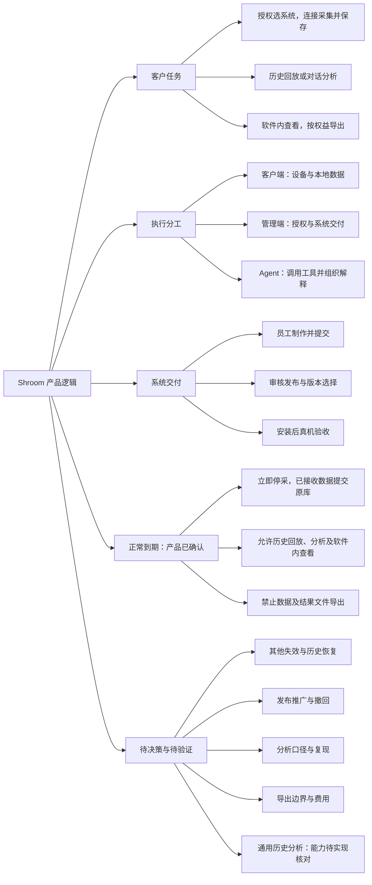

# Shroom 产品逻辑思维导图 v1.3

## 总览

## 阅读依据与状态

- 基于 [客户端与服务端协同设计说明 v1.3](../客户端与服务端协同设计说明-v1.3.md)
- 现行说明
	- 文档描述的当前机制
	- 不等于生产实测结论
- 产品已确认
	- 正常到期的使用规则
	- 对话驱动的分析方向
	- 实现与验收仍待核对
- 产品要求
	- 需要设计和验证的目标
	- 不代表能力已经上线
- 待决策
	- 文档尚未确定的选择
- 评审待澄清
	- 上轮反驳提出的问题
	- 不自动改变已确认规则

## 客户任务主线

- 主线
	- 取得授权与系统
	- 连接目标设备
	- 获得有效数据
	- 采集并确认保存
	- 回放或分析历史
	- 查看或交付结果
- 用前准备
	- 软件权益
		- 系统范围
		- 电脑数量
		- 使用期限
	- 运行环境
		- 电脑与驱动
		- 系统包与依赖
		- 实际设备
- 采集与保存
	- 确认目标通道
	- 检查按压方向
	- 开始采集
	- 观察写入状态
	- 停止并提交尾部
	- 核对实际记录
- 回放与分析
	- 选择记录和区间
	- 回放历史过程
	- 向 Agent 提出问题
	- 必要时澄清目标
	- 工具计算实际结果
	- Agent 组织解释
	- 通用分析待实现核对
- 结果使用
	- 软件内查看
	- 按权益导出文件
	- 正常到期禁止文件导出

## 执行分工

- 客户端
	- 接入设备
	- 协议解码与映射
	- 算法与归零
	- 本地采集存储
	- 展示与历史回放
	- 运行 Agent 工具
- 远程管理端
	- 客户与合同
	- 密钥与电脑授权
	- 系统包审核发布
	- 客户版本选择
	- 更新资源管理
	- 接收允许上传的反馈
- Agent
	- 员工配置提案
	- 分类训练与评价
	- 按问题选择工具
	- 根据真实结果解释
	- 通用分析方向已确认
		- 能力与效果待验收
- 外部模型服务
	- 回答与工具调用请求
	- 不替代本机计算证据

## 系统制作与交付

- 员工制作
	- 配置协议与映射
	- 配置算法与显示
	- 保存并本机验证
- 公司发布
	- 员工提交审核包
	- 管理员审核
	- 签名发布
- 版本选择
	- 现行解析顺序
		- 客户专属版本
		- 全体默认版本
		- 最新已发布版本
	- 显式推广方案
		- 仍待决策
	- 撤回已安装版本
		- 仍待决策
- 客户交付
	- 核对密钥范围
	- 验签与兼容检查
	- 安装并加载
	- 真实设备验收
- 交付版本组合
	- 完整安装包
	- 网页构建
	- 公司系统包
	- 分别记录与组合验证

## 权益与贯穿约束

- 正常授权
	- 密钥有效
	- 系统范围匹配
	- 电脑授权满足
	- 本机能力满足
- 正常到期
	- 产品规则已确认
		- 立即停止新增采集
		- 到期前待写数据提交原库
		- 历史查看与回放允许
		- Agent 历史分析允许
		- 软件内结果查看允许
		- 数据和结果文件导出禁止
	- 实现与真机验收待核对
- 其他失效
	- 凭证失效
	- 密钥暂停或吊销
	- 电脑解绑
	- 系统范围变化
	- 细则仍待决策
- 数据可信
	- 串口打开不等于有效帧
	- 入队不等于提交成功
	- 量值等级和单位明确
	- 保存范围与异常可解释
	- 历史处理依据可追溯
	- 分析结论有计算证据
- 数据去向
	- 采集库主要留在本机
	- 模型请求按任务发送
	- 聊天同步按独立设置
	- 使用统计按独立设置
	- 关闭聊天同步不关闭模型请求
- 验收层次
	- 代码实现
	- 合成环境测试
	- 安装包验证
	- 真实设备验证
	- 客户环境验收

## 关键待决策与待验证

- 文档待决策
	- 首批用户与任务
	- 其他授权失效细则
	- 发布推广与撤回
	- 标定等级和责任
	- 历史追溯实现
	- 队列恢复与数据保留
	- 模型费用与人工支持
	- 容量门槛与回退
- 评审待澄清
	- 导出限制的商业目标
	- 导出入口与跨期任务
	- 历史权益绑定对象
	- 换机或重装恢复范围
	- 跨到期采集的事前提示
	- 分析数据的固定快照
	- 统计方法与缺口处理
	- 自定义规则与正式标准
	- 分析任务验收题集
- 决策落地
	- 确认业务规则
	- 更新专项契约
	- 实现对应能力
	- 保存验证证据
	- 再作客户承诺
