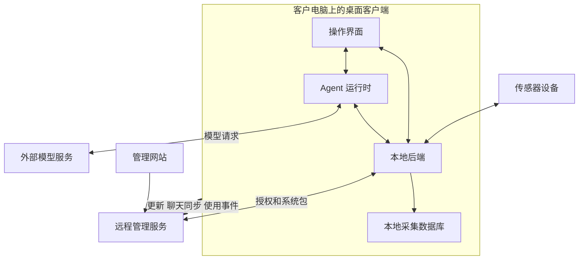
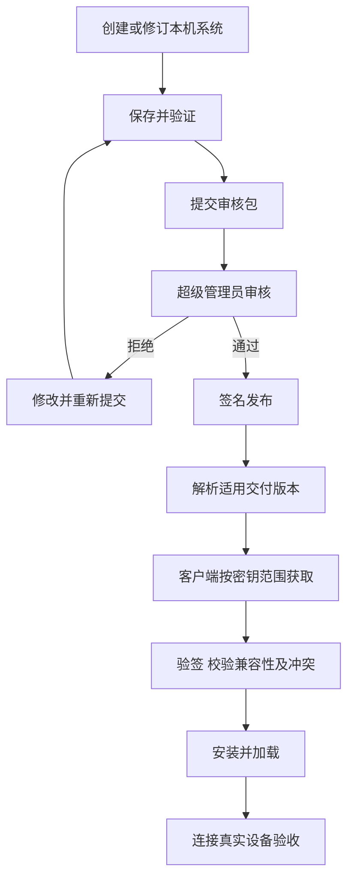

# Shroom 客户端与服务端协同设计说明

- 版本：1.3
- 整理日期：2026-10-19
- 阅读对象：产品、研发、交付、测试和运维人员
- 适用范围：桌面客户端 `E:/shroom1` 与配套管理服务 `E:/key`

Shroom 将传感器的本地采集分析与公司的远程授权、系统交付和运行管理连接起来。客户在桌面端连接设备、观察压力分布、保存和分析数据；员工制作展示系统并提交审核；管理员在服务端管理授权、发布版本和查看已上传的使用反馈。

本说明按当前实现组织业务关系和协作流程。生产环境的部署版本、迁移状态和真机验收结果需按第八章单独记录；功能说明不等同于生产发布记录。

1.1 版增加产品目标、客户权益、数据可信度、异常处理和交付验收要求。补充小节中的“产品要求”表示需要纳入设计和验收的目标，不代表相关界面、字段或流程已经实现；“建议方案”和“待决策”表示尚需确认的产品选择。涉及现行规则调整时，仍按现有专项契约执行，确认后的变更须同步更新契约、实现与验证记录。待决策事项和修订记录见第九章。

1.2 版记录已确认的密钥到期规则：立即停止采集，已接收数据继续提交当前采集数据库，允许历史回放及 Agent 分析，禁止采集数据和分析结果导出；该规则的实现与验收状态待核对。同时确认通过客户与 Agent 对话，针对具体问题按需组织比较、判断与报告的交互方向，不据此认定通用分析或报告已接入。

1.3 版固化本轮产品确认：分析从客户与 Agent 的具体对话问题出发；密钥到期后仍允许 Agent 分析历史数据并在软件内查看结果，禁止采集数据及分析结果导出。保留产品规则与实际实现、验证状态的区分。

## 1 系统概述

### 产品定位

Shroom 是面向压力与触觉传感器的桌面采集、可视化和分析软件。系统通过协议、线序、点位、算法和显示配置，将不同设备的数据转换为可理解的压力画面、统计指标和历史记录。

配套管理服务负责账号、客户、合同、软件密钥、电脑授权、公司系统发布、聊天同步和使用分析，使本机制作的系统能够经过审核、签名后交付给持有相应授权的客户端。

### 主要使用场景

| 场景 | 操作者 | 完成的工作 |
| --- | --- | --- |
| 实时监测与采集 | 客户端使用者 | 选择系统、连接设备、观察压力、开始和结束采集 |
| 历史分析与导出 | 客户端使用者 | 筛选记录、回放过程、查看变化、导出 CSV |
| 定制系统制作 | 员工或系统作者 | 配置协议、线序、点位、算法和显示方式，验证实际设备 |
| 公司系统交付 | 员工与超级管理员 | 提交审核包、审查差异、签名发布、调整交付版本 |
| 授权与客户管理 | 管理网站账号 | 关联合同、签发密钥、管理有效期和电脑数量 |
| 使用支持与维护 | 超级管理员与运维 | 查看已上传的聊天和统计、定位错误、发布更新或回退 |

### 阶段目标与用户价值

**建议方案，待试点确认**：首阶段优先验证“员工完成设备配置与交付，客户独立完成一次有效采集、保存、回放与导出”。客户采集可靠性与员工交付效率作为主要投入方向，客户自助训练单独试点，不预设其付费价值。

| 参与者 | 需要取得的结果 | 需要验证的问题 |
| --- | --- | --- |
| 客户端操作者 | 在支持的设备和环境中取得可解释、可保存、可复核的数据 | 能否独立完成核心任务，在哪里需要员工接管 |
| 系统制作与交付员工 | 将设备资料转为可复用、可验收的系统 | 配置和排障耗时是否下降，交付能否重复完成 |
| 购买决策者 | 明确软件权益、适用范围和交付结果 | 购买的是设备配套使用权、系统使用权还是其他权益 |
| 客户验收人 | 根据约定任务确认结果 | 由谁验收，什么证据足以通过，遗留项如何处理 |

购买决策者、实际操作者与验收人分别记录，不能用管理网站账号或软件密钥代替其业务身份。主目标和支持范围由试点需求确认后形成阶段基线。

### 成功指标与统计口径

**产品要求**：先通过试点建立基线，再确认目标值、统计周期和样本范围。下表是建议指标，不构成已达到的性能或成功率承诺。

| 指标 | 口径 | 取证方式 |
| --- | --- | --- |
| 首次任务独立成功率 | 分母为纳入试点且环境准备完成的首次任务；分子为用户未由员工接管，独立取得目标通道有效帧、采集落盘并完成回放和导出的任务；员工接管后的完成情况另列 | 试点任务记录、本机采集与导出证据 |
| 首次有效数据耗时 | 从有效授权、所需系统和设备就绪后，用户开始连接操作，到目标通道首个有效帧；环境准备耗时另计 | 操作记录与首帧证据，不冒充设备采样延迟 |
| 采集完整性 | 在明确数据阶段及存储策略下，比较应提交与实际提交的历史行，并报告缺失区间及原因 | 分通道接收、入队和数据库提交证据，详见第四章 |
| 客户交付成功率 | 分母为基线约定验收日期落在统计周期内的全部交付任务，包含延期、失败和未完成；分子为统计截止日已在客户环境通过验收的任务，按期与逾期通过分别报告 | 交付工单、原定验收日期与客户验收记录 |
| 交付周期与支持工时 | 从协议、样机和验收要求齐备到客户验收；等待时间单列，报告中位数、长尾与未完成账龄；支持工时包含失败和返工投入 | 交付工单与工时记录 |
| Agent 任务收益 | 对同类配置任务比较完成时间、首次应用通过情况、人工接管和恢复成本；训练任务另评分类效果 | 提案执行记录、人工对照任务及真实设备结果 |

未能完成环境准备的试点任务及其原因另行记录，不从整体交付结果中省略。聊天与使用事件仅覆盖成功上传且允许观测的样本，不作为全体客户成功率或活跃率的完整分母。新增指标若依赖尚不存在的计数或事件，须先补观测设计，不据此默认扩大上传范围。

### 整体业务流程

```text
客户与合同建立
  → 申请或签发软件密钥
  → 客户端激活并取得适用授权
  → 加载内置系统、本机系统或公司系统
  → 连接设备并确认有效数据
  → 实时展示、采集、分析、回放和导出
  → 按各自设置同步聊天与使用事件
  → 管理端分析问题并安排修订和更新
```

系统制作与授权签发可以并行推进。新系统只有完成发布，并处于客户端密钥允许的系统范围内，才能通过公司系统交付通道获取。

### 支持范围与客户承诺

**产品要求**：每次客户交付形成明确的支持范围，销售说明、系统配置与验收记录使用同一份基线。

| 范围 | 交付时明确的内容 |
| --- | --- |
| 设备与协议 | 型号、固件或协议版本、连接方式、原始点数与映射矩阵 |
| 运行环境 | 操作系统、电脑配置、驱动和所需本地组件 |
| 容量与时效 | 传感器和通道数、输入节奏、存储策略、连续运行时长及显示要求 |
| 网络与授权 | 首次联网、授权刷新、离线条件、电脑数量与到期规则 |
| 数据含义 | 原始读数、相对量或已标定物理量，单位及适用边界 |
| 交付版本 | 安装包、网页构建与系统包的组合及最低宿主能力 |
| 服务与权益 | 可用系统、期限、升级维护、支持方式、验收人与遗留项 |

超出已验证范围的能力需单独评估。支持某个设备或模板不自动构成对所有设备、严格硬件同步或所有离线场景的承诺。

## 2 总体架构与运行边界

### 组件职责

| 组件 | 运行位置 | 职责与主要数据 |
| --- | --- | --- |
| 传感器设备 | 外部硬件 | 采样并输出设备协议数据 |
| 桌面操作界面 | Electron 渲染进程 | 系统选择、连接控制、画面、图表、采集回放、配置器和 Agent 对话 |
| 本地后端 | 客户电脑，当前由 Electron 主进程加载 | 串口、协议、映射、算法编排、归零、本地存储、HTTP 控制和实时发布 |
| Agent 运行时 | 客户电脑上的独立进程 | 模型请求、受限工具、任务、提案和会话管理 |
| Python 算法组件 | 客户电脑上的相关子进程 | 执行已接入的算法和固定训练组件 |
| 远程管理服务 | 服务端部署环境 | 账号、合同、客户、密钥、系统包、网页发布、聊天接收和统计 |
| 外部模型服务 | 用户配置的模型服务环境 | 根据请求内容生成回答和工具调用 |

### 协作关系



图中连接表示职责关系，具体传输方式见第七章。远程管理服务与外部模型服务是不同的接收方；聊天同步开关不控制 Agent 向模型服务发出的正常任务请求。

### 本地与联网能力

实时采集、画面更新、本地存储和已有记录回放在客户电脑上完成。它们仍受当前授权和运行状态约束，不能据此推导为任何情况下均可离线使用。

在线授权刷新、公司系统包下载、网页更新、聊天同步、使用统计以及外部模型请求需要相应网络连接。断网时分别采用各自的凭证、缓存或队列规则，没有统一的“断网即全部允许”策略。

多传感器通过系统和传感器身份区分。普通多串口并发接收及软件配帧不能证明硬件同步采样；需要严格同步时，应另外确认设备时钟、触发或硬件时间戳能力。

## 3 角色权限与核心业务对象

### 账号角色与操作身份

| 角色或身份 | 主要权限 | 数据范围或限制 |
| --- | --- | --- |
| 超级管理员 `super_admin` | 审批无合同申请、管理电脑限制、审核发布公司系统、调整版本、查看聊天和统计 | 密钥全量可见；聊天及统计还要求账号处于启用状态 |
| 管理员 `admin` | 在其权限内生成和管理密钥 | 密钥可见范围为本人及下级；飞书合同可读取全部 |
| 子账号 `user` | 在其权限内生成和管理本人密钥 | 密钥仅本人可见；飞书合同按账号姓名与提交人精确匹配 |
| 系统制作员工 | 使用登录会话或受限员工令牌提交审核包、读取允许修订的已发布原包 | 提交权限不包含审核、发布和客户版本管理权限 |
| 客户端使用者 | 通过软件密钥使用相应系统 | 受密钥范围、期限、电脑授权和本机能力约束 |

合同权限和密钥权限分别判断，不能将“管理员可看下级密钥”套用为合同筛选规则。员工是业务操作身份，实际管理端权限仍由账号角色和所用凭据决定。

### 业务对象

| 对象 | 核心含义 | 关联关系 |
| --- | --- | --- |
| 客户 | 公司资料、业务归属与状态 | 可关联合同、密钥和客户专属版本配置 |
| 合同 | 飞书维护的业务依据 | 供管理网站展示、选择和绑定 |
| 软件密钥 | 软件使用凭据 | 包含或关联系统范围、期限和生命周期状态 |
| 电脑授权 | 某次电脑安装身份的使用登记 | 与密钥、本机身份摘要和签名凭证关联 |
| 展示系统 | 一组可运行的设备与展示定义 | 包含传感器、协议、映射、算法与显示配置 |
| 系统包与发布版本 | 经过审核并签名的交付内容 | 关联稳定系统 ID、版本基线和交付版本指针 |
| 采集记录 | 一次采集会话内保存的数据 | 关联系统、传感器通道、时间与数据阶段 |
| Agent 会话 | 消息、任务、提案与附件引用 | 本地持久保存，按设置同步会话快照 |

### 身份区分规则

- 电脑授权数量限制的是运行软件的电脑安装身份，不是连接的传感器数量。
- 系统名称用于显示，稳定系统 ID 用于识别，不能依靠名称相似判定目标。
- `sensorId` 标识系统内传感器，COM 号标识某次连接的物理串口；COM 变化不应重命名历史通道。
- 系统发布版本、安装包版本和网页构建版本是不同对象，需要分别记录。
- 软件密钥、模型 API Key、员工提交令牌各有用途，不能互相替用。

### 软件权益与业务终止

**产品要求**：订单或交付约定应说明系统范围、电脑数、期限、升级维护和支持范围。全部授权、分类授权及固定范围授权是否包含未来新增系统，需要有业务示例并与签发规则一致。

| 业务动作 | 影响对象与边界 | 需要确认的业务结果 |
| --- | --- | --- |
| 停用或删除客户档案 | 客户资料及其关联信息；按现行规则，不单独阻断有效密钥的公司系统范围 | 是否还需执行独立的密钥或交付操作 |
| 停止续费 | 后续服务安排 | 既有密钥按其期限和状态处理，不把续费意向当作即时吊销指令 |
| 暂停或吊销密钥 | 对应使用凭据 | 适用电脑与系统、在线生效和离线约束、当前采集处理 |
| 解绑电脑 | 指定电脑安装身份的登记 | 下次联网检查及离线凭证期限，不能承诺瞬间切断 |
| 停止系统交付或撤回版本 | 系统目录、版本指针及对应发布内容 | 新下载、已安装和运行中的不同影响 |
| 合同终止或退货 | 需执行的客户、密钥和交付业务动作 | 操作责任人、处理范围、生效条件及完成证据 |

**已确认产品规则，待实现核对与验收**：软件密钥正常到期后立即停止采集，不设继续采集的宽限期；已有记录及到期前已接收、待提交的数据继续保存在当前采集数据库。到期后允许查看历史、回放及使用 Agent 分析已有数据，分析与报告内容可在软件内查看，禁止采集数据和分析结果导出。

**仍待决策**：凭证失效但密钥尚未到期、暂停、吊销、电脑解绑等其他状态的处理细则，以及批量终止业务的操作流程。客户档案、合同和密钥状态分别管理，不能以修改其中一个对象代替完整业务处理。

## 4 核心业务流程

### 客户合同与密钥签发

合同以飞书为维护来源。管理网站读取账号可见合同，供操作者选择并绑定；不在网站直接修改飞书合同原始内容。

1. 操作者填写系统范围、有效期和数量等签发参数。
2. 普通账号选择当前可见合同，服务端重新校验合同身份和可见范围，带入合同客户信息。
3. 无合同场景保存生成参数和申请原因，由超级管理员批准或拒绝。
4. 批准时，密钥生成与申请状态更新在同一事务内完成；生成的密钥归申请人。
5. 超级管理员可选择无合同直接签发，不经过普通申请流程。
6. 操作者将生成的密钥交付给客户，客户进入桌面授权流程。

通知发送异常不等于申请创建失败；申请状态以管理网站保存的业务结果为准。客户档案、合同可见范围和密钥归属仍分别按各自规则管理。

### 客户端激活与电脑授权

客户输入密钥后，客户端与服务端核对适用的密钥状态、期限、系统范围及电脑授权规则。服务端首次有效激活会更新相应状态；客户端据此组织可访问系统。

| 检查项 | 通过条件 | 不通过时的处理 |
| --- | --- | --- |
| 密钥有效性 | 已登记且满足适用的状态、签名和期限规则 | 显示未登记、无效、暂停、吊销或过期等原因 |
| 系统范围 | 目标系统在当前密钥允许范围内 | 拒绝进入或连接相应系统 |
| 电脑名额 | 当前电脑已登记，或仍有可登记名额 | 拒绝新增登记并显示限额原因 |
| 离线凭证 | 本机绑定和签名正确，且凭证、密钥均未过期 | 需要联网刷新或处理授权 |
| 本机能力 | 已安装系统及其依赖可运行 | 提示安装失败、缺失依赖或需升级软件 |

新版在线授权首次需要联网，启动时及运行中每 2 小时刷新。成功后保存与本机、密钥摘要绑定的签名凭证，最长 7 天，且不能超过密钥到期时间。网络失败时只接受仍有效的凭证；服务端明确拒绝后不能以断网缓存继续放行。

电脑上限 `0` 表示不限量，其他期限与状态规则仍然适用。同机正常升级通常不重复占名额；重装、克隆或本机身份文件变化可能影响身份。解绑会在联网检查后生效，已经离线的电脑最迟受凭证期限约束。

旧不限量 RSA 离线码保留原纯离线规则。需要电脑限制时重新签发包含相应限制的新版本离线码，并配合支持该能力的客户端；不能通过网页给旧签名追加原本不存在的限制。

**示例**：客户甲的密钥允许系统 A、系统 B，上限为 3 台电脑。第四台登记时被拒绝。管理员解绑旧电脑后，旧电脑下次联网校验会被拒绝；该操作不会瞬间删除其离线凭证。

### 运行中授权失效与数据收尾

**产品要求**：区分网络失败、凭证到期、密钥到期和服务端明确拒绝。运行中授权限制与采集收尾应共同验收，不能只检查入口是否拒绝。

| 情况 | 现行授权边界 | 需要补充的处理 |
| --- | --- | --- |
| 网络失败且本机凭证仍有效 | 按有效凭证及密钥范围处理 | 展示离线状态与有效期限，避免误报为吊销 |
| 本机凭证失效但密钥尚未到期 | 不满足继续按该凭证放行的条件 | 明确刷新入口、当前采集停止及尾部提交规则 |
| 软件密钥正常到期 | 立即停止采集，禁止新建或继续采集 | 已接收数据继续提交当前库，允许历史回放及 Agent 分析，禁止数据和分析结果导出 |
| 服务端明确拒绝 | 不得继续以缓存授权放行 | 明确拒绝原因、受控结束步骤及已保存数据范围 |
| 电脑解绑或系统范围变化 | 按适用授权检查结果处理 | 明确受影响通道、任务与生效状态 |

**密钥正常到期的已确认产品规则**：

1. 到达密钥有效期终点时，立即停止为本次采集接收新数据，不允许开始或继续采集；已知到期时间应在本机到达时生效，不等待下一次每 2 小时联网刷新。断网不延长密钥期限，休眠恢复后先核对到期状态再允许采集。
2. 到期前已接收且符合本次存储策略的数据，包括待写队列，继续提交当前采集数据库，不因到期丢弃队列或另建数据库。提交失败时显示实际保存范围及异常，不能仅因停止采集而宣称全部保存成功。
3. 本次记录标记为授权到期中断，保留停止原因、实际采集范围及提交结果；停止新增接收与尾部提交完成分别表达。
4. 允许进入已有历史并回放，允许 Agent 分析已有数据，并在软件内展示比较、判断与报告内容。禁止采集数据和分析结果导出为文件；界面、后端、Agent 及批处理等导出入口适用同一规则，不能因允许分析而绕过到期限制。

**其他授权失效情形的建议方案，待决策**：限制新建受限操作，对已接收数据执行必要的队列提交和结果核对；采集记录保留结束原因及实际保存范围，不能将授权中断标为正常完成。提前预警时点，以及除密钥正常到期外的停止时点和历史权益，另行确认。数据落盘收尾不等于获得继续采集许可。

验收时在采集中分别触发上述情况，检查授权状态、采集结束原因、已提交数据、待写数据及历史访问结果。停止接收、提交完成与保存失败应分别有确定证据。

密钥到期验收还应覆盖运行中、断网、重启及休眠恢复：确认到期后无新增采集数据，尾部队列仍写入原库，记录可查看和回放，Agent 可以分析选定历史数据且结果可在软件内查看，采集数据及分析结果的文件导出请求被拒绝。该产品决策尚不构成以上场景已实测通过的结论。

### 设备连接与实时数据

用户确认进入目标系统后，为每个传感器选择实际枚举出的串口，按系统定义建立接收和处理链路。

```text
选择系统及传感器
  → 选择物理串口并打开
  → 按协议分帧与解码
  → 执行线序与点位映射
  → 按系统配置执行算法与归零
  → 形成标准压力帧
  → 发布到界面并按采集状态保存
```

| 检查点 | 已证明的内容 | 还需继续确认的内容 |
| --- | --- | --- |
| 已进入系统 | 页面和目标系统加载完成 | 设备连接与实际数据 |
| 串口已打开 | 操作系统允许访问端口 | 分帧、解码、点数和通道 |
| 已收到有效帧 | 处理链产生了可用数据 | 物理方向、量值及持续稳定性 |
| 真实画面正确 | 对应按压显示在正确区域 | 长时间运行和存储结果 |

串口波特率、分隔符或固定长度、数值位宽、字节偏移和原始点数共同构成协议条件。不能因为最终展示矩阵相同，就推断两种设备采用相同协议。

**映射示例**：设备每帧提供 1024 个采样值，系统抽取并重排其中的点位，形成 23×23 的 529 个展示点。协议仍按 1024 点解码，映射定义提供 529 个有效索引，显示和相关统计消费映射后的矩阵。用递增测试值检查索引、换行和首尾位置后，还要通过真实按压确认方向。

没有画面时，先按“串口 → 分帧 → 解码 → 映射 → 算法 → 发布 → 渲染”定位。串口打开或页面预览正常均不能代替有效帧检查。

### 量值等级与测量可信度

**产品要求**：每个交付系统声明其数值等级，界面、统计与导出使用一致的单位和解释。

| 数值等级 | 交付声明要求 |
| --- | --- |
| 原始读数 | 说明数据来源、编码和阶段，不直接标注为压力物理单位 |
| 相对量 | 说明归一化、归零或相对比较依据，以及跨设备、跨次采集的比较限制 |
| 已标定物理量 | 说明单位、标定版本、适用设备、量程与有效条件；定量交付另约定误差和重复性验收方法 |

点位方向正确只能证明映射的一部分。颜色范围、平滑效果和点距设置不能替代量值标定；使用自动色阶进行前后比较时，应展示实际数值范围，避免将颜色相同解释为压力相同。

**待决策**：各型号承诺的量值等级、校准责任与复核周期，以及需要定量验收的客户场景。在缺少依据时按可证明的读数或相对量说明，不能补造单位或校准结论。

### 采集存储与停止

开始采集会建立本次采集会话并启用存储状态。本地后端按通道、存储频率和磁盘条件判断是否接收历史行，再通过队列批量提交 SQLite。

1. 用户确认实时数据与目标通道正确。
2. 设置本次采集信息并开始采集。
3. 后端按系统和通道保存数据、时间及可用身份信息。
4. 用户停止采集，后端关闭采集状态并提交待写队列。
5. 在历史列表检查记录，再执行回放或导出。

实时画面正常不代表数据正在落库，入队成功也不代表数据库事务已提交。磁盘空间不足、写入失败和停止时的队列提交需要分别反馈。

采样率、算法执行率、存储率、网络发布率和显示帧率分别定义。主链路算法可能影响可存储的处理帧率；屏幕刷新率不能作为完整保存设备原始数据的证据。

### 采集结果与完整性

**产品要求**：每次采集形成可核对的结果摘要，按通道记录起止时间、数据覆盖区间、存储策略、实际提交结果、断流或写入异常及结束原因。以下为产品状态语义，具体接口枚举另行确定。

| 状态 | 对用户表达的结果 |
| --- | --- |
| 准备中 | 正在核对目标通道、权限和存储条件，尚不能宣称已采集 |
| 采集中 | 正在按策略接收和保存，需能观察写入状态 |
| 收尾中 | 已停止接收本次新数据，仍在提交或核对尾部数据 |
| 完成 | 约定范围内的数据提交完成，记录可读取 |
| 中断 | 因授权、断流、退出等原因提前结束，保留实际覆盖范围 |
| 保存异常 | 提交失败或结果不确定，不能显示为保存成功 |

完整性应沿实际链路分别核对接收有效帧、符合存储策略的待存记录、入队记录和已提交记录。若以比例报告保存完成率，分母为可核对的“按本次存储策略应提交的记录数”，分子为实际提交数；分母不可确定时报告已提交数、覆盖区间与已知异常，不生成完整率。

主动降采样、无效帧丢弃、算法抑制、断流和写入失败分别解释。没有硬件计数依据时，只证明软件可观测范围，不能据此声称设备原始数据零丢失。收尾失败时，应提供记录核查和再次读取的路径。

### 历史回放与导出

用户选择历史记录后，本地后端加载对应数据并以回放来源回注统一发布边界。界面使用同一套通道身份显示历史内容，避免把实时流混入回放。

回放操作包括播放、暂停、倍速和定位。多通道需要依据记录时间对齐，不能假定各通道相同数组下标就是同一时刻。

CSV 导出独立选择记录和选项。导出命令接收、任务执行和文件完成是不同状态，交付时应检查实际文件、通道身份和数据列。Manifest 历史与旧型号历史的内部存储形状可能不同，不能将所有历史行都描述成统一的网络帧格式。

**已确认产品规则，待实现核对与验收**：密钥正常到期后仍可查看和回放既有记录，并使用 Agent 分析历史数据；禁止采集数据及分析结果导出。读取回放、执行分析与执行导出的授权条件分别核验。

算法输出是否进入历史和 CSV 取决于接入路径：Manifest 主链路算法可能改变存储内容；算法超市会话旁路不回写标准帧和历史。原生系统专项算法按对应能力说明。

### 历史结果追溯

**产品要求**：稳定系统 ID、通道和矩阵尺寸用于识别输入身份，还需保留解释历史结果的处理依据。即使尺寸不变，映射、滤波、归零和算法变化也可能改变数值含义。

| 依据 | 需要确定的追溯范围 |
| --- | --- |
| 交付与配置 | 系统包版本，或本机配置的不可变修订与摘要；必要配置快照 |
| 数据处理 | 协议、映射、算法及特征版本，存储数据阶段 |
| 量值与归零 | 单位、校准依据、归零方法及可追溯的参考状态 |
| 时间与存储 | 时间来源、存储策略、已知采样节奏和数据缺口 |
| 再分析结果 | 原采集记录、采用的新算法或配置及计算时间 |

原记录回放与采用新算法重新分析分别标识。升级后，不因当前配置变化而静默改写原记录的解释和导出口径；旧记录缺少依据时标为未知，不用当前版本补填历史事实。

**待决策**：各存储路径能够保存的字段、快照与摘要方式、旧记录展示和迁移方案。具体实现先评估容量与兼容性，不要求所有设备无差别保存全部原始串口数据。

### 公司系统制作与发布

员工使用配置器或 Agent 创建系统，在本机核对协议、映射、画面和算法。系统包只包含当前宿主支持且导出校验通过的配置和相关依赖；采集库、聊天记录与模型密钥不进入系统包。



提交入口使用受限员工凭据，仅提交磁盘中已经保存的配置。编辑器尚未保存的修改不进入审核包；提交成功只表示进入待审核。

同一系统 ID 同时只能有一个待审提交。更新已发布系统须明确版本基线，发布时重新核对；基线已变化的旧包需要重新处理。同 ID 更新不能破坏传感器身份、输出通道和矩阵尺寸，确需改变这些输入身份时应创建新系统 ID。

正式受管系统只读，修订时从支持派生的已发布包创建独立本机草稿。不能自动派生的包应按软件提示处理，不能丢弃其算法依赖后当作完整修订。

### 公司系统授权与版本交付

公司系统目录和包下载依据有效、已登记密钥中的系统范围。客户关联用于业务信息和可选版本覆盖，不是额外下载门槛；客户缺失、停用或删除不会单独阻断仍有效密钥的公司系统范围。聊天上传的客户校验规则不能套用到此接口。

适用版本按以下顺序解析：

1. 已关联客户的专属版本指针。
2. 系统的全体默认版本指针。
3. 没有适用指针时，使用最新已发布版本。

如果明确指针指向已撤回或缺失版本，停止交付，不自动选择其他版本。固定范围旧密钥不会因新增公司系统而自动扩大范围；全部授权和分类授权按各自定义展开。

| 操作 | 业务含义 | 客户端行为 |
| --- | --- | --- |
| 发布 | 形成可交付的不可变签名版本 | 满足授权及兼容条件后可获取 |
| 推广 | 调整客户或全体默认版本指针 | 下次同步解析新的适用版本 |
| 回退 | 将版本指针指回仍已发布的旧版 | 下次同步按旧版交付 |
| 撤回 | 停用某个发布版本 | 指向该版本的客户停止取得该系统，不自动改用旧版 |

客户端通常每 6 小时复查，也可手动刷新；签名目录最长有效 24 小时。管理端操作不能立即切断所有断网客户端。安装前校验目录和包签名、摘要、最低软件能力及本机冲突，失败时保留已有内容并提示原因。

#### 发布影响与撤回边界

按上述现行版本解析规则，没有客户专属指针及全体默认指针时，新发布版本可能改变相关客户的目标版本。因此，发布不能默认理解为“尚未影响客户”。

**建议方案，待决策**：首次发布建立明确交付基线，后续发布形成候选版本，经显式推广再改变客户目标版本。若继续采用无适用指针时交付最新发布版本的方式，发布确认应展示实际受影响范围。在契约、实现与数据迁移完成前，仍执行现行版本解析规则。

**产品要求**：撤回时分别说明未下载、已下载待安装、已安装、正在运行和断网客户端的影响，并记录替代方案及处理进度。停止交付、版本告警和限制运行是不同结果，不能以一个“已撤回”状态代替全部确认。

**待决策**：撤回是否影响已安装版本、是否另设问题版本停用机制、当前采集如何收尾以及断网客户端如何处理。电脑授权凭证最长 7 天与签名目录最长 24 小时分别约束不同对象，不能直接推导为同一个撤回生效时限。

验收至少覆盖固定旧版本、使用全体默认版本、无适用指针及指向撤回版本的客户；发布新版前后核对其目标版本，撤回时再检查上述安装和运行状态。

已登记的离线码可以在联网时按对应规则拉取包；完全断网的文件导入不属于当前交付能力。原生模板副本依赖安装包内的来源系统，新增原生能力仍需更新安装包。

公司包授权与版本规则以[服务端系统包契约](../../key/docs/system-packages.md)为准。

### Agent 配置任务与提案应用

Agent 在任务开始时识别当前系统，读取允许访问的状态和能力目录，再生成受支持的配置或连接提案。

1. 用户提出需求，必要时提供协议、点位或图片资料。
2. Agent 读取真实系统身份、已有配置和本机能力。
3. 生成提案，展示摘要及适用的修改前后内容。
4. 用户点击应用，运行时重新核对版本、权限和当前状态。
5. 执行支持的写入或连接，并读取验证结果。
6. 设备类结果继续检查有效帧，算法类结果继续检查绑定和实际输出。

连接提案必须指向明确的系统、传感器和当前枚举出的串口。模型回答结束不能代替操作成功；停止任务不会撤销已经完成的更改。

恢复仅适用于支持恢复且版本仍匹配的已应用修改。写入期间中断或缺少完整回执时，保留不确定结果并检查实际状态，不自动重复执行。

**产品要求**：不确定结果需有可操作的核查入口，展示已确认完成、尚未执行与待核查步骤，以及已保存或已改变的对象。用户取消或重启后，应先核对实际状态，再决定继续、恢复或人工处理。

验收分别在“保存完成、绑定前”和“绑定完成、回执前”中断任务，检查重启后能否识别实际结果、避免重复创建，并给出可执行的后续动作。是否支持逐步继续及各工具的恢复范围，按能力列明，不承诺所有任务均可自动撤销。

### Agent 分类算法训练与接入

以“使用拍打和抚摸记录训练识别算法”为例：

1. 在当前系统选择带标签的采集记录，确认读取范围和用途。
2. 至少提供两类开发数据；独立验证数据使用另外采集的记录，不能把同次采集拆到开发与独立验证两组。
3. 用户明确确认选数后，运行时才读取允许范围的压力帧。
4. 本机 CPU 比较内置分类候选，生成模型和真实评价报告。
5. 用户查看评价方式、错分、未知结果及数据范围，再应用保存新版本。
6. 将已保存算法绑定到目标系统和传感器，并启用实时实例。
7. 兼容帧到达后积累窗口，检查类别输出与实际动作是否一致。

当前内置训练候选包括逻辑回归、决策树和随机森林，训练最长 60 秒且可取消。完整压力帧和逐窗训练特征留在本机；开发集有界摘要、模型摘要和评价结果可进入模型任务请求。

保存、绑定、启用和观察到有效分类是不同状态。实时运行还需核对点数、数据阶段、矩阵、特征版本和采样节奏；断流或输入不匹配时不能补造压力帧维持识别。

开发集结果不能当作独立验证准确率，独立验证结果也只代表选定记录。详细数量限制、报告字段和运行边界见[内置 Agent 说明](embedded-agent.md)。

#### Agent 价值与效果验收

**建议方案，待试点确认**：员工配置提效与客户自助训练分别评价。前者检查完成同类设备配置所需时间、首次应用成功、人工接管和恢复成本；后者先验证用户能否准备有效标签并理解评价结果，再判断是否适合扩大交付。

**产品要求**：根据具体用途约定可接受的误报、漏报、未知结果与识别延迟。独立采集记录不自动代表跨人员、跨设备或跨日期有效；需要这些能力时，验证数据应覆盖相应变化，并记录适用范围。

**待决策**：首批任务和用户、模型服务费用承担方、失败后的人工支持范围及分类效果门槛。模型回答、训练结束、保存成功和真实业务任务完成分别统计。

#### 通过对话按需完成分析与报告

**已确认的交互方向，能力实现与验收待推进**：客户先通过与内置 Agent 聊天提出具体问题，Agent 根据本次问题澄清目标、选择数据与分析方法，再按需完成比较、判断或报告。不要求客户先进入固定分析模块，也不要求为每个设备或业务场景预建完整流程。通用工具是 Agent 的执行基础，不是要求客户先学习和选择的功能清单。

1. 理解具体问题与所需结果。用户只想了解一次变化时直接围绕变化分析；只有评价目标含糊或缺少必要条件时才追问，不要求每次对话完整填写分析表单。
2. 识别并复用本轮已确认的记录、通道、区间和上下文，按既有选数与授权规则读取数据；范围不明确时让用户选择，不自行扩大读取范围。
3. 根据问题组合已支持的数据读取、区间选择、统计和比较能力。本机工具完成可复核计算，Agent 使用实际结果组织解释；不能完成的计算明确说明缺口，并提供可用的替代分析或转交开发、交付支持。
4. 按客户需要输出直接回答、差异说明、带依据的判断或报告，不强制每个问题同时产生比较、判断和报告。报告内容围绕本次问题形成，必要的数值与结论能够追溯到所用记录、区间、参数和工具结果。

分析仍需核对数据阶段、单位和比较依据，不凭热力图外观或有界摘要推断未计算的事实。涉及“更好”“合格”等结论时，先取得相应指标、阈值或用户确认的评价规则；缺少依据时先澄清，或明确只提供描述性结果。

验收从真实客户问题出发，检查是否正确理解问题、是否取得正确范围的数据、计算与结论是否有依据，以及对话后是否解决问题。单次采集解释、记录比较和报告整理可以作为验证样例，不将这些样例固化为客户必须选择的有限入口。没有现成工具的问题不承诺均能自动完成，按实际缺口决定补充通用能力或人工处理。

当前已接入的分类训练分析、评价报告与上述通用历史分析是不同能力，现有手册仍将自动分析报告列为暂未支持，详见[内置 Agent 说明](embedded-agent.md)。密钥正常到期后，产品权益允许 Agent 分析选定历史数据，并在软件内展示分析、比较、判断及报告内容；禁止将采集数据或分析结果导出为文件。权益确认不代表上述通用能力已经实现，分析的数据范围、模型服务配置及上传规则仍按各自约束执行。

## 5 客户端模块设计

### 功能模块

| 模块 | 用户操作与输出 | 前置条件或边界 |
| --- | --- | --- |
| 系统目录 | 分类、搜索、预览、刷新、进入与返回 | 预览不代表已连接设备；可见性与实际运行权限分别核验 |
| 设备接入 | 串口枚举、传感器角色绑定、连接与断开 | 协议、通道及当前授权匹配 |
| 数据处理 | 解码、线序、点位、算法与归零 | 保持处理顺序及各阶段语义 |
| 实时展示 | 点图、热力图、数字矩阵、三维模型与图表 | 按具体系统和渲染器提供能力 |
| 分析工具 | 框选统计、传感点量尺、视角及显示调节 | 量尺依赖可靠点位映射和用户设置的实际点距 |
| 采集与历史 | 本地保存、列表选择、回放、倍速、定位、删除和导出 | 真实入库、通道身份和写入完成需可验证 |
| 系统配置 | 新建、复制、保存、修订与提交审核 | 区分内置、可编辑本机、受管和修订草稿 |
| Agent | 模型设置、附件、选数、提案、执行、历史和同步状态 | 仅调用已接入工具，修改类操作按提案确认执行 |
| 应用服务 | 授权状态、安装包更新、网页缓存、统计设置 | 与采集数据处理分别管理失败和恢复 |

HaLow 等专项接入按适用型号单独说明。人体 HaLow 接收与串口互斥，仍接入同一后续归零、采集和标准帧发布链路，不能据此假定所有系统都支持该传输方式。

### 参数作用范围

画面颜色、高度、点大小和视角等显示参数，按渲染器能力影响显示效果。协议、映射、归零和主链路算法可能影响数据阶段及后续处理，不能与纯显示参数混为一类。

例如矩阵渲染器的颜色范围调节改变数值到颜色的对应关系；它不能修复错误线序，也不能直接证明采集值改变。切换视图后，界面应按当前渲染器实际能力展示工具。

### 运行数据位置

| 数据 | 安装版主要位置或规则 |
| --- | --- |
| 采集数据库 | Electron `userData/db/` |
| Agent 会话与附件 | `userData/agent/` 下的会话和附件目录 |
| 模型设置 | `userData/agent/`，模型密钥使用系统安全存储加密 |
| 用户展示系统 | `userData/display-systems/` 等可写运行目录 |
| 授权、网页缓存、统计队列 | `userData` 下各自独立目录 |
| CSV 与专项报告 | 按平台及当前导出路径规则解析，不能统一假定均在 `userData` |

开发态部分路径与安装态不同。正常升级应继续读取已有用户数据；更换电脑、系统账号、应用身份或删除数据目录不属于同一数据目录的正常升级。

## 6 服务端模块设计

### 管理模块与客户端影响

| 模块 | 管理操作 | 对客户端或业务的影响 |
| --- | --- | --- |
| 账号与组织 | 创建、分配角色、部门及启停 | 决定网站功能权限和适用数据范围 |
| 客户与合同 | 合同读取、档案关联、客户元数据展示 | 支撑签发业务归属与客户版本覆盖 |
| 密钥生命周期 | 签发、激活、续期、暂停、吊销及删除管理 | 决定相应凭据是否可用及其系统范围 |
| 电脑授权 | 名额设置、设备登记、解绑与恢复 | 影响当前电脑能否取得或续用授权凭证 |
| 公司系统库 | 提交、审查、发布、推广、回退及撤回 | 决定有效密钥可获取的系统版本 |
| Agent 聊天 | 接收会话快照，向允许账号提供查看 | 支持了解客户端已上传任务及错误 |
| 使用分析 | 筛选事件、统计功能、查看错误上下文 | 提供已观测使用情况与问题线索 |
| 网页发布 | 维护签名清单、资源和兼容要求 | 供客户端下载、验证和下次启动启用 |

### 审批与执行状态

无合同申请的提交、批准、拒绝与密钥生成结果需要区分。公司系统包的待审、拒绝、发布、撤回，以及客户版本指针同样分别记录。业务状态名称用于解释操作含义，具体字段和枚举以接口契约为准。

发布失败时，待审记录可能仍存在。操作者应处理签名配置或服务错误后按原记录重试，不能仅因失败提示就反复创建同 ID 提交。

### 管理观测范围

聊天页面只显示客户端成功上传的会话快照，由启用中的超级管理员查看。它不主动抓取本地全部历史；附件只含元数据，不提供原文件预览和下载，也不作为远程会话恢复或删除入口。

使用分析支持按日期、环境、客户、版本、功能和错误上下文筛选。没有记录只能说明相应事件未被观测到，不能单独证明客户没有使用功能。

聊天同步和使用统计使用独立设置、数据范围、队列和失败状态。关闭其中一个不自动关闭另一个。

## 7 数据接口与安全边界

### 通信分类

| 通信双方 | 方式与入口 | 主要用途 |
| --- | --- | --- |
| 界面到本地后端 | HTTP，默认 `:19245` 的 `POST /api/commands` | 串口、系统切换、采集、回放和归零等控制命令 |
| 本地后端到界面 | 单 WebSocket，默认 `:19999` | 订阅、标准帧及低频系统状态 |
| 客户端到远程服务端 | HTTPS 授权及对应业务接口 | 授权、系统目录与包、网页更新、聊天和统计 |
| Agent 到模型服务 | 用户配置且兼容的模型接口 | 本轮回答生成及工具调用请求 |

当前仍保留旧扁平 WebSocket 控制兼容入口，部分旧页面配置命令仍使用它。新控制命令以 HTTP 为规范入口，不能把迁移方向写成所有旧入口已删除。

公司系统客户接口包括 `/api/system-packages/client/catalog` 与 `/api/system-packages/client/packages/:id/:version`。聊天同步使用 `/api/agent/conversations`，统计批量上传使用 `/api/usage/events/batch`。这些远程入口与本地 `/api/system-packages/status` 等状态接口分别记录，避免把请求发往错误服务。

### 标准压力帧身份

| 字段 | 用途与边界 |
| --- | --- |
| `displaySystemId` | 稳定系统身份 |
| `sensorId` | 系统内传感器身份 |
| `channelId` | 通道隔离和订阅键，形如 `displaySystemId:sensorId` |
| `sensorLabel` | 可读名称，不代替主键 |
| `source` | 区分实时和回放来源 |
| `timestamp` | 帧时间，不能直接当作设备硬件采样时间 |
| `sequence` | 当前通道发布序号，不能直接当作硬件采样计数 |
| `payload.value` | 对外展示值，不是原始串口字节 |
| `payload.stages` | 可用的数据处理阶段；缺失阶段不能冒充已有数据 |
| `payload.matrix` | 已知矩阵形状，供渲染和算法检查 |

标准帧规范用于实时和回放发布边界，历史数据库内部行格式仍可能因系统类型不同而变化。具体字段以现有 SDK 契约为准，不在本说明维护第二份完整 schema。

### 数据保存与上传范围

| 数据 | 主要保存或接收方 | 范围与用户控制 |
| --- | --- | --- |
| 压力采集记录 | 本机数据库 | 聊天同步和统计通道不上传整库；用户可主动导出 |
| Agent 本机会话 | 本机用户数据目录 | 消息、提案和附件内容不因密钥加密而自动全部加密 |
| 同步会话快照 | 远程聊天接收服务 | 正文、任务状态、附件名称等规定字段；不逐个上传流式 token |
| 附件原文件 | 本机附件目录 | 不随管理端聊天同步上传；用于模型任务时按该任务附件规则处理 |
| 模型 API Key | 本机系统安全存储 | 不作为软件授权或管理端上传凭据 |
| 使用事件 | 远程统计接收服务 | 白名单事件与有限元数据，不含原始压力帧、聊天正文或采集标签 |
| 错误信息 | 本机队列与远程统计 | 对规定字段做凭据、路径等脱敏，不上传任意日志文件 |

首次聊天同步默认策略与既有用户设置分别处理，已手动关闭的选择应保留。官方指定聊天地址可按配置复用软件密钥，自定义接收地址需要独立上传凭据，不能自动获得软件密钥或模型密钥。

聊天同步不会遍历补传所有本地归档；打开旧会话可按规则同步该会话。正文中用户主动写入的采集摘要仍可能随聊天上传，不能把“未上传原文件”解释为正文中不含业务信息。

### 回执与重试

| 业务 | 可作为完成依据的结果 | 常见误判 |
| --- | --- | --- |
| 设备连接 | 打开后收到目标通道有效帧 | 把串口 open 当作设备正确运行 |
| 采集保存 | 数据库完成提交且记录可读取 | 把入队当作已保存 |
| CSV 导出 | 收到完成结果并存在可读文件 | 把命令接收当作文件完成 |
| 系统提交 | 服务端保存待审记录 | 把待审当作已发布 |
| 系统安装 | 校验、切换及加载成功 | 把下载完成当作已可使用 |
| 聊天同步 | 匹配事件的接收确认 | 把本地保存当作服务器已接收 |
| 统计上传 | 服务端确认批次事件身份 | 未确认即清除队列 |

上传队列按相应凭据范围隔离，防止切换密钥后混发其他客户数据。网络及暂时服务失败采用对应退避策略；明确拒绝按错误码处理，不无限重试。停止聊天同步保留本地待传队列，关闭统计会清除待传统计文件，已送达服务端的数据不会因本地关闭而撤回。

### 上传选择与队列恢复

**产品要求**：用户应能分别理解外部模型请求、管理端聊天同步和使用统计的接收方、内容范围与触发条件。首次使用及接收方或范围发生变化时，按用户已确认的设置说明相应影响，不能以一个同步开关代替全部上传选择。

| 场景 | 需要说明的内容 |
| --- | --- |
| 使用模型任务 | 当前模型接收方、选定附件和摘要的发送规则；关闭聊天同步不阻止模型任务请求 |
| 停止聊天同步 | 现有行为保留待传队列，已送达内容不随本地开关撤回 |
| 重新开启聊天同步 | 是否恢复上传旧队列、涉及哪些会话和时间范围 |
| 打开旧会话 | 可能按规则同步该会话，不能仅以“不遍历归档”解释上传范围 |
| 切换密钥或接收方 | 队列归属和凭据范围，不将旧客户待传内容混入新范围 |
| 处理已上传内容 | 保存期限、查看权限和删除请求的处理入口及责任方 |

**建议方案，待决策**：将“暂停并保留待传队列”与“关闭并清理待传队列”区分表达，重新开启时明确历史待传范围。清理待传队列不自动删除本机会话；现有关闭行为在变更落地前仍按上述规则执行。服务端数据保存与删除流程、自定义接收方的责任边界另行确认。

## 8 版本交付运行维护与验收

### 三种更新对象

| 更新对象 | 内容 | 启用与兼容要求 |
| --- | --- | --- |
| 完整安装包 | Electron、本地后端、IPC、原生依赖、Python 和相关资源 | 按安装包更新流程执行，验证数据保留和完整启动 |
| 网页资源 | 兼容宿主的界面与前端逻辑 | 签名与文件校验后缓存，下次启动启用，失败回退 |
| 公司系统包 | 宿主支持的系统配置及通过校验的相关依赖 | 按密钥范围及适用版本获取，校验后安装 |

网页需要新增 IPC、原生依赖、Python 能力或模型资源时，应先更新完整安装包并提高相应最低软件版本。仅发布网页不能给旧主进程补充不存在的能力。

### 网页缓存与回退

客户端先使用安装包页面或可用的已验证缓存启动，再后台检查签名清单。下载时校验路径、大小、摘要、签名和宿主兼容性，完成后保存为待启用版本，采集中不重载页面。

下次启动启用候选页面后，通过受限 IPC 确认应用外壳启动。未在规定时间确认或发生异常时回退到上一成功版或安装包页面。启动确认只证明外壳启动，不代表真实设备和全部功能已经验收。

缓存还需与安装包内真实构建编号比较，旧缓存不能覆盖更新的安装包页面。更新清理只作用于对应缓存目录，不应删除采集库、聊天和授权数据。

### 部署与交付步骤

1. 明确本轮变化属于安装包、网页、系统包还是组合更新。
2. 在目标环境完成相应服务端迁移、HTTPS、签名和资源目录配置。
3. 确认服务端签名私钥与客户端内置公钥配对，私钥不进入仓库和安装包。
4. 对新增本地能力先交付兼容安装包，再发布依赖该能力的网页和系统包。
5. 使用目标环境的测试密钥检查授权、目录、下载和上传接口。
6. 用真实设备核对协议、点位、算法输入、采集和回放。
7. 记录发布版本、适用范围、回退版本和验收结果。

### 验收范围

| 领域 | 验收场景 | 需要保留的证据 |
| --- | --- | --- |
| 授权 | 正常激活、未登记、暂停、过期、名额超限、解绑、断网及凭证过期 | 明确错误码与受限行为；密钥到期立即停止新增采集、原库收尾、可回放及 Agent 分析、数据与分析结果不可导出的证据 |
| 设备数据 | 正确与错误协议、多通道、首帧、断流、重连和按压方向 | 目标通道有效帧、矩阵和值变化 |
| 采集 | 开始、停止、尾部提交、磁盘不足和重启读取 | 实际数据库记录与可回放结果 |
| 回放导出 | 暂停、倍速、定位、多通道时间、批量导出 | 回放来源、时间对应和实际文件 |
| 系统交付 | 待审、签名发布、未授权、损坏包、冲突、低版本、推广、回退与撤回 | 发布状态、适用版本及安装结果 |
| Agent | 选数确认、提案、应用、中断、不确定结果、训练和绑定 | 执行记录、保存报告及真实分类输出 |
| 更新 | 下载中断、验签拒绝、启动失败回退、升级后数据保留 | 启动版本、回退结果和原数据可读性 |
| 同步统计 | 开关、断网重试、重复事件、换密钥、上传范围和账号权限 | 匹配回执、队列结果及隔离验证 |

每条验收记录填写环境、软件与服务端版本、设备信息、前置条件、步骤、预期、实际结果及证据。代码已实现、合成环境测试、安装包验证、真机验证和生产验收分别记录，不能用一个“通过”覆盖全部层次。

### 性能容量与版本组合验收

**产品要求**：性能与稳定性结论绑定具体工作负载和环境。支持范围不使用单一“流畅”或“长时间稳定”作为通过标准。

| 验收维度 | 记录内容与门槛定义 |
| --- | --- |
| 环境与负载 | 电脑与驱动、设备及固件、传输方式、通道数、点数、输入节奏、算法、展示和存储开关 |
| 时效 | 明确起止点，分别报告显示延迟、存储提交滞后与控制完成耗时；统计分位与样本范围 |
| 容量与稳定性 | 连续运行时长、CPU 与内存、队列增长、磁盘余量、断流及异常恢复结果 |
| 数据完整性 | 已知接收范围、按策略应提交数、实际提交数及缺口解释，未知项单列 |
| 版本组合 | 安装包、网页构建、公司系统包及服务端版本，最低宿主能力与验证状态 |
| 回退结果 | 回退对象、已有记录可读性、系统包兼容性和关键任务结果 |

**待决策**：各目标场景的容量、连续运行时间、延迟及恢复门槛，以及组合更新的试点客户、停止推广条件和回退顺序。目标值在对应试点或推广前明确，不能把界面启动成功当作业务通过。

每个拟交付组合至少保留目标设备连接、采集停止、重启读取、回放及导出的证据；涉及回退时再次检查已有数据和关键任务。合成验证与真机验收分别记录。

### 客户交付确认

**产品要求**：发布、送达、安装与客户验收分别记录。交付确认单关联客户约定和实际运行证据，至少包括：

| 项目 | 确认内容 |
| --- | --- |
| 业务与责任 | 客户、交付任务、操作者、客户验收人和交付负责人 |
| 环境与范围 | 设备、电脑、网络条件、系统 ID、软件权益和支持边界 |
| 版本 | 安装包、网页、系统包与服务端版本，必要的配置和校准依据 |
| 核心任务 | 激活、连接、有效帧、实际按压、采集收尾、重启读取、回放和导出；其他任务按订单增加 |
| 结果与证据 | 各任务预期、实际结果、证据位置和验证层次 |
| 遗留与支持 | 已知限制、处理责任、完成节点、支持入口与回退方案 |

客户环境下完成约定任务并由指定验收人确认后，记录为客户验收完成。若采用其他约定的验收方式，单独记录；未完成项不得以包已发布或文件已下载替代。

**建议方案，待确认**：支持与发布事件采用统一问题单，记录版本、现象、影响范围、责任角色、临时处置、验证与关闭结果。优先使用必要的版本和状态证据，客户原始数据和聊天内容按授权范围提供。

### 维护规则

接口与字段变化更新对应契约，运行机制变化更新专项手册，本说明维护跨端职责和业务流程。对尚未部署或只完成合成验证的能力，在对应验收记录中保留状态，不直接标记为生产可用。

后续增加模块说明时，沿用“用途 → 操作入口 → 前置条件 → 客户端动作 → 服务端动作 → 数据与状态变化 → 异常 → 验收”顺序；参数含义和完成条件放在具体功能旁。

### 相关文档

客户端入口：

- [快速架构索引](../ARCHITECTURE_INDEX.md)
- [开发者手册](developer-guide.md)
- [数据与控制链路](chains/data-flow.md)
- [界面与渲染链路](chains/interface-flow.md)
- [内置 Agent 说明](embedded-agent.md)
- [聊天同步接口](agent-chat-sync-api.md)
- [电脑授权网页缓存与使用统计](desktop-distribution-services.md)
- [公司系统提交与发布](system-publishing-design.md)

配套服务端入口：

- [服务端架构与业务规则](../../key/ARCHITECTURE.md)
- [公司系统包授权与版本契约](../../key/docs/system-packages.md)
- [服务端聊天同步](../../key/docs/agent-chat-sync-service.md)
- [服务端授权网页发布与统计](../../key/docs/desktop-distribution-services.md)

服务端链接按 `shroom1` 与 `key` 为同级目录组织。公司系统包授权与交付版本以服务端专项契约为准；字段级细节继续查原始契约，避免把旧设计段落当作现行规则。

## 9 产品决策与修订记录

### 待决策事项与责任

P0 表示在相应能力向客户承诺或扩大交付前必须明确的规则；P1 表示需在对应试点或迭代中验证的选择。优先级用于产品评审，不代表已确认存在代码缺陷。下表责任角色为建议分工；已确认范围见后续决策记录，其余选择仍待确认。

| 决策项 | 优先级 | 需要明确的结果 | 建议责任角色 | 完成节点 |
| --- | --- | --- | --- | --- |
| 目标用户与价值 | P1 | 阶段主任务、购买与验收角色、试点范围和指标基线 | 产品、销售、交付 | 试点启动前 |
| 客户权益与终止 | P0 | 已确认正常到期可查看、回放及 Agent 分析，数据与分析结果不可导出；其他终止状态仍待确认 | 产品、商务、授权服务负责人 | 对应权益承诺前 |
| 授权失效与采集 | P0 | 已确认正常到期立即停止并提交原库；待核对实现、提示与证据，其他失效情形待决策 | 产品、客户端、测试 | 对应采集场景交付前 |
| 发布推广与撤回 | P0 | 无指针客户影响、推广基线、已安装与断网处置 | 产品、发布、客户端与服务端负责人 | 对应版本发布前 |
| 测量与保存承诺 | P0 | 数值等级、标定责任、完整性边界、异常状态 | 产品、硬件或算法、存储、测试 | 对应数据能力承诺前 |
| 历史结果追溯 | P1 | 配置证据、存储字段、旧记录未知项和再分析口径 | 产品、数据与存储负责人 | 对应数据口径变更前 |
| 上传与数据处理 | P0 | 接收方说明、队列恢复选择、服务端保存和删除流程 | 产品、客户端与服务端负责人 | 对应上传能力扩大交付前 |
| Agent 任务价值 | P1 | 首批用户、任务效果、费用与人工支持、部分完成恢复范围 | 产品、Agent、交付 | 对应任务试点前 |
| 容量与组合交付 | P0 | 支持负载、通过门槛、灰度与停止推广条件、回退验证 | 发布、测试、交付、产品 | 对应组合推广前 |

每项完成后记录决策内容、确认人、日期、受影响契约与实现版本，以及验证证据。仅确认产品方案不能将状态标为实现或生产验收通过；若决策改变现行行为，更新正文、专项契约、实现和交付记录后再作为新规则使用。

### 已确认产品决策

| 决策 | 确认日期与来源 | 确认内容 | 实现与验证状态 |
| --- | --- | --- | --- |
| 密钥正常到期 | 2026-10-19，产品方本轮讨论确认 | 立即停止采集；已有及到期前已接收的待写数据保存在当前采集数据库；可查看、回放及 Agent 分析，软件内可查看结果，数据与分析结果不可导出 | 仅确认产品规则，代码、专项契约及真机验收待核对；其他失效状态不据此自动决定 |
| 对话驱动的分析交互 | 2026-10-19，产品方本轮讨论确认 | 客户先与 Agent 聊天提出具体问题，Agent 据此选择数据与方法，按需组织比较、判断和报告，不逐场景预建完整功能流程 | 仅确认产品交互方向，通用分析工具与报告能力、权限及效果待实现或核对后验收 |

### 版本修订记录

| 版本 | 日期 | 修订内容 |
| --- | --- | --- |
| 1.0 | 2026-10-19 | 按当前实现整理客户端、服务端职责、业务流程、数据边界与验收范围 |
| 1.1 | 2026-10-19 | 补充阶段目标与指标、支持范围、客户权益、授权中断、量值等级、采集完整性、历史追溯、版本发布影响、Agent 价值与恢复、上传选择、组合验收及待决策事项；区分现行规则与建议方案 |
| 1.2 | 2026-10-19 | 确认密钥到期立即停止、原库保存、可回放及 Agent 分析但不可导出的产品规则；确认通过对话针对具体问题按需组织分析与报告的交互方向，保留实现与验收状态 |
| 1.3 | 2026-10-19 | 固化对话驱动、针对具体问题按需分析的产品交互；明确到期后 Agent 分析及软件内结果查看继续可用，数据与分析结果禁止导出；生成对应版本文档 |
