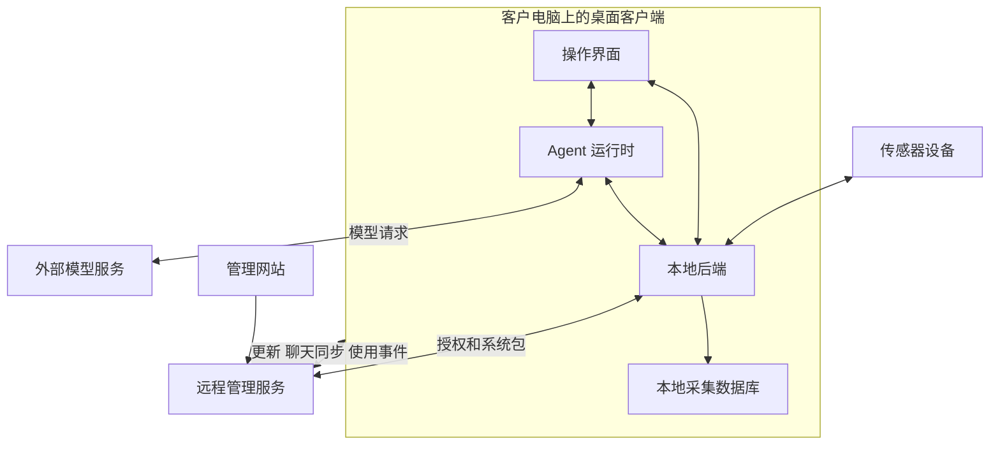
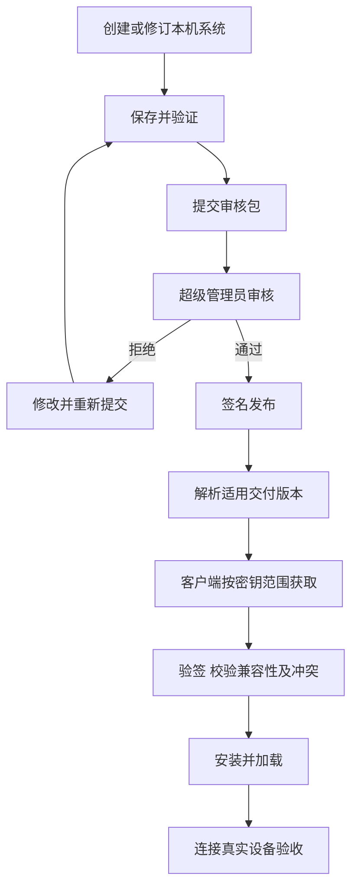
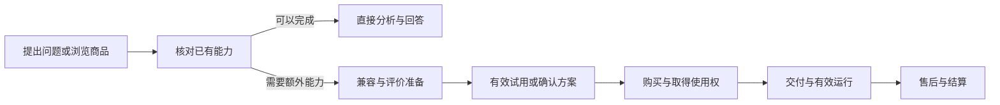

# Shroom 产品整体与客户端服务端协同设计说明

- 版本：1.4
- 整理日期：2026-10-20
- 状态：整体产品设计合并版
- 阅读对象：产品、研发、交付、测试、运营、商务和财务人员
- 适用范围：Shroom 桌面客户端、配套管理服务，以及拟发展的算法交易能力
- 合并依据：[协同设计 1.3](客户端与服务端协同设计说明-v1.3.md)与[算法交易方向 0.2](PRD-Shroom-算法交易平台-v0.2.md)
- 日常主入口：[客户端与服务端协同设计说明](客户端与服务端协同设计说明.md)
- 本轮版本快照：[合并版 1.4](客户端与服务端协同设计说明-v1.4.md)

Shroom 帮助客户连接传感器、采集保存数据，并围绕具体问题完成展示、回放、分析及结果交付。客户端承担本机设备与数据任务，Agent 按需组织已接入能力，管理服务负责授权、公司系统交付、更新与允许上传的反馈。算法交易与生态作为产品的一条发展方向，在现有能力不足且客户需要额外算法时提供验证、采购和定制路径。

本版将原协同设计 1.3 与算法交易 PRD 0.2 合为一个整体产品入口。共用的角色、业务对象、软件与算法权益、Agent、数据保护及验收分别并入公共章节，商品、交易、试用、售后、结算和探索门槛集中在第八章。

阅读顺序：

1. 第一章看产品主线、用户价值与发展方向。
2. 第二至七章看跨端分工、权益、已有业务流程及拟新增的公共约束。
3. 第八章看算法交易方向的商品与交易闭环，以及何时继续或暂停投入。
4. 第九章看版本交付与验收，第十章看统一决策与修订记录。

| 状态 | 阅读约定 |
| --- | --- |
| 现行说明 | 继承来源文档描述的机制；本轮合并不构成代码或部署状态的重新核验 |
| 产品已确认 | 已确认的产品政策或方向，仍与实现、测试和生产验收分别记录 |
| 产品要求 | 需要设计与验证的目标，不代表界面、字段或交易能力已经上线 |
| 建议方案或待决策 | 尚需选择和确认，不能自动覆盖已确认规则或现行专项契约 |

软件正常到期和对话分析的既有产品决策继续保留。算法购买不自动附带宿主续期、数据外传或第三方再分发资格。原来免费或已购能力可完成任务时直接使用，市场收入不能替代核心任务可靠性。

生产部署、迁移、安装包与真机结果按第九章单独记录。现有 v1.3 实现进展另查[实现与交付记录](v1.3-implementation-and-release.md)；产品版本合并不直接提升任何能力的实测状态。字段和接口变化仍以对应契约维护，已确认变更须同步契约、实现与验证记录。

## 1 整体产品与发展方向

### 产品定位

Shroom 是面向压力与触觉传感器的桌面采集、可视化和分析软件。系统通过协议、线序、点位、算法和显示配置，将不同设备的数据转换为可理解的压力画面、统计指标和历史记录。

配套管理服务负责账号、客户、合同、软件密钥、电脑授权、公司系统发布、聊天同步和使用分析，使本机制作的系统能够经过审核、签名后交付给持有相应授权的客户端。

### 整体产品主线与能力扩展

整体产品先帮助客户可靠接入设备、保存可解释的数据，并围绕具体问题完成回放、比较、判断和结果交付。Agent 是按需组织已有能力的交互入口，客户也可以直接使用对应工具。

算法交易是这一产品主线的能力扩展方向：已有免费或已购能力足够时直接完成任务；存在明确缺口时，再进入算法验证、购买或定制。市场成交不能替代采集可靠性、数据可信度和客户任务完成。

### 算法交易与生态发展方向

**方向定位已确认，交易能力仍处于探索与评审。** 算法类型保持开放，卖家采用公司自营与邀请开发者；具体商品、运行格式、价格、费率和投入顺序按试点证据决定。

建设一个围绕 Shroom 设备与数据任务的算法交易平台。买家可以判断适用性、试用、购买、运行和获得支持；卖家可以提交能力、取得收入并持续维护；平台负责商品可信度、交易、授权、交付记录、争议和结算。

算法类型保持开放，客户可通过与 Agent 对话提出具体问题，也可直接浏览商品。先核对已有能力能否解决问题，再判断是否需要付费算法或定制服务。本机算法包、云端 API 与定制服务共享必要的商品、身份、订单和售后记录，交付与验收分别设计。

首阶段使用真实客户与邀请卖家做人工撮合或小额交易，分别验证自营销售、第三方标准商品及定制项目。根据需求、执行格式和交付证据选择先投入的交易方式；本机包为优先候选，云端能力与定制服务保留探索，不预先承诺三类商品同时完成自动交易。

平台出售的默认对象是约定范围内的算法使用权及支持服务。源码交付、模型权利转让、再分发和独占定制必须单独约定。付款、拿到包、安装完成和业务效果达标分别记录。

### 主要使用场景

| 场景 | 操作者 | 完成的工作 |
| --- | --- | --- |
| 实时监测与采集 | 客户端使用者 | 选择系统、连接设备、观察压力、开始和结束采集 |
| 历史分析与导出 | 客户端使用者 | 筛选记录、回放过程、查看变化、导出 CSV |
| 定制系统制作 | 员工或系统作者 | 配置协议、线序、点位、算法和显示方式，验证实际设备 |
| 公司系统交付 | 员工与超级管理员 | 提交审核包、审查差异、签名发布、调整交付版本 |
| 授权与客户管理 | 管理网站账号 | 关联合同、签发密钥、管理有效期和电脑数量 |
| 使用支持与维护 | 超级管理员与运维 | 查看已上传的聊天和统计、定位错误、发布更新或回退 |
| 额外算法能力获取（发展方向） | 客户操作者与采购 | 核对已有能力后，验证、采购或定制需要的额外算法 |
| 算法供给与经营（发展方向） | 自营团队、邀请开发者与运营 | 提交商品、维护版本、处理售后并核对结算 |

### 阶段目标与用户价值

**建议方案，待试点确认**：首阶段优先验证“员工完成设备配置与交付，客户独立完成一次有效采集、保存、回放与导出”。客户采集可靠性与员工交付效率作为主要投入方向，客户自助训练单独试点，不预设其付费价值。

| 参与者 | 需要取得的结果 | 需要验证的问题 |
| --- | --- | --- |
| 客户端操作者 | 在支持的设备和环境中取得可解释、可保存、可复核的数据 | 能否独立完成核心任务，在哪里需要员工接管 |
| 系统制作与交付员工 | 将设备资料转为可复用、可验收的系统 | 配置和排障耗时是否下降，交付能否重复完成 |
| 购买决策者 | 明确软件权益、适用范围和交付结果 | 购买的是设备配套使用权、系统使用权还是其他权益 |
| 客户验收人 | 根据约定任务确认结果 | 由谁验收，什么证据足以通过，遗留项如何处理 |

购买决策者、实际操作者与验收人分别记录，不能用管理网站账号或软件密钥代替其业务身份。主目标和支持范围由试点需求确认后形成阶段基线。

### 成功指标与统计口径

**产品要求**：先通过试点建立基线，再确认目标值、统计周期和样本范围。下表是建议指标，不构成已达到的性能或成功率承诺。

| 指标 | 口径 | 取证方式 |
| --- | --- | --- |
| 首次任务独立成功率 | 分母为纳入试点且环境准备完成的首次任务；分子为用户未由员工接管，独立取得目标通道有效帧、采集落盘并完成回放和导出的任务；员工接管后的完成情况另列 | 试点任务记录、本机采集与导出证据 |
| 首次有效数据耗时 | 从有效授权、所需系统和设备就绪后，用户开始连接操作，到目标通道首个有效帧；环境准备耗时另计 | 操作记录与首帧证据，不冒充设备采样延迟 |
| 采集完整性 | 在明确数据阶段及存储策略下，比较应提交与实际提交的历史行，并报告缺失区间及原因 | 分通道接收、入队和数据库提交证据，详见第四章 |
| 客户交付成功率 | 分母为基线约定验收日期落在统计周期内的全部交付任务，包含延期、失败和未完成；分子为统计截止日已在客户环境通过验收的任务，按期与逾期通过分别报告 | 交付工单、原定验收日期与客户验收记录 |
| 交付周期与支持工时 | 从协议、样机和验收要求齐备到客户验收；等待时间单列，报告中位数、长尾与未完成账龄；支持工时包含失败和返工投入 | 交付工单与工时记录 |
| Agent 任务收益 | 对同类配置任务比较完成时间、首次应用通过情况、人工接管和恢复成本；训练任务另评分类效果 | 提案执行记录、人工对照任务及真实设备结果 |

未能完成环境准备的试点任务及其原因另行记录，不从整体交付结果中省略。聊天与使用事件仅覆盖成功上传且允许观测的样本，不作为全体客户成功率或活跃率的完整分母。新增指标若依赖尚不存在的计数或事件，须先补观测设计，不据此默认扩大上传范围。

整体指标优先反映设备接入、数据保存、分析与客户交付。算法交易的试用、成交、真实复用及双方投入另按第八章分组统计，不用交易收入或商品数量替代整体产品成功。

### 整体业务流程

```text
客户与合同建立
  → 申请或签发软件密钥
  → 客户端激活并取得适用授权
  → 加载内置系统、本机系统或公司系统
  → 连接设备并确认有效数据
  → 实时展示、采集、分析、回放和导出
  → 按各自设置同步聊天与使用事件
  → 管理端分析问题并安排修订和更新
```

系统制作与授权签发可以并行推进。新系统只有完成发布，并处于客户端密钥允许的系统范围内，才能通过公司系统交付通道获取。

客户提出问题后，先核对现有工具、已购权益与数据条件。只有确需额外能力时才转入第八章的交易或定制分支，取得适用能力后回到原任务；该分支不构成每次采集或分析的必经采购步骤。

### 支持范围与客户承诺

**产品要求**：每次客户交付形成明确的支持范围，销售说明、系统配置与验收记录使用同一份基线。

| 范围 | 交付时明确的内容 |
| --- | --- |
| 设备与协议 | 型号、固件或协议版本、连接方式、原始点数与映射矩阵 |
| 运行环境 | 操作系统、电脑配置、驱动和所需本地组件 |
| 容量与时效 | 传感器和通道数、输入节奏、存储策略、连续运行时长及显示要求 |
| 网络与授权 | 首次联网、授权刷新、离线条件、电脑数量与到期规则 |
| 数据含义 | 原始读数、相对量或已标定物理量，单位及适用边界 |
| 交付版本 | 安装包、网页构建与系统包的组合及最低宿主能力 |
| 服务与权益 | 可用系统、期限、升级维护、支持方式、验收人与遗留项 |

超出已验证范围的能力需单独评估。支持某个设备或模板不自动构成对所有设备、严格硬件同步或所有离线场景的承诺。

## 2 总体架构与运行边界

### 组件职责

| 组件 | 运行位置 | 职责与主要数据 |
| --- | --- | --- |
| 传感器设备 | 外部硬件 | 采样并输出设备协议数据 |
| 桌面操作界面 | Electron 渲染进程 | 系统选择、连接控制、画面、图表、采集回放、配置器和 Agent 对话 |
| 本地后端 | 客户电脑，当前由 Electron 主进程加载 | 串口、协议、映射、算法编排、归零、本地存储、HTTP 控制和实时发布 |
| Agent 运行时 | 客户电脑上的独立进程 | 模型请求、受限工具、任务、提案和会话管理 |
| Python 算法组件 | 客户电脑上的相关子进程 | 执行已接入的算法和固定训练组件 |
| 远程管理服务 | 服务端部署环境 | 账号、合同、客户、密钥、系统包、网页发布、聊天接收和统计 |
| 外部模型服务 | 用户配置的模型服务环境 | 根据请求内容生成回答和工具调用 |
| 交易服务能力（发展方向） | 既有管理服务扩展或按部署方案提供 | 商品、组织订单、算法权益、售后与结算，具体实现待确认 |
| 云端算法服务（可选交付） | 平台或经审核卖家的计算环境 | 执行经授权的数据任务，与外部对话模型服务分别说明 |

### 协作关系



图中连接表示职责关系，具体传输方式见第七章。远程管理服务与外部模型服务是不同的接收方；聊天同步开关不控制 Agent 向模型服务发出的正常任务请求。

### 本地与联网能力

实时采集、画面更新、本地存储和已有记录回放在客户电脑上完成。它们仍受当前授权和运行状态约束，不能据此推导为任何情况下均可离线使用。

在线授权刷新、公司系统包下载、网页更新、聊天同步、使用统计以及外部模型请求需要相应网络连接。断网时分别采用各自的凭证、缓存或队列规则，没有统一的“断网即全部允许”策略。

多传感器通过系统和传感器身份区分。普通多串口并发接收及软件配帧不能证明硬件同步采样；需要严格同步时，应另外确认设备时钟、触发或硬件时间戳能力。

交易控制、云端算法计算与现有模型请求是不同职责。第八章描述拟新增的商品和交易关系，不改变本地采集链路，也不表示已经存在支付、商业包隔离或云端算法接口。

## 3 角色权限与核心业务对象

### 账号角色与操作身份

| 角色或身份 | 主要权限 | 数据范围或限制 |
| --- | --- | --- |
| 超级管理员 `super_admin` | 审批无合同申请、管理电脑限制、审核发布公司系统、调整版本、查看聊天和统计 | 密钥全量可见；聊天及统计还要求账号处于启用状态 |
| 管理员 `admin` | 在其权限内生成和管理密钥 | 密钥可见范围为本人及下级；飞书合同可读取全部 |
| 子账号 `user` | 在其权限内生成和管理本人密钥 | 密钥仅本人可见；飞书合同按账号姓名与提交人精确匹配 |
| 系统制作员工 | 使用登录会话或受限员工令牌提交审核包、读取允许修订的已发布原包 | 提交权限不包含审核、发布和客户版本管理权限 |
| 客户端使用者 | 通过软件密钥使用相应系统 | 受密钥范围、期限、电脑授权和本机能力约束 |

合同权限和密钥权限分别判断，不能将“管理员可看下级密钥”套用为合同筛选规则。员工是业务操作身份，实际管理端权限仍由账号角色和所用凭据决定。

### 算法交易方向的角色与职责

**产品要求与建议分工。** 下列角色随交易方向引入，实际权限和责任人待对应阶段确认；原有网站角色不自动获得交易审批或财务权限。

以下为建议分工，具体人员在立项时指定。

| 角色 | 职责 | 需要取得的结果 |
| --- | --- | --- |
| 买家操作者 | 选择任务、确认数据、试用与运行 | 在目标设备和数据上完成约定任务 |
| 企业采购或组织管理员 | 下单、确认授权组织与电脑数量、管理成员 | 价格与权益明确，订单和使用范围可核对 |
| 自营算法团队 | 提供首批商品与维护样例 | 建立可复用的商品和交付标准 |
| 邀请开发者 | 提交包或服务、声明来源与依赖、维护支持 | 获得真实试用、成交和可核对结算 |
| 产品与平台运营 | 目录、交易规则、卖家入驻、争议与退出 | 供需匹配并形成可持续交易 |
| 算法与技术审核 | 兼容性、基准、执行权限和资源评估 | 准入证据明确，风险版本可隔离 |
| 客户支持与交付 | 安装排障、效果问题归类和升级 | 解决使用问题，记录每单支持成本 |
| 财务与商务 | 收款、退款、结算、合同及开票责任 | 订单、支付、授权和结算能够对账 |

同一企业可以同时是买家和卖家。商品提交人及直接业务负责人不得自行批准其版本，也不得单独裁定相关争议；自营与第三方商品均由回避直接利益关系的审核及售后复核角色处理。人员不足时暂停对应审批，或交给预先指定且同样满足回避条件的替代负责人，不以更换账号代替角色回避。

自营商品标明平台关系，采用与第三方一致的证据和售后标准。复核记录参与人、利益关系、依据及结论；无法解决的争议按预先公布的升级路径和时限处理，不要求每笔交易引入外部裁定。卖家收入明细与买家原始数据按职责分别授权。

#### 账户与许可对象

平台新增稳定的用户、组织和卖家身份。订单和算法权益归购买组织或明确的个人账户，软件密钥用于证明宿主权益及其范围，不直接充当长期商店账户主键。组织绑定现有密钥须验证归属，知道一个密钥不能获得他人订单与收入信息。

买家侧区分采购授权、付款、安装使用和组织管理；卖家侧区分商品编辑、提交与财务查看。原有超级管理员身份不自动授予新平台的全部财务操作。

本机许可建议最少包含购买主体、商品、可用版本范围、电脑数量、起止时间、试用或正式状态和升级范围。企业内共享、换机、项目交付和再分发分别约定；软件可运行的电脑数不等于算法授权电脑数。

### 业务对象

| 对象 | 核心含义 | 关联关系 |
| --- | --- | --- |
| 客户 | 公司资料、业务归属与状态 | 可关联合同、密钥和客户专属版本配置 |
| 合同 | 飞书维护的业务依据 | 供管理网站展示、选择和绑定 |
| 软件密钥 | 软件使用凭据 | 包含或关联系统范围、期限和生命周期状态 |
| 电脑授权 | 某次电脑安装身份的使用登记 | 与密钥、本机身份摘要和签名凭证关联 |
| 展示系统 | 一组可运行的设备与展示定义 | 包含传感器、协议、映射、算法与显示配置 |
| 系统包与发布版本 | 经过审核并签名的交付内容 | 关联稳定系统 ID、版本基线和交付版本指针 |
| 采集记录 | 一次采集会话内保存的数据 | 关联系统、传感器通道、时间与数据阶段 |
| Agent 会话 | 消息、任务、提案与附件引用 | 本地持久保存，按设置同步会话快照 |

#### 算法交易方向的新增对象

产品层至少区分用户、组织、卖家、商品、执行版本、SKU、试用、订单、支付、使用权、安装实例或云任务、运行证据、售后单与结算单。商品和版本不能混为同一个 ID，订单和授权也不能由一个密钥替代。

### 身份区分规则

- 电脑授权数量限制的是运行软件的电脑安装身份，不是连接的传感器数量。
- 系统名称用于显示，稳定系统 ID 用于识别，不能依靠名称相似判定目标。
- `sensorId` 标识系统内传感器，COM 号标识某次连接的物理串口；COM 变化不应重命名历史通道。
- 系统发布版本、安装包版本和网页构建版本是不同对象，需要分别记录。
- 软件密钥、模型 API Key、员工提交令牌各有用途，不能互相替用。

### 软件权益与业务终止

**产品要求**：订单或交付约定应说明系统范围、电脑数、期限、升级维护和支持范围。全部授权、分类授权及固定范围授权是否包含未来新增系统，需要有业务示例并与签发规则一致。

| 业务动作 | 影响对象与边界 | 需要确认的业务结果 |
| --- | --- | --- |
| 停用或删除客户档案 | 客户资料及其关联信息；按现行规则，不单独阻断有效密钥的公司系统范围 | 是否还需执行独立的密钥或交付操作 |
| 停止续费 | 后续服务安排 | 既有密钥按其期限和状态处理，不把续费意向当作即时吊销指令 |
| 暂停或吊销密钥 | 对应使用凭据 | 适用电脑与系统、在线生效和离线约束、当前采集处理 |
| 解绑电脑 | 指定电脑安装身份的登记 | 下次联网检查及离线凭证期限，不能承诺瞬间切断 |
| 停止系统交付或撤回版本 | 系统目录、版本指针及对应发布内容 | 新下载、已安装和运行中的不同影响 |
| 合同终止或退货 | 需执行的客户、密钥和交付业务动作 | 操作责任人、处理范围、生效条件及完成证据 |

**已确认产品规则，待实现核对与验收**：软件密钥正常到期后立即停止采集，不设继续采集的宽限期；已有记录及到期前已接收、待提交的数据继续保存在当前采集数据库。到期后允许查看历史、回放及使用 Agent 分析已有数据，分析与报告内容可在软件内查看，禁止采集数据和分析结果导出。

**仍待决策**：凭证失效但密钥尚未到期、暂停、吊销、电脑解绑等其他状态的处理细则，以及批量终止业务的操作流程。客户档案、合同和密钥状态分别管理，不能以修改其中一个对象代替完整业务处理。

### 交易方向的软件与算法组合权益

**拟实施的组合方案，尚需确认。** 软件正常到期仍执行本章与第四章已确认规则；算法订单不能自动附带宿主续期或改变到期导出限制。

下面是建议的商业算法权益组合，尚需产品确认；“有效”均包含目标系统、电脑、功能与版本范围，不能只看是否付款。

| 软件权益 | 算法权益 | 实时采集与付费算法 | 对已有记录运行付费算法 | 查看已有保存结果 | 数据或结果文件导出 |
| --- | --- | --- | --- | --- | --- |
| 有效 | 有效 | 满足设备与系统条件后允许 | 满足输入条件后允许 | 允许 | 满足软件及商品输出条款后允许 |
| 正常到期 | 有效 | 禁止新增采集 | 按已确认历史权益及兼容条件允许 | 允许 | 禁止 |
| 有效 | 算法许可到期，或相应撤销已在当前端生效 | 采集按软件权益处理，相应付费算法不再运行 | 不再执行被限制范围的付费算法 | 建议保留可读，不删除原始数据 | 自有数据按软件权益；已保存结果按购买时条款，建议允许保留原有交付权 |
| 正常到期 | 算法许可到期，或相应撤销已在当前端生效 | 禁止新增采集及相应付费算法运行 | 不再执行被限制范围的付费算法，其他合法历史能力另判 | 建议保留可读 | 禁止 |

退款属于资金状态，权益矩阵依据当前运行端已生效的许可判断。退款完成但离线撤销尚未生效时，标明撤销待生效及最迟窗口，不能显示已全面停用；部分退款仅按售后批准范围调整相应权益，补偿性退款不自动撤销许可。

该矩阵用于 Shroom 内的执行与导出。若商品允许其他系统独立调用云端 API，应另设相应 SKU 与调用、数据和输出条款；不能据此解除 Shroom 内既有的到期限制。是否将独立调用纳入首版，仍待需求验证。

暂停、吊销、系统范围变更和凭证失效不能套用正常到期的全部权益，需按相应规则决定。历史算法付费不等于外部模型调用免费；Agent 服务配置与费用另计。

下单确认页应直述“购买后仍需要的宿主软件权益”。若算法期限跨越软件期限，显示影响和续期入口，不让买家误以为算法购买自动包含软件续费。试点另评估是否需要限定能力的历史分析基础运行环境，不在本版默认新增免费权益。

以客户目标任务说明实际可用期限：例如需要导出报告的任务，须同时满足宿主导出权益与相应算法、输出条款。报价展示算法、宿主及必须服务的完整费用和期限错位影响，用实际接受或拒绝记录验证购买意愿；因双重授权放弃采购或续费的原因单列，不以已提示依赖替代商业接受度验证。

## 4 核心业务流程

### 客户合同与密钥签发

合同以飞书为维护来源。管理网站读取账号可见合同，供操作者选择并绑定；不在网站直接修改飞书合同原始内容。

1. 操作者填写系统范围、有效期和数量等签发参数。
2. 普通账号选择当前可见合同，服务端重新校验合同身份和可见范围，带入合同客户信息。
3. 无合同场景保存生成参数和申请原因，由超级管理员批准或拒绝。
4. 批准时，密钥生成与申请状态更新在同一事务内完成；生成的密钥归申请人。
5. 超级管理员可选择无合同直接签发，不经过普通申请流程。
6. 操作者将生成的密钥交付给客户，客户进入桌面授权流程。

通知发送异常不等于申请创建失败；申请状态以管理网站保存的业务结果为准。客户档案、合同可见范围和密钥归属仍分别按各自规则管理。

### 客户端激活与电脑授权

客户输入密钥后，客户端与服务端核对适用的密钥状态、期限、系统范围及电脑授权规则。服务端首次有效激活会更新相应状态；客户端据此组织可访问系统。

| 检查项 | 通过条件 | 不通过时的处理 |
| --- | --- | --- |
| 密钥有效性 | 已登记且满足适用的状态、签名和期限规则 | 显示未登记、无效、暂停、吊销或过期等原因 |
| 系统范围 | 目标系统在当前密钥允许范围内 | 拒绝进入或连接相应系统 |
| 电脑名额 | 当前电脑已登记，或仍有可登记名额 | 拒绝新增登记并显示限额原因 |
| 离线凭证 | 本机绑定和签名正确，且凭证、密钥均未过期 | 需要联网刷新或处理授权 |
| 本机能力 | 已安装系统及其依赖可运行 | 提示安装失败、缺失依赖或需升级软件 |

新版在线授权首次需要联网，启动时及运行中每 2 小时刷新。成功后保存与本机、密钥摘要绑定的签名凭证，最长 7 天，且不能超过密钥到期时间。网络失败时只接受仍有效的凭证；服务端明确拒绝后不能以断网缓存继续放行。

电脑上限 `0` 表示不限量，其他期限与状态规则仍然适用。同机正常升级通常不重复占名额；重装、克隆或本机身份文件变化可能影响身份。解绑会在联网检查后生效，已经离线的电脑最迟受凭证期限约束。

旧不限量 RSA 离线码保留原纯离线规则。需要电脑限制时重新签发包含相应限制的新版本离线码，并配合支持该能力的客户端；不能通过网页给旧签名追加原本不存在的限制。

**示例**：客户甲的密钥允许系统 A、系统 B，上限为 3 台电脑。第四台登记时被拒绝。管理员解绑旧电脑后，旧电脑下次联网校验会被拒绝；该操作不会瞬间删除其离线凭证。

### 运行中授权失效与数据收尾

**产品要求**：区分网络失败、凭证到期、密钥到期和服务端明确拒绝。运行中授权限制与采集收尾应共同验收，不能只检查入口是否拒绝。

| 情况 | 现行授权边界 | 需要补充的处理 |
| --- | --- | --- |
| 网络失败且本机凭证仍有效 | 按有效凭证及密钥范围处理 | 展示离线状态与有效期限，避免误报为吊销 |
| 本机凭证失效但密钥尚未到期 | 不满足继续按该凭证放行的条件 | 明确刷新入口、当前采集停止及尾部提交规则 |
| 软件密钥正常到期 | 立即停止采集，禁止新建或继续采集 | 已接收数据继续提交当前库，允许历史回放及 Agent 分析，禁止数据和分析结果导出 |
| 服务端明确拒绝 | 不得继续以缓存授权放行 | 明确拒绝原因、受控结束步骤及已保存数据范围 |
| 电脑解绑或系统范围变化 | 按适用授权检查结果处理 | 明确受影响通道、任务与生效状态 |

**密钥正常到期的已确认产品规则**：

1. 到达密钥有效期终点时，立即停止为本次采集接收新数据，不允许开始或继续采集；已知到期时间应在本机到达时生效，不等待下一次每 2 小时联网刷新。断网不延长密钥期限，休眠恢复后先核对到期状态再允许采集。
2. 到期前已接收且符合本次存储策略的数据，包括待写队列，继续提交当前采集数据库，不因到期丢弃队列或另建数据库。提交失败时显示实际保存范围及异常，不能仅因停止采集而宣称全部保存成功。
3. 本次记录标记为授权到期中断，保留停止原因、实际采集范围及提交结果；停止新增接收与尾部提交完成分别表达。
4. 允许进入已有历史并回放，允许 Agent 分析已有数据，并在软件内展示比较、判断与报告内容。禁止采集数据和分析结果导出为文件；界面、后端、Agent 及批处理等导出入口适用同一规则，不能因允许分析而绕过到期限制。

**其他授权失效情形的建议方案，待决策**：限制新建受限操作，对已接收数据执行必要的队列提交和结果核对；采集记录保留结束原因及实际保存范围，不能将授权中断标为正常完成。提前预警时点，以及除密钥正常到期外的停止时点和历史权益，另行确认。数据落盘收尾不等于获得继续采集许可。

验收时在采集中分别触发上述情况，检查授权状态、采集结束原因、已提交数据、待写数据及历史访问结果。停止接收、提交完成与保存失败应分别有确定证据。

密钥到期验收还应覆盖运行中、断网、重启及休眠恢复：确认到期后无新增采集数据，尾部队列仍写入原库，记录可查看和回放，Agent 可以分析选定历史数据且结果可在软件内查看，采集数据及分析结果的文件导出请求被拒绝。该产品决策尚不构成以上场景已实测通过的结论。

### 设备连接与实时数据

用户确认进入目标系统后，为每个传感器选择实际枚举出的串口，按系统定义建立接收和处理链路。

```text
选择系统及传感器
  → 选择物理串口并打开
  → 按协议分帧与解码
  → 执行线序与点位映射
  → 按系统配置执行算法与归零
  → 形成标准压力帧
  → 发布到界面并按采集状态保存
```

| 检查点 | 已证明的内容 | 还需继续确认的内容 |
| --- | --- | --- |
| 已进入系统 | 页面和目标系统加载完成 | 设备连接与实际数据 |
| 串口已打开 | 操作系统允许访问端口 | 分帧、解码、点数和通道 |
| 已收到有效帧 | 处理链产生了可用数据 | 物理方向、量值及持续稳定性 |
| 真实画面正确 | 对应按压显示在正确区域 | 长时间运行和存储结果 |

串口波特率、分隔符或固定长度、数值位宽、字节偏移和原始点数共同构成协议条件。不能因为最终展示矩阵相同，就推断两种设备采用相同协议。

**映射示例**：设备每帧提供 1024 个采样值，系统抽取并重排其中的点位，形成 23×23 的 529 个展示点。协议仍按 1024 点解码，映射定义提供 529 个有效索引，显示和相关统计消费映射后的矩阵。用递增测试值检查索引、换行和首尾位置后，还要通过真实按压确认方向。

没有画面时，先按“串口 → 分帧 → 解码 → 映射 → 算法 → 发布 → 渲染”定位。串口打开或页面预览正常均不能代替有效帧检查。

### 量值等级与测量可信度

**产品要求**：每个交付系统声明其数值等级，界面、统计与导出使用一致的单位和解释。

| 数值等级 | 交付声明要求 |
| --- | --- |
| 原始读数 | 说明数据来源、编码和阶段，不直接标注为压力物理单位 |
| 相对量 | 说明归一化、归零或相对比较依据，以及跨设备、跨次采集的比较限制 |
| 已标定物理量 | 说明单位、标定版本、适用设备、量程与有效条件；定量交付另约定误差和重复性验收方法 |

点位方向正确只能证明映射的一部分。颜色范围、平滑效果和点距设置不能替代量值标定；使用自动色阶进行前后比较时，应展示实际数值范围，避免将颜色相同解释为压力相同。

**待决策**：各型号承诺的量值等级、校准责任与复核周期，以及需要定量验收的客户场景。在缺少依据时按可证明的读数或相对量说明，不能补造单位或校准结论。

### 采集存储与停止

开始采集会建立本次采集会话并启用存储状态。本地后端按通道、存储频率和磁盘条件判断是否接收历史行，再通过队列批量提交 SQLite。

1. 用户确认实时数据与目标通道正确。
2. 设置本次采集信息并开始采集。
3. 后端按系统和通道保存数据、时间及可用身份信息。
4. 用户停止采集，后端关闭采集状态并提交待写队列。
5. 在历史列表检查记录，再执行回放或导出。

实时画面正常不代表数据正在落库，入队成功也不代表数据库事务已提交。磁盘空间不足、写入失败和停止时的队列提交需要分别反馈。

采样率、算法执行率、存储率、网络发布率和显示帧率分别定义。主链路算法可能影响可存储的处理帧率；屏幕刷新率不能作为完整保存设备原始数据的证据。

### 采集结果与完整性

**产品要求**：每次采集形成可核对的结果摘要，按通道记录起止时间、数据覆盖区间、存储策略、实际提交结果、断流或写入异常及结束原因。以下为产品状态语义，具体接口枚举另行确定。

| 状态 | 对用户表达的结果 |
| --- | --- |
| 准备中 | 正在核对目标通道、权限和存储条件，尚不能宣称已采集 |
| 采集中 | 正在按策略接收和保存，需能观察写入状态 |
| 收尾中 | 已停止接收本次新数据，仍在提交或核对尾部数据 |
| 完成 | 约定范围内的数据提交完成，记录可读取 |
| 中断 | 因授权、断流、退出等原因提前结束，保留实际覆盖范围 |
| 保存异常 | 提交失败或结果不确定，不能显示为保存成功 |

完整性应沿实际链路分别核对接收有效帧、符合存储策略的待存记录、入队记录和已提交记录。若以比例报告保存完成率，分母为可核对的“按本次存储策略应提交的记录数”，分子为实际提交数；分母不可确定时报告已提交数、覆盖区间与已知异常，不生成完整率。

主动降采样、无效帧丢弃、算法抑制、断流和写入失败分别解释。没有硬件计数依据时，只证明软件可观测范围，不能据此声称设备原始数据零丢失。收尾失败时，应提供记录核查和再次读取的路径。

### 历史回放与导出

用户选择历史记录后，本地后端加载对应数据并以回放来源回注统一发布边界。界面使用同一套通道身份显示历史内容，避免把实时流混入回放。

回放操作包括播放、暂停、倍速和定位。多通道需要依据记录时间对齐，不能假定各通道相同数组下标就是同一时刻。

CSV 导出独立选择记录和选项。导出命令接收、任务执行和文件完成是不同状态，交付时应检查实际文件、通道身份和数据列。Manifest 历史与旧型号历史的内部存储形状可能不同，不能将所有历史行都描述成统一的网络帧格式。

**已确认产品规则，待实现核对与验收**：密钥正常到期后仍可查看和回放既有记录，并使用 Agent 分析历史数据；禁止采集数据及分析结果导出。读取回放、执行分析与执行导出的授权条件分别核验。

算法输出是否进入历史和 CSV 取决于接入路径：Manifest 主链路算法可能改变存储内容；算法超市会话旁路不回写标准帧和历史。原生系统专项算法按对应能力说明。

### 历史结果追溯

**产品要求**：稳定系统 ID、通道和矩阵尺寸用于识别输入身份，还需保留解释历史结果的处理依据。即使尺寸不变，映射、滤波、归零和算法变化也可能改变数值含义。

| 依据 | 需要确定的追溯范围 |
| --- | --- |
| 交付与配置 | 系统包版本，或本机配置的不可变修订与摘要；必要配置快照 |
| 数据处理 | 协议、映射、算法及特征版本，存储数据阶段 |
| 量值与归零 | 单位、校准依据、归零方法及可追溯的参考状态 |
| 时间与存储 | 时间来源、存储策略、已知采样节奏和数据缺口 |
| 再分析结果 | 原采集记录、采用的新算法或配置及计算时间 |

原记录回放与采用新算法重新分析分别标识。升级后，不因当前配置变化而静默改写原记录的解释和导出口径；旧记录缺少依据时标为未知，不用当前版本补填历史事实。

**待决策**：各存储路径能够保存的字段、快照与摘要方式、旧记录展示和迁移方案。具体实现先评估容量与兼容性，不要求所有设备无差别保存全部原始串口数据。

### 公司系统制作与发布

员工使用配置器或 Agent 创建系统，在本机核对协议、映射、画面和算法。系统包只包含当前宿主支持且导出校验通过的配置和相关依赖；采集库、聊天记录与模型密钥不进入系统包。



提交入口使用受限员工凭据，仅提交磁盘中已经保存的配置。编辑器尚未保存的修改不进入审核包；提交成功只表示进入待审核。

同一系统 ID 同时只能有一个待审提交。更新已发布系统须明确版本基线，发布时重新核对；基线已变化的旧包需要重新处理。同 ID 更新不能破坏传感器身份、输出通道和矩阵尺寸，确需改变这些输入身份时应创建新系统 ID。

正式受管系统只读，修订时从支持派生的已发布包创建独立本机草稿。不能自动派生的包应按软件提示处理，不能丢弃其算法依赖后当作完整修订。

### 公司系统授权与版本交付

公司系统目录和包下载依据有效、已登记密钥中的系统范围。客户关联用于业务信息和可选版本覆盖，不是额外下载门槛；客户缺失、停用或删除不会单独阻断仍有效密钥的公司系统范围。聊天上传的客户校验规则不能套用到此接口。

适用版本按以下顺序解析：

1. 已关联客户的专属版本指针。
2. 系统的全体默认版本指针。
3. 没有适用指针时，使用最新已发布版本。

如果明确指针指向已撤回或缺失版本，停止交付，不自动选择其他版本。固定范围旧密钥不会因新增公司系统而自动扩大范围；全部授权和分类授权按各自定义展开。

| 操作 | 业务含义 | 客户端行为 |
| --- | --- | --- |
| 发布 | 形成可交付的不可变签名版本 | 满足授权及兼容条件后可获取 |
| 推广 | 调整客户或全体默认版本指针 | 下次同步解析新的适用版本 |
| 回退 | 将版本指针指回仍已发布的旧版 | 下次同步按旧版交付 |
| 撤回 | 停用某个发布版本 | 指向该版本的客户停止取得该系统，不自动改用旧版 |

客户端通常每 6 小时复查，也可手动刷新；签名目录最长有效 24 小时。管理端操作不能立即切断所有断网客户端。安装前校验目录和包签名、摘要、最低软件能力及本机冲突，失败时保留已有内容并提示原因。

#### 发布影响与撤回边界

按上述现行版本解析规则，没有客户专属指针及全体默认指针时，新发布版本可能改变相关客户的目标版本。因此，发布不能默认理解为“尚未影响客户”。

**建议方案，待决策**：首次发布建立明确交付基线，后续发布形成候选版本，经显式推广再改变客户目标版本。若继续采用无适用指针时交付最新发布版本的方式，发布确认应展示实际受影响范围。在契约、实现与数据迁移完成前，仍执行现行版本解析规则。

**产品要求**：撤回时分别说明未下载、已下载待安装、已安装、正在运行和断网客户端的影响，并记录替代方案及处理进度。停止交付、版本告警和限制运行是不同结果，不能以一个“已撤回”状态代替全部确认。

**待决策**：撤回是否影响已安装版本、是否另设问题版本停用机制、当前采集如何收尾以及断网客户端如何处理。电脑授权凭证最长 7 天与签名目录最长 24 小时分别约束不同对象，不能直接推导为同一个撤回生效时限。

验收至少覆盖固定旧版本、使用全体默认版本、无适用指针及指向撤回版本的客户；发布新版前后核对其目标版本，撤回时再检查上述安装和运行状态。

已登记的离线码可以在联网时按对应规则拉取包；完全断网的文件导入不属于当前交付能力。原生模板副本依赖安装包内的来源系统，新增原生能力仍需更新安装包。

公司包授权与版本规则以[服务端系统包契约](../../key/docs/system-packages.md)为准。

### Agent 配置任务与提案应用

Agent 在任务开始时识别当前系统，读取允许访问的状态和能力目录，再生成受支持的配置或连接提案。

1. 用户提出需求，必要时提供协议、点位或图片资料。
2. Agent 读取真实系统身份、已有配置和本机能力。
3. 生成提案，展示摘要及适用的修改前后内容。
4. 用户点击应用，运行时重新核对版本、权限和当前状态。
5. 执行支持的写入或连接，并读取验证结果。
6. 设备类结果继续检查有效帧，算法类结果继续检查绑定和实际输出。

连接提案必须指向明确的系统、传感器和当前枚举出的串口。模型回答结束不能代替操作成功；停止任务不会撤销已经完成的更改。

恢复仅适用于支持恢复且版本仍匹配的已应用修改。写入期间中断或缺少完整回执时，保留不确定结果并检查实际状态，不自动重复执行。

**产品要求**：不确定结果需有可操作的核查入口，展示已确认完成、尚未执行与待核查步骤，以及已保存或已改变的对象。用户取消或重启后，应先核对实际状态，再决定继续、恢复或人工处理。

验收分别在“保存完成、绑定前”和“绑定完成、回执前”中断任务，检查重启后能否识别实际结果、避免重复创建，并给出可执行的后续动作。是否支持逐步继续及各工具的恢复范围，按能力列明，不承诺所有任务均可自动撤销。

### Agent 分类算法训练与接入

以“使用拍打和抚摸记录训练识别算法”为例：

1. 在当前系统选择带标签的采集记录，确认读取范围和用途。
2. 至少提供两类开发数据；独立验证数据使用另外采集的记录，不能把同次采集拆到开发与独立验证两组。
3. 用户明确确认选数后，运行时才读取允许范围的压力帧。
4. 本机 CPU 比较内置分类候选，生成模型和真实评价报告。
5. 用户查看评价方式、错分、未知结果及数据范围，再应用保存新版本。
6. 将已保存算法绑定到目标系统和传感器，并启用实时实例。
7. 兼容帧到达后积累窗口，检查类别输出与实际动作是否一致。

当前内置训练候选包括逻辑回归、决策树和随机森林，训练最长 60 秒且可取消。完整压力帧和逐窗训练特征留在本机；开发集有界摘要、模型摘要和评价结果可进入模型任务请求。

保存、绑定、启用和观察到有效分类是不同状态。实时运行还需核对点数、数据阶段、矩阵、特征版本和采样节奏；断流或输入不匹配时不能补造压力帧维持识别。

开发集结果不能当作独立验证准确率，独立验证结果也只代表选定记录。详细数量限制、报告字段和运行边界见[内置 Agent 说明](embedded-agent.md)。

#### Agent 价值与效果验收

**建议方案，待试点确认**：员工配置提效与客户自助训练分别评价。前者检查完成同类设备配置所需时间、首次应用成功、人工接管和恢复成本；后者先验证用户能否准备有效标签并理解评价结果，再判断是否适合扩大交付。

**产品要求**：根据具体用途约定可接受的误报、漏报、未知结果与识别延迟。独立采集记录不自动代表跨人员、跨设备或跨日期有效；需要这些能力时，验证数据应覆盖相应变化，并记录适用范围。

**待决策**：首批任务和用户、模型服务费用承担方、失败后的人工支持范围及分类效果门槛。模型回答、训练结束、保存成功和真实业务任务完成分别统计。

#### 通过对话按需完成分析与报告

**已确认的交互方向，能力实现与验收待推进**：客户先通过与内置 Agent 聊天提出具体问题，Agent 根据本次问题澄清目标、选择数据与分析方法，再按需完成比较、判断或报告。不要求客户先进入固定分析模块，也不要求为每个设备或业务场景预建完整流程。通用工具是 Agent 的执行基础，不是要求客户先学习和选择的功能清单。

1. 理解具体问题与所需结果。用户只想了解一次变化时直接围绕变化分析；只有评价目标含糊或缺少必要条件时才追问，不要求每次对话完整填写分析表单。
2. 识别并复用本轮已确认的记录、通道、区间和上下文，按既有选数与授权规则读取数据；范围不明确时让用户选择，不自行扩大读取范围。
3. 根据问题组合已支持的数据读取、区间选择、统计和比较能力。本机工具完成可复核计算，Agent 使用实际结果组织解释；不能完成的计算明确说明缺口，并提供可用的替代分析或转交开发、交付支持。
4. 按客户需要输出直接回答、差异说明、带依据的判断或报告，不强制每个问题同时产生比较、判断和报告。报告内容围绕本次问题形成，必要的数值与结论能够追溯到所用记录、区间、参数和工具结果。

分析仍需核对数据阶段、单位和比较依据，不凭热力图外观或有界摘要推断未计算的事实。涉及“更好”“合格”等结论时，先取得相应指标、阈值或用户确认的评价规则；缺少依据时先澄清，或明确只提供描述性结果。

验收从真实客户问题出发，检查是否正确理解问题、是否取得正确范围的数据、计算与结论是否有依据，以及对话后是否解决问题。单次采集解释、记录比较和报告整理可以作为验证样例，不将这些样例固化为客户必须选择的有限入口。没有现成工具的问题不承诺均能自动完成，按实际缺口决定补充通用能力或人工处理。

当前已接入的分类训练分析、评价报告与上述通用历史分析是不同能力，现有手册仍将自动分析报告列为暂未支持，详见[内置 Agent 说明](embedded-agent.md)。密钥正常到期后，产品权益允许 Agent 分析选定历史数据，并在软件内展示分析、比较、判断及报告内容；禁止将采集数据或分析结果导出为文件。权益确认不代表上述通用能力已经实现，分析的数据范围、模型服务配置及上传规则仍按各自约束执行。

#### 对话分析与算法交易方向的衔接

**交易扩展要求，相关市场能力待实现与验收。** 原有对话分析方向保持不变，按问题和已有能力决定是否需要交易分支。

Agent 从客户对话中的具体问题出发，按需组织比较、判断或报告。先核对已有免费工具、已购权益和当前可用能力，能够完成时直接完成，不要求所有分析先进入市场或购买。

需要额外能力时，Agent 查找兼容商品，并说明推荐依据、相对现有方法的增量、验证证据、未验证项、完整费用和可行替代方案。自营身份或推广关系明确展示，推荐记录所据商品版本和条件；不得将形状相同或未验证描述成已可靠适用，也不能隐藏已有能力促成购买。没有合适商品时，说明缺口并生成可编辑的定制需求草稿。

客户需要时提供直接回答、差异说明或报告内容，不强制每个问题都形成报告。计算由已接入工具执行，输出关联数据范围、配置、方法与工具结果；需要新增计算能力时明确缺口，不承诺任意问题均可自动完成。界面、工具和后端分别核验许可、预算与导出权限，不能只依靠 Agent 的语言判断。

购买、追加付费额度、接受定制报价和发送数据到新接收方应展示明确的价格、主体、范围与后果，取得适用授权后执行。算法购买许可、数据读取许可、模型请求与聊天同步分别处理；算法私有源码不作为通用模型上下文默认发送。

## 5 客户端模块设计

### 功能模块

| 模块 | 用户操作与输出 | 前置条件或边界 |
| --- | --- | --- |
| 系统目录 | 分类、搜索、预览、刷新、进入与返回 | 预览不代表已连接设备；可见性与实际运行权限分别核验 |
| 设备接入 | 串口枚举、传感器角色绑定、连接与断开 | 协议、通道及当前授权匹配 |
| 数据处理 | 解码、线序、点位、算法与归零 | 保持处理顺序及各阶段语义 |
| 实时展示 | 点图、热力图、数字矩阵、三维模型与图表 | 按具体系统和渲染器提供能力 |
| 分析工具 | 框选统计、传感点量尺、视角及显示调节 | 量尺依赖可靠点位映射和用户设置的实际点距 |
| 采集与历史 | 本地保存、列表选择、回放、倍速、定位、删除和导出 | 真实入库、通道身份和写入完成需可验证 |
| 系统配置 | 新建、复制、保存、修订与提交审核 | 区分内置、可编辑本机、受管和修订草稿 |
| Agent | 模型设置、附件、选数、提案、执行、历史和同步状态 | 仅调用已接入工具，修改类操作按提案确认执行 |
| 应用服务 | 授权状态、安装包更新、网页缓存、统计设置 | 与采集数据处理分别管理失败和恢复 |
| 算法市场与我的算法（发展方向） | 浏览、验证、购买、安装及权益状态 | 与已有算法启用入口衔接，按第八章推进，不视为已上线 |
| 交易与售后入口（发展方向） | 订单、完整报价、退款和支持记录 | 商品、组织与操作权限分别核验 |

HaLow 等专项接入按适用型号单独说明。人体 HaLow 接收与串口互斥，仍接入同一后续归零、采集和标准帧发布链路，不能据此假定所有系统都支持该传输方式。

### 参数作用范围

画面颜色、高度、点大小和视角等显示参数，按渲染器能力影响显示效果。协议、映射、归零和主链路算法可能影响数据阶段及后续处理，不能与纯显示参数混为一类。

例如矩阵渲染器的颜色范围调节改变数值到颜色的对应关系；它不能修复错误线序，也不能直接证明采集值改变。切换视图后，界面应按当前渲染器实际能力展示工具。

### 运行数据位置

| 数据 | 安装版主要位置或规则 |
| --- | --- |
| 采集数据库 | Electron `userData/db/` |
| Agent 会话与附件 | `userData/agent/` 下的会话和附件目录 |
| 模型设置 | `userData/agent/`，模型密钥使用系统安全存储加密 |
| 用户展示系统 | `userData/display-systems/` 等可写运行目录 |
| 授权、网页缓存、统计队列 | `userData` 下各自独立目录 |
| CSV 与专项报告 | 按平台及当前导出路径规则解析，不能统一假定均在 `userData` |

开发态部分路径与安装态不同。正常升级应继续读取已有用户数据；更换电脑、系统账号、应用身份或删除数据目录不属于同一数据目录的正常升级。

## 6 服务端模块设计

### 管理模块与客户端影响

| 模块 | 管理操作 | 对客户端或业务的影响 |
| --- | --- | --- |
| 账号与组织 | 创建、分配角色、部门及启停 | 决定网站功能权限和适用数据范围 |
| 客户与合同 | 合同读取、档案关联、客户元数据展示 | 支撑签发业务归属与客户版本覆盖 |
| 密钥生命周期 | 签发、激活、续期、暂停、吊销及删除管理 | 决定相应凭据是否可用及其系统范围 |
| 电脑授权 | 名额设置、设备登记、解绑与恢复 | 影响当前电脑能否取得或续用授权凭证 |
| 公司系统库 | 提交、审查、发布、推广、回退及撤回 | 决定有效密钥可获取的系统版本 |
| Agent 聊天 | 接收会话快照，向允许账号提供查看 | 支持了解客户端已上传任务及错误 |
| 使用分析 | 筛选事件、统计功能、查看错误上下文 | 提供已观测使用情况与问题线索 |
| 网页发布 | 维护签名清单、资源和兼容要求 | 供客户端下载、验证和下次启动启用 |
| 商品与卖家管理（发展方向） | 入驻、能力证据、执行格式、版本审核与经营记录 | 自营与第三方遵循相同证据标准并执行角色回避 |
| 交易与商业权益（发展方向） | 组织订单、支付核对、算法许可、退款与离线撤权 | 不以软件密钥代替组织和订单身份 |
| 结算与争议管理（发展方向） | 费用、冻结、应结与到账记录，复核与升级 | 与交付及资金状态分别管理，具体权限待确认 |

### 审批与执行状态

无合同申请的提交、批准、拒绝与密钥生成结果需要区分。公司系统包的待审、拒绝、发布、撤回，以及客户版本指针同样分别记录。业务状态名称用于解释操作含义，具体字段和枚举以接口契约为准。

发布失败时，待审记录可能仍存在。操作者应处理签名配置或服务错误后按原记录重试，不能仅因失败提示就反复创建同 ID 提交。

### 管理观测范围

聊天页面只显示客户端成功上传的会话快照，由启用中的超级管理员查看。它不主动抓取本地全部历史；附件只含元数据，不提供原文件预览和下载，也不作为远程会话恢复或删除入口。

使用分析支持按日期、环境、客户、版本、功能和错误上下文筛选。没有记录只能说明相应事件未被观测到，不能单独证明客户没有使用功能。

聊天同步和使用统计使用独立设置、数据范围、队列和失败状态。关闭其中一个不自动关闭另一个。

## 7 数据接口与安全边界

### 通信分类

| 通信双方 | 方式与入口 | 主要用途 |
| --- | --- | --- |
| 界面到本地后端 | HTTP，默认 `:19245` 的 `POST /api/commands` | 串口、系统切换、采集、回放和归零等控制命令 |
| 本地后端到界面 | 单 WebSocket，默认 `:19999` | 订阅、标准帧及低频系统状态 |
| 客户端到远程服务端 | HTTPS 授权及对应业务接口 | 授权、系统目录与包、网页更新、聊天和统计 |
| Agent 到模型服务 | 用户配置且兼容的模型接口 | 本轮回答生成及工具调用请求 |

当前仍保留旧扁平 WebSocket 控制兼容入口，部分旧页面配置命令仍使用它。新控制命令以 HTTP 为规范入口，不能把迁移方向写成所有旧入口已删除。

公司系统客户接口包括 `/api/system-packages/client/catalog` 与 `/api/system-packages/client/packages/:id/:version`。聊天同步使用 `/api/agent/conversations`，统计批量上传使用 `/api/usage/events/batch`。这些远程入口与本地 `/api/system-packages/status` 等状态接口分别记录，避免把请求发往错误服务。

### 标准压力帧身份

| 字段 | 用途与边界 |
| --- | --- |
| `displaySystemId` | 稳定系统身份 |
| `sensorId` | 系统内传感器身份 |
| `channelId` | 通道隔离和订阅键，形如 `displaySystemId:sensorId` |
| `sensorLabel` | 可读名称，不代替主键 |
| `source` | 区分实时和回放来源 |
| `timestamp` | 帧时间，不能直接当作设备硬件采样时间 |
| `sequence` | 当前通道发布序号，不能直接当作硬件采样计数 |
| `payload.value` | 对外展示值，不是原始串口字节 |
| `payload.stages` | 可用的数据处理阶段；缺失阶段不能冒充已有数据 |
| `payload.matrix` | 已知矩阵形状，供渲染和算法检查 |

标准帧规范用于实时和回放发布边界，历史数据库内部行格式仍可能因系统类型不同而变化。具体字段以现有 SDK 契约为准，不在本说明维护第二份完整 schema。

### 数据保存与上传范围

| 数据 | 主要保存或接收方 | 范围与用户控制 |
| --- | --- | --- |
| 压力采集记录 | 本机数据库 | 聊天同步和统计通道不上传整库；具备相应软件及数据权益时可主动导出 |
| Agent 本机会话 | 本机用户数据目录 | 消息、提案和附件内容不因密钥加密而自动全部加密 |
| 同步会话快照 | 远程聊天接收服务 | 正文、任务状态、附件名称等规定字段；不逐个上传流式 token |
| 附件原文件 | 本机附件目录 | 不随管理端聊天同步上传；用于模型任务时按该任务附件规则处理 |
| 模型 API Key | 本机系统安全存储 | 不作为软件授权或管理端上传凭据 |
| 使用事件 | 远程统计接收服务 | 白名单事件与有限元数据，不含原始压力帧、聊天正文或采集标签 |
| 错误信息 | 本机队列与远程统计 | 对规定字段做凭据、路径等脱敏，不上传任意日志文件 |

首次聊天同步默认策略与既有用户设置分别处理，已手动关闭的选择应保留。官方指定聊天地址可按配置复用软件密钥，自定义接收地址需要独立上传凭据，不能自动获得软件密钥或模型密钥。

聊天同步不会遍历补传所有本地归档；打开旧会话可按规则同步该会话。正文中用户主动写入的采集摘要仍可能随聊天上传，不能把“未上传原文件”解释为正文中不含业务信息。

### 回执与重试

| 业务 | 可作为完成依据的结果 | 常见误判 |
| --- | --- | --- |
| 设备连接 | 打开后收到目标通道有效帧 | 把串口 open 当作设备正确运行 |
| 采集保存 | 数据库完成提交且记录可读取 | 把入队当作已保存 |
| CSV 导出 | 收到完成结果并存在可读文件 | 把命令接收当作文件完成 |
| 系统提交 | 服务端保存待审记录 | 把待审当作已发布 |
| 系统安装 | 校验、切换及加载成功 | 把下载完成当作已可使用 |
| 聊天同步 | 匹配事件的接收确认 | 把本地保存当作服务器已接收 |
| 统计上传 | 服务端确认批次事件身份 | 未确认即清除队列 |

上传队列按相应凭据范围隔离，防止切换密钥后混发其他客户数据。网络及暂时服务失败采用对应退避策略；明确拒绝按错误码处理，不无限重试。停止聊天同步保留本地待传队列，关闭统计会清除待传统计文件，已送达服务端的数据不会因本地关闭而撤回。

### 上传选择与队列恢复

**产品要求**：用户应能分别理解外部模型请求、管理端聊天同步和使用统计的接收方、内容范围与触发条件。首次使用及接收方或范围发生变化时，按用户已确认的设置说明相应影响，不能以一个同步开关代替全部上传选择。

| 场景 | 需要说明的内容 |
| --- | --- |
| 使用模型任务 | 当前模型接收方、选定附件和摘要的发送规则；关闭聊天同步不阻止模型任务请求 |
| 停止聊天同步 | 现有行为保留待传队列，已送达内容不随本地开关撤回 |
| 重新开启聊天同步 | 是否恢复上传旧队列、涉及哪些会话和时间范围 |
| 打开旧会话 | 可能按规则同步该会话，不能仅以“不遍历归档”解释上传范围 |
| 切换密钥或接收方 | 队列归属和凭据范围，不将旧客户待传内容混入新范围 |
| 处理已上传内容 | 保存期限、查看权限和删除请求的处理入口及责任方 |

**建议方案，待决策**：将“暂停并保留待传队列”与“关闭并清理待传队列”区分表达，重新开启时明确历史待传范围。清理待传队列不自动删除本机会话；现有关闭行为在变更落地前仍按上述规则执行。服务端数据保存与删除流程、自定义接收方的责任边界另行确认。

### 算法交易方向的数据与执行保护

**产品要求，按商品与执行格式验证。** 本机包、云 API 和定制服务分别说明数据去向；模型请求、聊天同步、使用统计与算法云任务不合并成一个上传授权。

默认买家保有自己提供的数据，购买算法不自动授权卖家读取原库、复用样本或训练通用模型。云端调用按任务确认上传范围，卖家使用客户数据进行另一次训练需独立许可。

卖家声明源码、模型、训练数据、依赖与素材的来源和再分发权。算法包交付不自动表示转让源码或知识产权；定制项目分别约定模型、源码、训练数据、衍生成果、复用和独占范围。

商业包签名、许可校验、执行隔离和资源限制分别验证。保护措施可提高盗用成本，本机运行不承诺绝对无法复制或逆向；强源码保密需求可探索云端交付，同时公开数据发送和持续服务依赖。

公司系统包引用收费算法时，应引用商品、版本和所需使用权；普通系统包导出或 Agent 提交不自动授予第三方再分发资格。向其他客户转交系统时，接收方须具备相应算法权益，或卖家事先提供清楚的再分发许可。

每次运行结果记录算法版本、输入数据或快照、参数和配置摘要。升级不静默重算历史结论。需要重新分析时产生独立结果，原版本不可用时说明可读、可重算和可下载的不同范围。

## 8 算法交易与生态发展方向

### 8.1 方向边界与阅读方式

本章将算法市场纳入 Shroom 的整体发展，作为需要额外算法能力时的可选分支。它不替代现有设备、数据、Agent 与客户交付主线，不把所有分析转为付费采购。

已确认的是类型开放探索与自营加邀请卖家的供给方式。以下为算法方向 0.2 的产品要求和候选方案，不代表交易、收费、准入或结算能力已经实现。角色与组合权益统一见第三章，Agent 衔接见第四章，数据保护见第七章，专项验收见第九章，统一决策见第十章。

### 8.2 现有算法能力与交易层衔接

Shroom 已有设备接入、标准帧、本地记录、算法配置和结果展示。现有算法超市界面提供指标图表、算法包入口和传感器选择；包目录已有名称、版本、兼容信息和指标描述，可作为商业商品接入的基础。

需要建立的交易层包括组织账户、卖家入驻、商品与报价、订单支付、商业使用权、试用、交付证据、售后和结算。不能将本机包目录中的一个条目直接等同于已经具备完整权利定义的收费商品。

现有内置包发现路径会读取算法源码并提供给配置能力。商业包应区分公开能力描述与私有执行内容，分别审查 Agent、系统包导出、诊断和日志的可见范围；不能直接照搬内置资源的源码公开方式。

相关入口：

- [现有算法超市界面](../client/src/page/licensePortal/PortalAlgorithmMarket.jsx)
- [内置算法包目录](../backend/extension-host/manifest/builtinAlgorithmPackageCatalog.js)
- [算法运行服务](../backend/extension-host/runtime/algorithmMarketService.js)
- [合并前协同设计来源快照](客户端与服务端协同设计说明-v1.3.md)

以上用于界定衔接位置，不构成支付、安全隔离或商业分发能力已完成的结论。

### 8.3 用户任务与付费增量

| 细分用户 | 典型任务 | 购买前的关键疑问 |
| --- | --- | --- |
| 已有设备的测试与研发人员 | 快速提取指标、识别动作、比较历史记录 | 是否适合自己的传感器，结论能否复核 |
| 设备交付与方案公司 | 将成熟算法复用到多个客户项目 | 需要买多少授权，能否随系统交付，谁负责售后 |
| 企业研究与工程团队 | 获取复杂计算或云端批处理能力 | 哪些数据会上传，费用上限和失败如何计算 |
| 缺少适用算法的客户 | 提出需求并委托开发验证 | 交付物、效果门槛、周期、知识产权和验收付款 |
| 开发者与算法团队 | 将已有算法变为标准商品 | 接入成本、试用保护、收入、更新和退出规则 |

首批从既有客户问题中选择任务，候选包括触觉动作识别、接触状态识别、压力时序特征和历史差异分析。具体型号、指标和效果均按验证确定，不预设所有设备通用。

每个候选任务先记录客户原有解决方式、已有能力、仍未满足的结果、数据与网络条件、可接受的验证办法。任务能由已有免费或已购能力完成时直接使用；需要专门模型、计算、验证或维护时，再判断是否形成值得额外付费的商品。

### 8.4 探索目标与试点指标

#### 阶段目标与投入边界

先证明存在可跨客户复用、有人愿意付费且支持成本可控的算法商品，再扩大算法数量和卖家规模。首阶段覆盖真实的试用、采购、有效运行、售后与结算，并比较平台相对现有销售和人工交付减少了哪些投入或增加了哪些有效结果。

自营标准商品、第三方标准商品与定制项目分别记录，交付类型另按本机、云端或项目分类。自营收入和定制收入可以成立，但不能替代第三方标准交易及平台增量价值的证据；下载量、上架数和全部订单合计不作为扩大平台的单一依据。

以下为建议的试点门槛，属于探索假设，启动试点前确认样本与观察周期：

- 邀请约 3 家供给方，整理约 6 个有明确任务和输入契约的商品，避免同一算法换参数重复上架。
- 邀请约 5 家真实需求企业试用，争取形成至少 3 笔真实付费订单，并覆盖至少 2 个独立买家组织。
- 至少观察同一实际算法能力在两个独立买家组织中有效交付，并核对执行版本、输入契约、配置变化及适配支持投入。优先验证同一执行版本；需要重训或较大改造的部分另记定制投入，不能仅凭商品名称相同证明复用。
- 同品续费、电脑扩购、跨品购买和定制复购分别统计。追加采购证明相应购买行为，不代替跨组织复用证据。
- 完整走通一次退款和一次卖家结算演练；真实发生的交易按真实结果入账，不为达到指标制造订单。
- 对照客户原有方法及已有免费、已购能力，记录付费商品新增的效果、节省的时间或减少的人工依赖，并用完整报价验证购买意愿。
- 核算每单审核、支付、交付和支持投入，同时记录卖家接入与持续维护、平台固定建设和运营投入，再决定平台费和扩大投入。

上述小样本只用于发现需求与交易障碍，不据此推断全市场转化率。扩展第三方标准交易还须满足第八章对应门槛，不要求试点立即摊平初期研发，也不以单均贡献为正代替整体可持续性的判断。

试点启动前确认观察窗口、人员与费用投入上限、标准适配和支持范围、责任人及继续、缩减或暂停条件。数值当前待确认；未确定时可以访谈和准备样例，不将探索结果标为阶段通过或据此自动扩大投入。

#### 交易、复用与供给指标

| 指标 | 口径与数据来源 |
| --- | --- |
| 试用启动请求率 | 分母为进入兼容性核查的独立组织商品组合；分子为完成准备并由用户确认发送正式试用启动请求的组合，尚未取得首次有效输出也保留；不兼容及准备失败原因单列 |
| 可评价准备情况 | 对进入验证准备的组织商品组合，分别记录有无明确任务、代表性数据、必要标签或参照、评价负责人及通过标准；缺少条件者列为尚不能评价，不并入效果通过样本 |
| 试用有效完成率 | 分母为同批全部已确认启动请求，包含首次有效输出前失败或退出的试用；分子为在约定数据与版本下完成预登记任务并得到有效结果的试用；超时、退出和不支持分别列出 |
| 试用转付费 | 分母为同批全部已确认启动请求的独立组织商品组合，包含首次有效输出前失败或退出；分子为固定窗口内首次成功付费的组合；不以正式计时开始或完成试用作为入组条件，恢复或补发不重复入组，退款、重复购买及观察未结束者单列，免费及内部测试剔除 |
| 首次有效交付率 | 分母为约定交付日期落在统计周期内的付费订单，包含延期与失败；分子为完成该类型交付检查的订单 |
| 跨组织复用 | 同一实际执行能力在独立组织完成约定任务，附执行版本、输入契约、配置及模型变化、适配和支持工时；超出预定标准范围的投入单列，不凭商品 ID 或成交数认定复用 |
| 复购类型 | 同品续费、电脑扩购、跨品购买、定制复购分别计数；关联原订单，不替代跨组织复用指标 |
| 平台增量价值 | 对照客户原有办法或现有销售交付方式，记录发现来源、匹配与验证投入、交付耗时、人工接管及最终任务结果；自营、第三方和定制分别报告，对照条件不同时说明限制 |
| 退款与争议 | 按已付款订单队列及观察窗口统计，区分不兼容、声明不符、服务故障与超出适用范围 |
| 平台单均贡献 | 对同队列每笔已付款商业订单，以平台实际保留的销售款或服务费减平台承担的支付、审核、交付支持、退款损失及云成本，再除以队列订单数；第三方应付卖家款不计作平台收入，自营与第三方分别核算，退款及交付失败订单保留，退款金额和损失不重复扣减，未结清项目单列 |
| 卖家持续投入 | 按卖家与商品记录接入、证据准备、每单适配、售后及版本维护工时、实收和结算等待；补贴及平台代劳单列，观察后续销售与维护意愿，不以入驻数量替代持续供给 |
| 平台期间投入 | 在同一观察期列出交易贡献、固定建设和持续运营投入，避免与已计单均成本重复；记录投入上限和剩余额度，不能只凭单均贡献决定扩张 |
| 卖家维护质量 | 按支持承诺计算响应与解决情况，展示样本数，不用没有投诉证明算法可靠 |

获客成本、客户终身价值和市场规模暂无数据，不填虚构估计；试点记录触达工时、成交、复购和持续维护成本后再估算。

### 8.5 商业价值与收费候选

#### 三方价值

- 买家：付款前知道是否兼容，能在自己的任务上验证，买后可运行、可追溯、有人支持。
- 卖家：使用统一接入标准、展示效果证据、获得采购需求与结算，减少重复对接客户。
- 平台：通过可信商品、设备匹配、授权和售后形成交易价值，并以实际服务覆盖成本。

#### 商业模式候选

| 模式 | 适合对象 | 建议用途与主要代价 | 验证方法 |
| --- | --- | --- | --- |
| 按期本机使用权与成交服务费 | 可复用本机算法 | 首批候选；以双方接受本机交付且执行格式通过准入为前提，明确宿主依赖与续费权益 | 用真实采购报价比较年期与项目期接受度 |
| 指定版本长期使用权及维护服务 | 算法稳定、预算偏项目制的企业 | 可作候选；不能把长期使用写成无限维护、跨版本兼容 | 比较一次采购意愿与后续支持成本 |
| 云端用量或套餐 | 算力成本随任务增长的 API | 需计量、预算与失败处理；对断网和数据上传敏感 | 小额额度试点，核对有效输出成本与买家预算偏差 |
| 定制项目与里程碑服务费 | 暂无标准商品的需求 | 初期人工撮合；交付周期和人力成本高 | 真实需求单与报价，检查可标准化复用部分 |

首阶段建议将平台服务费作为主要商业模型，算法使用权的年期、项目期或长期版本授权按 SKU 明确。可用卖家 80%、平台 20% 做协商测算样例，但这不是已确认费率或市场标准；是否采用取决于平台承担的审核、收款和售后成本。

免费基础指标、自营收费算法与第三方收费算法分别标识；既有免费或已购权益不因上线商城静默缩水。第三方模型服务费用、云算力、额外人工支持和升级费用在报价中单列。

商品说明应给出相对已有办法的新增能力或服务，不对同一已有权益重复收费。报价同时列出完成目标任务需要的宿主、算法、云调用与支持费用，以及各自期限；可选和必须费用分开。平台单均贡献、卖家收益及平台期间投入分别判断，不以固定分成样例预先证明任何一方有利可图。

### 8.6 商品类型与交付

| 商品类型 | 交付对象 | 计费候选 | 交付完成证据 | 数据位置 |
| --- | --- | --- | --- | --- |
| 本机算法包 | 签名版本、运行使用权、说明与支持 | 组织、授权电脑数、期限或指定版本 | 验签、授权、安装及目标输入有效运行；效果按购买时约定任务另行核对 | 算法运行以本机为主，许可请求不包含压力帧 |
| 云端算法 API | 服务访问权、额度或任务能力 | 有效调用、处理时长、记录量或套餐，按商品选定一种可核对单位 | 可追踪请求、约定输出与计费回执 | 发送前明确字段、接收方、部署区域与保留策略 |
| 定制算法服务 | 约定的模型、包、报告或源码等成果 | 报价及里程碑 | 双方约定数据、指标与交付物验收 | 数据提供方式、权限与删除要求按项目约定 |

同一算法可以有多种交付方式，但分别建立版本与 SKU，不能让买家在付款后才发现需要联网、另付算力或另购依赖。

商品还需明确仅供 Shroom 内使用，还是允许其他系统独立接入。开放独立 API、SDK 或再分发属于不同权利范围，不能由“购买算法”默认推导。

### 8.7 交易入口与页面

| 位置 | 页面或入口 | 核心内容 |
| --- | --- | --- |
| 桌面端 | 算法市场 | 按任务、交付类型、当前设备兼容性筛选；默认优先显示可用或可试用商品 |
| 桌面端 | Agent 对话 | 从客户具体问题出发，核对已有能力，按需组织分析或说明需要购买的额外能力 |
| 桌面端与网站 | 商品详情 | 适用范围、证据、依赖、价格、试用、版本和支持；购买前核查 |
| 桌面端 | 我的算法 | 已购、试用、待安装、运行实例、更新及不兼容原因 |
| 网站与桌面入口 | 订单与售后 | 支付、交付状态、退款、发票申请与支持工单 |
| 卖家工作台 | 商品与版本 | 草稿、审核、发布、更新、撤售、效果证据和支持 |
| 卖家工作台 | 收入与结算 | 逐单实收、费用、退款、冻结、可结算与到账状态 |
| 运营后台 | 审核与争议 | 入驻、商品复核、问题版本、订单核查、退款与影响范围 |
| 客户需求入口 | 找不到适用算法 | 描述任务、设备、数据和验收目标，形成定制需求单 |

现有监测页的算法超市保留快速启用已安装能力的用途，新增购买浏览与“我的算法”入口。避免在客户监测任务中强制跳转采购。

### 8.8 商品详情与能力契约

商品至少公开以下内容，缺少关键项不进入付费发布：

1. 解决的任务、适用与不适用场景、卖家及支持方式。
2. 输入要求：设备族、传感器、点数或矩阵、数据阶段、单位、采样节奏、窗口、缺失处理和前置配置。
3. 输出定义：指标、类别、置信度或未知结果的语义，以及失败状态。
4. 运行条件：支持的软件版本、系统包或其他算法依赖、CPU/GPU 与内存要求、是否联网和数据发送范围。
5. 效果证据：算法版本、验证数据来源及规模、划分方式、评价指标、误报漏报和已知限制。
6. 购买内容：价格、组织与电脑范围、期限、版本升级、输出使用、额外费用及再分发限制。
7. 试用准备条件、起算事件、时长与次数、故障恢复、允许输出、售后、退款条件、维护期限和卖家退出安排。
8. 客户侧评价方法：所需数据与标签或参照、准备责任、适用条件、指标及通过标准、额外验证支持范围和费用。

兼容性至少核对形状与数据语义；两个系统矩阵相同不表示同一模型可用。未经验证显示“未验证”，明确不匹配则拒绝安装或试用；无设备时可先预检，不能显示设备验收通过。

“平台审核通过”只对应已做的测试和声明，不展示为所有场景正确。效果指标需连同样本、适用条件和版本展示，不能只用一个准确率作为商品承诺。

兼容、执行成功、效果达标和完成业务任务分别记录。正式试用前由买家、卖家或约定验证支持方确认任务、数据代表性、必要参照、指标、阈值与负责人。缺少条件时显示“尚不能评价”，提供样例或准备支持，不把试用启动、程序有输出或模型高置信度直接标为效果达标。

验证依据固定记录算法及配置版本、数据范围和评价方法。调参与最终验收使用的数据分开；确实不能独立评价时说明证据限制，不作独立效果承诺。条件或通过标准变化须重新确认，保留原记录，不在争议发生后单方改写。

### 8.9 验证、试用与买家流程



本机包：客户提出问题或进入市场 → 核对已有能力及付费增量 → 兼容预检与样例 → 准备可评价数据和标准 → 确认选数并启动正式试用 → 在本机核对有效结果 → 选择组织、电脑数及期限 → 查看完整费用和宿主依赖 → 付款 → 取得签名许可 → 安装并绑定目标通道 → 按购买时约定核对交付 → 售后与评价。

试用分为样例体验、兼容预检、评价准备、正式试用与结果复核。前三步不消耗正式试用次数。每组织每商品一次仍为候选规则；次数、时长、电脑数量、范围及输出限制由 SKU 在试点前确认。

用户确认启动且准备条件通过后，以首次取得约定有效输出的事件记录正式起算点。本机包记录执行回执，云端记录首个约定有效计量单位；重复回执或重启不能重复扣除机会。安装失败、平台或卖家故障、许可异常不直接耗尽正式试用；按预先披露的规则暂停、恢复或补发并留痕。已产生的云成本与可向买家计费的单位分别处理，不能以尚未起算为由隐瞒费用。

启动请求与正式计时分别记录：首次有效输出前的失败仍进入试用漏斗和转化分母。试用免费范围、赠送额度及可能收费的部分在启动前说明；未取得对应付费授权的消耗由平台或卖家按约定承担，不事后向买家追加未经确认的费用。

关键修复版本、准备条件变化、任务取消和未明结果的复核方式在试用规则中明确，避免用户重复领取与正常恢复混为一谈。试用不修改原采集记录、不篡改结果数值，结束后保留试用依据及明确标识的已有结果；缺少充分评价条件的结束状态不标为验证通过。

云端 API：确认发送字段、接收方与费用 → 选择额度或预算上限 → 提交有唯一身份的任务 → 查看进度或查询最终状态 → 取得有效输出及计费回执。首批优先历史任务，实时云计算单独验证节奏、延迟和断网后行为。

定制服务：提交需求单 → 澄清数据与验收目标 → 卖家报价 → 确认交付物、里程碑、成果权利和支持 → 分阶段交付验收与付款。初期可人工处理，不将报价单误标为标准包可立即下载。

### 8.10 卖家入驻、审核与维护

邀请入驻 → 确认身份、收款信息和支持责任 → 创建商品 → 提交版本与证据 → 自动契约及依赖检查 → 技术、效果与来源审核 → 拒绝并说明原因或批准 → 生成不可变签名版本 → 按适用客户范围销售。

首批建立平台支持的执行格式和接入示例，再邀请外部商品接入。现有内置 Python 能运行不等于已具备任意第三方代码安全隔离；必须验证文件访问、网络、进程、依赖和资源限制后才能开放对应格式。

每种首发执行格式形成可核对的接入契约，明确输入输出、允许依赖、文件及网络权限、资源预算、超限终止和故障影响范围。以真实代表商品在目标采集负载下验证正常运行、崩溃、超时、内存超限与越权访问；未通过的格式保留人工申请或定制评估，不进入标准付费分发。具体容量与资源数值在对应准入前确认，不用一个自营包通过替代全部第三方格式验收。

更新不得覆盖旧版本内容。商品展示修订、算法执行版本、价格和订单权益分别记录；改变价格、升级政策或电脑数量不追溯修改既有订单。主要能力或输入语义变化须重新审核。

普通停止销售不自动终止已购许可；卖家退出需说明存量维护、依赖恢复和退款处置。安全事件与普通撤售分别处理，可暂停新授权、隔离问题版本、通知受影响买家并提供替代或退款。

入驻与商品维护评审核对卖家接入、客户适配、售后和版本维护的预计投入，成交后记录实际投入与实收。标准支持、额外收费适配、平台代劳和补贴分开；持续维护不可行时调整范围、价格或停止新增销售，不只以响应合格和已有商品数量判断供给健康。

### 8.11 支付、交付与状态

订单保存购买时的商品、版本范围、价目、期限、电脑数、升级和支持条款快照。价格调整不重算旧订单。

至少分开管理以下状态，不把它们压为一个“购买成功”：

- 订单：待支付、已支付、取消、部分或全额退款。
- 支付：处理中、成功、失败、退款处理中、退款完成。
- 交付：待发放、待安装或接入、可运行、失败；定制另按里程碑。
- 使用权：待生效、有效、到期、暂停、撤销，以及离线撤销待生效。
- 售后：已申请、核查、待补证、批准或拒绝、执行完成。
- 结算：待确认、冻结、可结算、出款中、到账或需调整。

付款完成回跳页面不能作为支付成功依据；以可核对支付结果建立唯一订单权益，重复通知和重试不得重复发放或扣费。付款成功但安装失败进入交付修复或退款流程，不要求客户再次购买。

对公采购可保留报价与人工对账入口。平台收款和卖家结算优先采用支持对应业务模式的支付渠道，首版不自行建设可充值提现的钱包。收款主体、开票责任、退款路径及结算渠道由商务和财务在真实收费前确定。

### 8.12 云端计量与预算

每个计费请求关联唯一任务、商品版本、购买主体、计量单位、最终结果和回执。接收请求不等于取得有效结果；网络超时先查询原任务，不因重试自动产生第二笔费用。

建议默认不收取输入校验失败、未执行、平台故障或服务端失败的费用。有效“未知”输出是否计费、取消前已完成单位如何计算、部分成功和超时未明结果怎样确认，逐 SKU 预先约定；不得靠用户无法核对的内部调用次数计费。

提供消费估算、额度余量、预算上限和达到上限后的行为。超过预算需明确追加授权，禁止 Agent 自行购买或无限重试。平台承担但尚无法向买家确认的云成本单独记账。

### 8.13 退款、争议与离线使用

| 问题 | 处理建议与依据 |
| --- | --- |
| 重复扣款、付款未发权 | 核对支付与订单身份，补发或退回重复金额，不让买家重复采购 |
| 不符合公开兼容声明、无法安装 | 在约定条件下复核，无法修复时退回相应费用；平台预检错误与买家隐瞒条件分别记录 |
| 效果不符商品承诺 | 按购买时版本、指标、数据条件和执行证据复核；不是仅凭不满意或一个总准确率裁定 |
| 场景超出声明范围 | 解释不适用依据，可转定制；不能把平台承诺不清全部归因买家 |
| 云服务未提供约定输出 | 按任务回执与计量规则退回未获得的服务费用 |
| 定制成果争议 | 按里程碑、冻结的验收数据和成果权利处理，保留未通过项和返工记录 |

申请期限、双方举证期限、支持响应时间和可退款范围在试点前确定并购买前展示，不直接复制其他市场的时限或一律不退规则。平台可以协调但不能让买卖双方无限等待。

每个商品定义效果争议的最小诊断材料和不传出原始数据的复核路径，优先采用客户本机的版本与配置核对、固定输入重放、质量检查及评价结果查看。客户可以选择是否提供额外样本或接受明确范围的支持；拒绝外传原库不自动判为买家责任。卖家、平台分别说明现有证据能够证明和不能证明的内容。

材料不足时按购买前约定的补证期限、替代核验、复核升级与退款范围处理，不无限冻结款项或工单，也不自动推定任何一方胜诉。诊断数据读取、文件生成及发送仍遵守软件到期、上传和客户授权规则；不能借售后为已到期客户端暗设数据或结果导出例外。受限条件下没有可执行复核路径的商品，应先调整支持与责任承诺再收费。

本机订阅或试用使用有限期签名凭证；首次取得、联网刷新和离线可用窗口在购买前披露，期限不超过算法许可终点。具体窗口待客户网络条件验证，不默认复用软件的 7 天授权或系统目录的 24 小时规则。

离线期间无法保证即时撤销。本机退款记录资金处理完成、服务端使用权撤销、各安装端收到撤销或凭证到期的不同状态，约定剩余窗口风险由谁承担。重新联网或凭证到期后按许可收尾，不删除客户原始数据。长期版本使用权的恢复与退款策略另定。

### 8.14 分成与结算

付费完成后先形成待确认收入，交付和约定争议期满足后再进入可结算；发生争议的相应款项冻结。试点可人工审核结算，但每笔处理保留账目与操作依据。

建议计算口径：可分成基数为订单商品实收减已退商品金额，税费和支付费用按订单中已明确的口径分别列示；平台服务费为基数乘约定费率；卖家应结为基数减平台服务费、约定由卖家承担的费用，再加减已记录调整。比例、折扣承担方和退款费用承担方都保存在订单快照。

卖家能逐单核对实收、服务费、退款、冻结、调整、应结和实付。已结算后退款以预先约定的追偿或后续抵扣流程处理，不静默改写原账。平台活动价与卖家主动降价分别记录，保护既有收益约定。

### 8.15 试点商品与交易记录

每个试点保留可关联的记录，人工撮合也使用同一口径；不要求首期实现完整工作台。

| 记录 | 最少包含的内容 |
| --- | --- |
| 客户问题 | 组织、操作者、目标任务、原有方法、免费或已购能力、缺口与结果用途 |
| 候选商品 | 自营或第三方、标准品或定制、本机或云端等交付类型、执行版本、输入契约与额外能力 |
| 验证准备 | 数据和标签或参照、准备责任、适用条件、指标及阈值、评价负责人、支持范围 |
| 试用结果 | 首次有效输出、起算与恢复记录、实际数据及方法、执行与效果结果、未完成原因 |
| 商业结果 | 完整报价、宿主与算法期限、线索来源、接受或拒绝原因、订单与实际交付 |
| 投入与复用 | 版本及配置变化、重训或标定、适配与支持工时、卖家投入与实收、平台代劳或补贴 |
| 后续处理 | 争议证据、复核与退款结算、实际维护、续费或追加购买类型、阶段投入结论 |

### 8.16 按证据推进与退出

#### 需求与供给验证

使用现有客户和邀请卖家收集问题、兼容条件、样例和报价，建立商品页草案；对三类交付开展人工撮合或小额试点。确认采购主体、付款方式、原始数据是否可离机及客户愿意为何种结果付费。

启动前确定试点负责人、观察窗口、投入上限、候选任务、标准适配与支持预算、费用承担及停止条件。先核对免费或已有方法，再用完整报价和实际评价验证购买理由。数值与人员当前待确认，不按预设费率或虚构市场容量作结论。

人工或小额试点发生真实收费时，同样先满足对应商品的执行准入、权益、支付对账、评价准备、适用的试用或方案确认及售后要求。工作台和自动化可以延后，安全与交易责任不因人工操作而豁免。

进入自营商品的受控交易，需要对应的真实试用、采购和有效交付证据。进入第三方标准交易建设，还需要邀请卖家的真实独立付费及交付，跨独立组织的复用与投入记录，以及相对原有销售交付的增量说明。演练、意向、纯自营销售和人工定制不替代这些证据；可以先人工完成交易记录和结算。

本机包仅在买家数据条件、卖家交付意愿和该执行格式准入均满足时优先。其他类型按各自证据试点，不因统一目录而默认可以同时自动交付。尚未形成第三方证据时，可继续已经验证的自营或定制业务，第三方平台投入保持受控。

#### 首版受控交易

建议必须包含：

- 自营与邀请卖家入驻、商品声明和审核记录。
- 目录筛选、兼容预检、样例和自有数据试用。
- 组织归属、订单、收款对账、商业使用权和安装后检查。
- 我的算法、支持工单、退款与结算明细。
- 软件及算法权益组合、版本固定、离线行为和收费算法引用规则。

首版按上一阶段的证据选择商品与交付方式。本机包满足准入时形成标准闭环；云 API 选择有明确需求且计量可核对的受控能力，其他云商品可保留申请体验；定制保留需求单、报价与人工里程碑管理。类型开放不等于同一批同时承诺所有自动交易能力。

对应商品收费前完成评价准备、适用的正式试用或项目方案确认、完整权益报价、审核回避、数据不离机复核和售后时限定义，并通过第九章“算法交易方向专项验收”中的相关场景。未通过的商品、格式或计费方式不得借其他类型的通过结论扩大开放。

#### 根据交易证据扩展、缩减或暂停

再决定是否投入云端自助计费、定制项目自动管理、更多执行格式、企业再分发许可、开发者工具与更开放的入驻。评价只接受可核对的已购或已完成体验，标明版本与样本；排序不只追逐销量，兼容性和有效交付优先。

早期无需优先建设复杂推荐算法、公开竞价、平台钱包或大规模社区。后续由成交、复用、支持成本和交易争议数据决定投入。

每个观察期对照已确认目标、平台总投入和卖家实际维护情况，记录继续、缩减、调整或暂停的决定。持续存在无有效需求、大量客户专属改造、卖家维护不可持续、无法处理争议或安全验收未通过时，先处理对应问题，不以增加商品数或工作台功能替代。暂停某类商品扩张不自动关闭其他已验证业务。

## 9 版本交付运行维护与验收

### 三种更新对象

| 更新对象 | 内容 | 启用与兼容要求 |
| --- | --- | --- |
| 完整安装包 | Electron、本地后端、IPC、原生依赖、Python 和相关资源 | 按安装包更新流程执行，验证数据保留和完整启动 |
| 网页资源 | 兼容宿主的界面与前端逻辑 | 签名与文件校验后缓存，下次启动启用，失败回退 |
| 公司系统包 | 宿主支持的系统配置及通过校验的相关依赖 | 按密钥范围及适用版本获取，校验后安装 |

网页需要新增 IPC、原生依赖、Python 能力或模型资源时，应先更新完整安装包并提高相应最低软件版本。仅发布网页不能给旧主进程补充不存在的能力。

### 网页缓存与回退

客户端先使用安装包页面或可用的已验证缓存启动，再后台检查签名清单。下载时校验路径、大小、摘要、签名和宿主兼容性，完成后保存为待启用版本，采集中不重载页面。

下次启动启用候选页面后，通过受限 IPC 确认应用外壳启动。未在规定时间确认或发生异常时回退到上一成功版或安装包页面。启动确认只证明外壳启动，不代表真实设备和全部功能已经验收。

缓存还需与安装包内真实构建编号比较，旧缓存不能覆盖更新的安装包页面。更新清理只作用于对应缓存目录，不应删除采集库、聊天和授权数据。

### 部署与交付步骤

1. 明确本轮变化属于安装包、网页、系统包还是组合更新。
2. 在目标环境完成相应服务端迁移、HTTPS、签名和资源目录配置。
3. 确认服务端签名私钥与客户端内置公钥配对，私钥不进入仓库和安装包。
4. 对新增本地能力先交付兼容安装包，再发布依赖该能力的网页和系统包。
5. 使用目标环境的测试密钥检查授权、目录、下载和上传接口。
6. 用真实设备核对协议、点位、算法输入、采集和回放。
7. 记录发布版本、适用范围、回退版本和验收结果。

### 验收范围

| 领域 | 验收场景 | 需要保留的证据 |
| --- | --- | --- |
| 授权 | 正常激活、未登记、暂停、过期、名额超限、解绑、断网及凭证过期 | 明确错误码与受限行为；密钥到期立即停止新增采集、原库收尾、可回放及 Agent 分析、数据与分析结果不可导出的证据 |
| 设备数据 | 正确与错误协议、多通道、首帧、断流、重连和按压方向 | 目标通道有效帧、矩阵和值变化 |
| 采集 | 开始、停止、尾部提交、磁盘不足和重启读取 | 实际数据库记录与可回放结果 |
| 回放导出 | 暂停、倍速、定位、多通道时间、批量导出 | 回放来源、时间对应和实际文件 |
| 系统交付 | 待审、签名发布、未授权、损坏包、冲突、低版本、推广、回退与撤回 | 发布状态、适用版本及安装结果 |
| Agent | 选数确认、提案、应用、中断、不确定结果、训练和绑定 | 执行记录、保存报告及真实分类输出 |
| 更新 | 下载中断、验签拒绝、启动失败回退、升级后数据保留 | 启动版本、回退结果和原数据可读性 |
| 同步统计 | 开关、断网重试、重复事件、换密钥、上传范围和账号权限 | 匹配回执、队列结果及隔离验证 |

每条验收记录填写环境、软件与服务端版本、设备信息、前置条件、步骤、预期、实际结果及证据。代码已实现、合成环境测试、安装包验证、真机验证和生产验收分别记录，不能用一个“通过”覆盖全部层次。

### 算法交易方向专项验收

**拟实施能力的验收门槛。** 只对对应商品、执行格式和交易方式判断通过，不复用其他类型的结论；普通桌面能力与市场交易分别记录。

| 场景 | 必须取得的结果 |
| --- | --- |
| 输入不兼容 | 在试用或运行前明确拒绝并解释，不能为促成购买显示兼容 |
| 能运行但缺少评价数据或标准 | 显示尚不能评价，列出缺少条件及准备责任，不把执行成功标为效果通过 |
| 试用准备、首次输出及故障恢复 | 样例与准备不消耗正式次数；起算有有效输出回执；故障按规则恢复或补发，重复回执不重复消耗 |
| 试用条件或阈值变更 | 原依据保留，重新确认；调参与独立验收不混用，不事后单方改标准 |
| 付款回执重复或客户端重试 | 只有一次扣款及一份约定权益，订单可核对 |
| 付款成功但安装失败 | 保留订单并提供修复与退款路径，不再收费 |
| 软件与算法分别到期 | 逐项验证实时、历史推理、已有结果查看和导出，符合权益矩阵 |
| 试用与离线退款 | 不破坏原记录，资金状态与各端撤权状态分开展示 |
| 部分退款或补偿 | 仅按批准范围调整对应商品、电脑数或期限；补偿性退款及未退权益不被自动全部撤销 |
| 算法失控或违规访问 | 实际验证隔离和资源限额，不影响采集稳定，不越权读文件或联网 |
| 新的第三方执行格式 | 以该格式的代表算法在目标采集负载下完成正常、崩溃、超时、内存及越权验证，不借用其他格式的通过结论 |
| 云端超时、重试或部分成功 | 按唯一任务查询和约定单位计量，买家能核对账单 |
| v1 升级到 v2 | 历史保留版本与输入依据，升级或回退不改写已有结论 |
| 系统包引用收费算法 | 接收方无算法权益时明确提示并阻止未授权执行，不随包静默复制许可 |
| 卖家退出与问题版本撤回 | 能列出受影响买家、安装和任务，给出通知、替代、修复或退款结果 |
| 结算后发生退款 | 原账保留，产生明确调整，平台与卖家可核对 |
| 定制项目验收 | 使用事先约定的独立数据、指标与交付物，记录通过与未通过范围 |
| 同商品向第二个独立组织交付 | 核对真实版本、配置及模型变化、适配与维护工时，超出标准支持的部分另计，不用复购冒充复用 |
| 自营审核或争议 | 提交人与直接业务负责人回避，独立角色记录证据、复核及升级结果，与第三方使用相同标准 |
| 客户原始数据不能离机的争议 | 按本机复核与最小材料走通可执行处理，无法补证按预定时限升级，不暗设到期导出例外 |
| Agent 面对免费、已购、未验证或无适用商品 | 已有能力足够时直接使用；推荐付费有增量及关系说明；未验证不夸大，无商品时说明缺口 |
| 算法期限跨越宿主期限 | 完整报价和目标任务可用范围清楚，软件到期后可历史分析但不可导出，不暗示算法订单包含续期 |

### 性能容量与版本组合验收

**产品要求**：性能与稳定性结论绑定具体工作负载和环境。支持范围不使用单一“流畅”或“长时间稳定”作为通过标准。

| 验收维度 | 记录内容与门槛定义 |
| --- | --- |
| 环境与负载 | 电脑与驱动、设备及固件、传输方式、通道数、点数、输入节奏、算法、展示和存储开关 |
| 时效 | 明确起止点，分别报告显示延迟、存储提交滞后与控制完成耗时；统计分位与样本范围 |
| 容量与稳定性 | 连续运行时长、CPU 与内存、队列增长、磁盘余量、断流及异常恢复结果 |
| 数据完整性 | 已知接收范围、按策略应提交数、实际提交数及缺口解释，未知项单列 |
| 版本组合 | 安装包、网页构建、公司系统包及服务端版本，最低宿主能力与验证状态 |
| 回退结果 | 回退对象、已有记录可读性、系统包兼容性和关键任务结果 |

**待决策**：各目标场景的容量、连续运行时间、延迟及恢复门槛，以及组合更新的试点客户、停止推广条件和回退顺序。目标值在对应试点或推广前明确，不能把界面启动成功当作业务通过。

每个拟交付组合至少保留目标设备连接、采集停止、重启读取、回放及导出的证据；涉及回退时再次检查已有数据和关键任务。合成验证与真机验收分别记录。

### 客户交付确认

**产品要求**：发布、送达、安装与客户验收分别记录。交付确认单关联客户约定和实际运行证据，至少包括：

| 项目 | 确认内容 |
| --- | --- |
| 业务与责任 | 客户、交付任务、操作者、客户验收人和交付负责人 |
| 环境与范围 | 设备、电脑、网络条件、系统 ID、软件权益和支持边界 |
| 版本 | 安装包、网页、系统包与服务端版本，必要的配置和校准依据 |
| 核心任务 | 激活、连接、有效帧、实际按压、采集收尾、重启读取、回放和导出；其他任务按订单增加 |
| 结果与证据 | 各任务预期、实际结果、证据位置和验证层次 |
| 遗留与支持 | 已知限制、处理责任、完成节点、支持入口与回退方案 |

客户环境下完成约定任务并由指定验收人确认后，记录为客户验收完成。若采用其他约定的验收方式，单独记录；未完成项不得以包已发布或文件已下载替代。

**建议方案，待确认**：支持与发布事件采用统一问题单，记录版本、现象、影响范围、责任角色、临时处置、验证与关闭结果。优先使用必要的版本和状态证据，客户原始数据和聊天内容按授权范围提供。

### 维护规则

接口与字段变化更新对应契约，运行机制变化更新专项手册，本说明维护整体产品主线、跨端职责、业务流程与算法交易发展方向。对尚未部署或只完成合成验证的能力，在对应验收记录中保留状态，不直接标记为生产可用。

后续增加模块说明时，沿用“用途 → 操作入口 → 前置条件 → 客户端动作 → 服务端动作 → 数据与状态变化 → 异常 → 验收”顺序；参数含义和完成条件放在具体功能旁。

### 相关文档

客户端入口：

- [快速架构索引](../ARCHITECTURE_INDEX.md)
- [开发者手册](developer-guide.md)
- [数据与控制链路](chains/data-flow.md)
- [界面与渲染链路](chains/interface-flow.md)
- [内置 Agent 说明](embedded-agent.md)
- [聊天同步接口](agent-chat-sync-api.md)
- [电脑授权网页缓存与使用统计](desktop-distribution-services.md)
- [公司系统提交与发布](system-publishing-design.md)

配套服务端入口：

- [服务端架构与业务规则](../../key/ARCHITECTURE.md)
- [公司系统包授权与版本契约](../../key/docs/system-packages.md)
- [服务端聊天同步](../../key/docs/agent-chat-sync-service.md)
- [服务端授权网页发布与统计](../../key/docs/desktop-distribution-services.md)

服务端链接按 `shroom1` 与 `key` 为同级目录组织。公司系统包授权与交付版本以服务端专项契约为准；字段级细节继续查原始契约，避免把旧设计段落当作现行规则。

#### 算法交易方向参考机制

以下仅用于产品机制对照，不直接移植对方费率、期限或法律条款；核对日期为 2026-10-20。

- Unity 区分按席位和按企业范围的资源许可，说明购买主体与许可单位需要显式定义：[Asset Store 许可说明](https://support.unity.com/hc/en-us/articles/208601846-Asset-Store-licenses-Extension-Assets-Single-and-Multi-Entity-assets)。
- Unity 上架规范要求说明依赖、用途、使用条件及限制；本方案据此将兼容和额外费用置于购买前：[Asset Store 上架规范](https://assetstore.unity.com/publishing/submission-guidelines)。
- MQL5 将算法产品测试、体验和交易管理纳入平台规则，并明确形式测试不能保证未来效果；本方案将技术准入与业务效果证据分开：[Market 服务规则](https://www.mql5.com/en/market/rules)。

上述机制不作为 Shroom 供需成立、费率合理或法律条款可直接适用的证据。

## 10 产品决策与修订记录

### 待决策事项与责任

P0 表示在相应能力向客户承诺或扩大交付前必须明确的规则；P1 表示需在对应试点或迭代中验证的选择。优先级用于产品评审，不代表已确认存在代码缺陷。下表责任角色为建议分工；已确认范围见后续决策记录，其余选择仍待确认。

| 决策项 | 优先级 | 需要明确的结果 | 建议责任角色 | 完成节点 |
| --- | --- | --- | --- | --- |
| 目标用户与价值 | P1 | 阶段主任务、购买与验收角色、试点范围和指标基线 | 产品、销售、交付 | 试点启动前 |
| 客户权益与终止 | P0 | 已确认正常到期可查看、回放及 Agent 分析，数据与分析结果不可导出；其他终止状态仍待确认 | 产品、商务、授权服务负责人 | 对应权益承诺前 |
| 授权失效与采集 | P0 | 已确认正常到期立即停止并提交原库；待核对实现、提示与证据，其他失效情形待决策 | 产品、客户端、测试 | 对应采集场景交付前 |
| 发布推广与撤回 | P0 | 无指针客户影响、推广基线、已安装与断网处置 | 产品、发布、客户端与服务端负责人 | 对应版本发布前 |
| 测量与保存承诺 | P0 | 数值等级、标定责任、完整性边界、异常状态 | 产品、硬件或算法、存储、测试 | 对应数据能力承诺前 |
| 历史结果追溯 | P1 | 配置证据、存储字段、旧记录未知项和再分析口径 | 产品、数据与存储负责人 | 对应数据口径变更前 |
| 上传与数据处理 | P0 | 接收方说明、队列恢复选择、服务端保存和删除流程 | 产品、客户端与服务端负责人 | 对应上传能力扩大交付前 |
| Agent 任务价值 | P1 | 首批用户、任务效果、费用与人工支持、部分完成恢复范围 | 产品、Agent、交付 | 对应任务试点前 |
| 容量与组合交付 | P0 | 支持负载、通过门槛、灰度与停止推广条件、回退验证 | 发布、测试、交付、产品 | 对应组合推广前 |

每项完成后记录决策内容、确认人、日期、受影响契约与实现版本，以及验证证据。仅确认产品方案不能将状态标为实现或生产验收通过；若决策改变现行行为，更新正文、专项契约、实现和交付记录后再作为新规则使用。

### 算法交易方向的决策与实施状态

下表继承算法方向 0.2 的状态；“已补充流程”不表示已经实现，整体产品规则和软件到期政策仍按本说明统一执行。

| 决策 | 当前状态 | 需要确认的内容 |
| --- | --- | --- |
| 算法类型开放 | 用户已确认 | 保持三类探索，具体首批商品按证据选择 |
| 自营与邀请卖家 | 用户已确认 | 邀请名单、入驻与维护责任 |
| 首版交付顺序 | 建议待确认 | 根据真实任务、双方交付意愿与格式准入，选择本机主闭环、云试点及定制人工撮合范围 |
| 平台与复用验证 | 算法方向 0.2 产品要求，参数待确认 | 自营、第三方和定制分组；第三方成交与跨组织复用证据；标准适配与支持范围 |
| 试点投入边界 | 待确认 | 观察窗口、责任人、费用及工时上限、继续或暂停条件 |
| 买家与付款主体 | 待确认 | 组织与个人范围、地区币种、采购和开票流程 |
| 授权与价格 | 待确认 | 期限、电脑数、升级、长期版本和输出使用权 |
| 平台费与结算 | 待确认 | 费率、成本分担、争议期、出款条件与退款追偿 |
| 双方投入与持续供给 | 算法方向 0.2 产品要求，基线待建立 | 平台单均与期间投入、卖家接入及维护、补贴代劳、后续供给意愿 |
| 宿主依赖 | 到期规则沿用已确认；商业组合待确认 | 软件先到期对目标任务的影响、完整费用与期限、历史运行环境及接受度 |
| 执行与数据边界 | 待验证 | 可接受格式、隔离、联网、云接收方和数据保留 |
| 商业包分发 | 待设计 | 公开目录与私有执行内容分离，避免经 Agent 或系统包转发源码 |
| 试用与售后 | 流程已补充，参数待确认 | 可评价准备、正式起算与恢复、时长和次数、输出限制、无法补证处置、响应期限与卖家退出 |
| 自营审核与争议回避 | 算法方向 0.2 产品要求，角色待指定 | 独立审核与售后复核、利益关系记录、替代负责人及升级路径 |
| Agent 推荐与分析 | 沿用对话方向，市场能力待实现验证 | 优先已有能力、付费增量证据、推荐关系披露、许可与预算检查 |

各阶段排期在首批商品、支付方式、运行格式及人员确定后评估。

每项决策记录确认人、日期、适用范围、证据及受影响版本。方案确认、实现完成、测试通过与实际交易分别标记；本说明的版本升级不表示上述能力已开发、收费或上线。

### 已确认产品决策

| 决策 | 确认日期与来源 | 确认内容 | 实现与验证状态 |
| --- | --- | --- | --- |
| 密钥正常到期 | 2026-10-19，产品方本轮讨论确认 | 立即停止采集；已有及到期前已接收的待写数据保存在当前采集数据库；可查看、回放及 Agent 分析，软件内可查看结果，数据与分析结果不可导出 | 仅确认产品规则，代码、专项契约及真机验收待核对；其他失效状态不据此自动决定 |
| 对话驱动的分析交互 | 2026-10-19，产品方本轮讨论确认 | 客户先与 Agent 聊天提出具体问题，Agent 据此选择数据与方法，按需组织比较、判断和报告，不逐场景预建完整功能流程 | 仅确认产品交互方向，通用分析工具与报告能力、权限及效果待实现或核对后验收 |
| 算法交易方向定位 | 2026-10-20，产品方本轮合并要求 | 作为 Shroom 整体产品的一个发展方向，与原客户端及服务端设计合并 | 本轮完成设计文档整合，不代表交易或收费能力上线 |
| 算法类型与卖家范围 | 2026-10-20，算法方向 0.2 记录的产品确认 | 算法类型暂不限、先探索；公司自营加邀请开发者 | 具体商品、格式、价格、费率与交付顺序仍待证据和决策 |

### 版本修订记录

| 版本 | 日期 | 修订内容 |
| --- | --- | --- |
| 1.0 | 2026-10-19 | 按当前实现整理客户端、服务端职责、业务流程、数据边界与验收范围 |
| 1.1 | 2026-10-19 | 补充阶段目标与指标、支持范围、客户权益、授权中断、量值等级、采集完整性、历史追溯、版本发布影响、Agent 价值与恢复、上传选择、组合验收及待决策事项；区分现行规则与建议方案 |
| 1.2 | 2026-10-19 | 确认密钥到期立即停止、原库保存、可回放及 Agent 分析但不可导出的产品规则；确认通过对话针对具体问题按需组织分析与报告的交互方向，保留实现与验收状态 |
| 1.3 | 2026-10-19 | 固化对话驱动、针对具体问题按需分析的产品交互；明确到期后 Agent 分析及软件内结果查看继续可用，数据与分析结果禁止导出；生成对应版本文档 |
| 1.4 | 2026-10-20 | 合并协同设计 1.3 与算法交易方向 0.2；统一产品定位、角色、对象、权益、Agent、数据保护、验收与决策，算法交易作为独立发展方向，保留来源快照 |

#### 算法交易方向来源修订

| 版本 | 日期 | 修订内容 |
| --- | --- | --- |
| 0.1 | 2026-10-20 | 提出开放算法类型、自营与邀请卖家的交易探索，定义目录、权益、交付、售后与结算 |
| 0.2 | 2026-10-20 | 将评审转为平台增量与复用验证、双方投入、可评价试用及故障恢复、自营角色回避、本机争议复核、完整权益报价和 Agent 推荐规则；补充阶段门槛与验收，保留待确认参数 |
